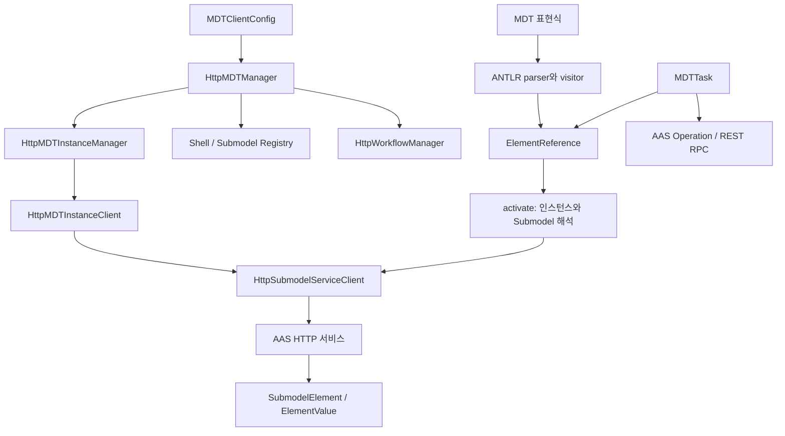

# mdt-client

ETRI MDT(Manufacturing Digital Twin) 시스템에 접근하는 Java 클라이언트 라이브러리다.

MDT Manager와 각 MDTInstance의 AAS 서비스에 HTTP로 접근해 AAS·Submodel 모델, 레지스트리, MDTInstance, 워크플로를
다룬다. 여러 MDT 프로젝트(mdt-manager, mdt-instance, mdt-cli, mdt-workflow 등)가 함께 쓰는 모델·참조·값·워크플로
타입도 이 프로젝트에 있고, 모델 변환, 표현식 파싱, 연산 실행, 태스크, ROS2 데이터 변환 기능도 포함한다.

> 예제의 URL, 인스턴스 id(`line-01`), Submodel 이름과 요소 경로는 연동할 환경에 맞게 바꾼다.

## 목차

1. [개요](#1-개요)
   - 1.1 [주요 기능](#11-주요-기능) · 1.2 [프로젝트 구조](#12-프로젝트-구조) · 1.3 [기능별 출발점](#13-기능별-출발점) ·
     1.4 [관련 문서](#14-관련-문서)
2. [빌드](#2-빌드)
   - 2.1 [요구 사항](#21-요구-사항) · 2.2 [빌드 명령](#22-빌드-명령) · 2.3 [의존성](#23-의존성) · 2.4 [Docker 이미지](#24-docker-이미지)
3. [전체 구조](#3-전체-구조)
   - 3.1 [호출 흐름](#31-호출-흐름) · 3.2 [Registry·Repository·Service](#32-registryrepositoryservice)
4. [접속](#4-접속)
   - 4.1 [설정 파일](#41-설정-파일) · 4.2 [접속 방법](#42-접속-방법) · 4.3 [서비스 경로](#43-서비스-경로) · 4.4 [빠른 시작](#44-빠른-시작)
5. [인스턴스와 AAS 서비스](#5-인스턴스와-aas-서비스)
   - 5.1 [인스턴스 관리](#51-인스턴스-관리) · 5.2 [요소와 첨부파일](#52-요소와-첨부파일)
6. [모델과 값](#6-모델과-값)
   - 6.1 [세 가지 표현](#61-세-가지-표현) · 6.2 [값 변환 규칙](#62-값-변환-규칙) · 6.3 [모델 변환](#63-모델-변환)
7. [참조와 MDT 표현식](#7-참조와-mdt-표현식)
   - 7.1 [참조 사용 순서](#71-참조-사용-순서) · 7.2 [표현식 예](#72-표현식-예) · 7.3 [시계열 참조](#73-시계열-참조)
8. [연산 실행](#8-연산-실행)
   - 8.1 [AAS Operation](#81-aas-operation) · 8.2 [태스크로 연산 실행](#82-태스크로-연산-실행) · 8.3 [외부 HTTP RPC](#83-외부-http-rpc)
9. [워크플로](#9-워크플로)
   - 9.1 [데이터 모델](#91-데이터-모델) · 9.2 [`ArgumentSpec`과 `TaskArgument`](#92-argumentspec과-taskargument) ·
     9.3 [태스크 명세](#93-태스크-명세) · 9.4 [워크플로 HTTP 관리](#94-워크플로-http-관리)
10. [MQTT와 ROS2 데이터](#10-mqtt와-ros2-데이터)
    - 10.1 [MQTT](#101-mqtt) · 10.2 [ROS2 값 변환](#102-ros2-값-변환)
11. [확장과 테스트](#11-확장과-테스트)
    - 11.1 [변경할 때 함께 맞출 곳](#111-변경할-때-함께-맞출-곳) · 11.2 [문법 변경](#112-문법-변경) · 11.3 [테스트](#113-테스트)
12. [현재 제약](#12-현재-제약)

---

## 1. 개요

### 1.1 주요 기능

| 기능 | 내용 |
| --- | --- |
| MDTManager 접근 | `HttpMDTManager`가 MDT 시스템의 최상위 진입점을 제공한다 |
| AAS 모델 | aas4j 기반 AAS·Submodel 모델 처리 (JSON, AASX) |
| 레지스트리 | Shell Registry, Submodel Registry 클라이언트 |
| MDTInstance 관리 | 인스턴스 조회·등록·시작·중지 (`HttpMDTInstanceManager`) |
| 요소 참조와 값 | MdtExpr 표현식으로 요소를 가리키고(`ElementReference`) 값만 주고받는다(`ElementValue`) |
| 연산·태스크 | AAS Operation 실행, `SetTask`, `AASOperationTask`, `OperationSubmodelTask`, REST RPC 태스크 |
| 워크플로 | 워크플로 모델·태스크 명세와 원격 workflow manager 클라이언트 |
| MQTT | MDT Manager 이벤트 구독, 범용 publish/subscribe 서비스 |
| ROS2 | ROS2 JSON·Java record·AAS 값 사이 변환 |

### 1.2 프로젝트 구조

`build.gradle`은 아래 세 소스 디렉터리를 하나의 main 소스셋으로 컴파일한다. 그래서 같은 Java 패키지가 여러
디렉터리에 나뉘어 있다. `src/main/api`에도 인터페이스뿐 아니라 값 객체와 실행 코드가 있으므로 구현을 찾을 때는
두 곳을 함께 본다.

| 경로 | 내용 |
| --- | --- |
| `src/main/api` | 공개 API: 서비스 계약, AAS·MDT 도메인 타입, 참조·값 객체, 워크플로 명세 |
| `src/main/java` | HTTP 구현(`mdt.client`), 모델 변환기, 표현식 평가(`mdt.model.expr`), 태스크(`mdt.task`), ROS2 변환(`mdt.rt`) |
| `src/main/java/mdt/test` | 서버에 접속하는 수동 실행 예제 (JUnit 테스트와 별개) |
| `src/main/antlr` | `MdtExpr.g4`와 생성된 lexer·parser·visitor. `.antlr` 디렉터리는 컴파일에서 제외 |
| `src/test/java` | JUnit 5 테스트 |
| `docker` | 이미지 빌드·배포 스크립트 |

### 1.3 기능별 출발점

| 하고 싶은 일 | 먼저 볼 타입 / 패키지 |
| --- | --- |
| MDT 접속 설정 | `MDTClientConfig`, `HttpMDTManager` |
| 인스턴스 찾기·시작·중지 | `MDTInstanceManager`, `MDTInstance`, `mdt.client.instance` |
| AAS·Submodel 탐색 | `mdt.aas`, `mdt.client.registry`, `mdt.client.repository` |
| 요소 읽기·쓰기·첨부파일 | `SubmodelService`, `HttpSubmodelServiceClient` |
| 짧은 표현식으로 값 접근 | `mdt.model.sm.ref`, `mdt.model.expr` |
| 값 변환·전달 | `mdt.model.sm.value`, `mdt.aas.DataTypes` |
| MDT 표준 모델 생성·해석 | `mdt.model.sm.entity`, `sm.data`, `sm.info`, `sm.ai`, `sm.simulation` |
| AAS Operation 실행 | `AASOperationClient`, `AASOperationTask` |
| 워크플로 모델·실행 관리 | `mdt.workflow`, `mdt.workflow.model`, `HttpWorkflowManager` |
| 로봇 데이터 변환 | `mdt.rt.Ros2Types`, `Ros2SerDes` |

처음 읽을 때는 `MDTManager → MDTInstanceManager → MDTInstance → SubmodelService` 순서로 원격 접근 구조를 익힌
뒤 `ElementReference → ElementValue`를 읽으면 표현식과 태스크 코드가 이어진다.

### 1.4 관련 문서

| 문서 | 내용 |
| --- | --- |
| [mdt.model README](src/main/api/mdt/model/README.md) | 공개 API 패키지별 핵심 타입, 값 JSON 형식, 엔티티 매핑, 도메인 서브모델 |
| [mdt.model.sm.ref README](src/main/api/mdt/model/sm/ref/README.md) | MdtExpr 문법, 요소 참조 API, CLI·REST 활용 예제 |
| [연산자 추가 가이드](../mdt-workflow/docs/adding-operator.md) (mdt-workflow) | 태스크를 workflow/Airflow 연산자로 연결하는 절차 |

---

## 2. 빌드

### 2.1 요구 사항

- JDK 21 (`build.gradle`의 Java toolchain)
- 설치된 Gradle (저장소에 Gradle Wrapper가 없다)
- 형제 프로젝트 `../../common/utils` — `settings.gradle`이 `:utils`로 포함한다

```text
development/
├── common/utils/
└── mdt/mdt-client/
```

### 2.2 빌드 명령

```bash
export MDT_BUILD_VERSION=1.0.0   # 지정하지 않으면 프로젝트 버전은 "unknown"

gradle compileJava
gradle test                      # 테스트만 실행
gradle build                     # 컴파일 + 테스트
gradle shadowJar                 # 의존성을 포함한 fat jar
```

일반 JAR와 Shadow JAR는 `build/libs`에 생긴다. 빌드 설정에 산출물 이름(`mdt-client-all.jar`)이나 main class는
고정되어 있지 않다. Docker 스크립트는 `mdt-client-all.jar`라는 이름을 기대하므로 배포할 때 이름을 맞춘다.

### 2.3 의존성

버전은 `gradle/libs.versions.toml`에서 관리한다.

| 의존성 | 버전 | 용도 |
| --- | --- | --- |
| `:utils` | 로컬 프로젝트 | 비동기 실행, HTTP·RPC, 스트림·함수형 도구, 파일·JDBC 등 공통 기능 |
| aas4j dataformat JSON·AASX | 1.0.5 | AAS 메타모델과 직렬화 |
| Jackson | 2.20.0 | JSON·YAML·Java 시간 타입 |
| OkHttp | 4.12.0 | HTTP 통신 |
| Eclipse Paho MQTTv3 | 1.2.5 | MQTT |
| ANTLR runtime | 4.13.2 | MDT 표현식 파싱 |
| JUnit Jupiter / Mockito | 5.10.2 / 5.17.0 | 테스트 |

테스트는 JUnit Platform으로 실행하며 `--add-opens=java.base/java.lang=ALL-UNNAMED`가 설정되어 있다.

### 2.4 Docker 이미지

`docker/` 디렉터리에 이미지 빌드 스크립트가 있다. `build_image.sh`는 `$MDT_CLIENT_HOME/mdt-client-all.jar`와
설정 파일(`mdt_client_config.yaml`, `logback.xml`)로 이미지를 만든다.

```bash
cd docker
./build_image.sh    # 이미지 빌드
./push_image.sh     # 레지스트리에 push
```

---

## 3. 전체 구조

### 3.1 호출 흐름



`MDTManager`는 인스턴스 관리자, Submodel 레지스트리, 워크플로 관리자를 제공하는 최상위 계약이고, HTTP 구현인
`HttpMDTManager`가 하위 클라이언트를 만든다. Manager로 인스턴스를 찾은 뒤에는 인스턴스 descriptor의 서비스 주소로
실제 AAS·Submodel에 접근한다.

### 3.2 Registry·Repository·Service

| 구분 | 다루는 대상 | 예 |
| --- | --- | --- |
| Registry | 서비스 위치 등을 담은 **descriptor** | `HttpShellRegistryClient`, `HttpSubmodelRegistryClient` |
| Repository | **AAS·Submodel 자원의 집합** | `HttpAASRepositoryClient`, `HttpSubmodelRepositoryClient` |
| Resource service | **AAS 또는 Submodel 하나** | `AssetAdministrationShellService`, `SubmodelService` |

Submodel descriptor를 등록하는 일과 실제 Submodel을 저장하는 일은 서로 다른 API 호출이다.

---

## 4. 접속

### 4.1 설정 파일

클라이언트 설정은 `mdt_client_config.yaml`로 한다.

```yaml
mdtUrl: "http://localhost:12985"
connectTimeout: "10s"
readTimeout: "30s"
workflowManagerUrl: "http://localhost:12989"
mqttEndpoint: "tcp://localhost:1883"    # 선택
```

| 항목 | 설명 |
| --- | --- |
| `mdtUrl` | MDT Manager의 base URL (필수) |
| `connectTimeout`, `readTimeout` | HTTP timeout. 지정하지 않으면 OkHttp 기본값 |
| `workflowManagerUrl` | workflow manager의 base URL. 생략하면 `mdtUrl`을 쓴다 |
| `mqttEndpoint` | MDTInstance 이벤트를 받을 MQTT broker. 지정하면 접속할 때 broker에 연결한다 |

`MDTClientConfig.load(File)`은 파일 내용을 Apache Commons Text의 `StringSubstitutor`로 치환한 뒤 YAML로 읽는다.
그래서 `${env:MDT_URL}` 같은 환경 변수 표현을 쓸 수 있다.

### 4.2 접속 방법

| 메소드 | 설정 |
| --- | --- |
| `HttpMDTManager.connect(url)` | URL을 직접 지정한다. read timeout은 30초 |
| `connect(MDTClientConfig)` | 설정 객체를 쓴다 |
| `connectWithConfigFile(file)` | 지정한 YAML 파일을 쓴다 |
| `connectWithDefault()` | 아래 순서로 설정을 찾는다 |

`connectWithDefault()`는 다음 순서로 찾는다.

1. `MDT_CLIENT_HOME` 환경 변수가 있으면 그 디렉터리, 없으면 현재 작업 디렉터리를 고른다.
2. 고른 디렉터리의 `mdt_client_config.yaml`을 읽을 수 있으면 그 설정을 쓴다.
3. 읽을 수 있는 파일이 없으면 `MDT_URL` 환경 변수를 URL로 쓴다.
4. 둘 다 없으면 예외가 난다. 설정 파일이 있는데 파싱에 실패해도 예외이며, 이때 환경 변수로 넘어가지 않는다.

`MDT_CLIENT_HOME`을 지정하면 현재 작업 디렉터리는 찾지 않는다.

접속 메소드는 프록시 객체를 만들 뿐이고, HTTP 서버가 살아 있는지는 `ping()`이나 실제 API 호출에서 드러난다.
`HttpMDTManager.Builder`는 인증서를 검증하지 않는(trust-all) HTTP 클라이언트를 만든다. 인증서 검증이 필요한
배포라면 이 구성과 하위 클라이언트에 넘기는 HTTP 클라이언트를 검토해야 한다.

### 4.3 서비스 경로

설정에는 base URL만 적는다. 각 서비스는 아래 경로를 붙여 접근한다.

| 서비스 | 추가 경로 |
| --- | --- |
| 인스턴스 관리자 | `/instance-manager` |
| Shell Registry | `/aas_registry/shell-descriptors` |
| Submodel Registry | `/aas_registry/submodel-descriptors` |
| 워크플로 관리자 | `/workflow-manager` |

### 4.4 빠른 시작

`line-01` 인스턴스의 `Temperature` 파라미터를 읽는다. Manager에 인스턴스와 파라미터가 등록되어 있고, 인스턴스
서비스에 접근할 수 있어야 한다.

```java
import mdt.client.HttpMDTManager;
import mdt.model.instance.MDTInstanceManager;
import mdt.model.sm.ref.ElementReferences;
import mdt.model.sm.ref.MDTElementReference;
import mdt.model.sm.value.ElementValue;
import mdt.model.sm.value.PropertyValue;

public class ReadParameter {
    public static void main(String[] args) throws Exception {
        MDTInstanceManager manager = HttpMDTManager.connect("http://localhost:12985").getInstanceManager();

        MDTElementReference ref = ElementReferences.parseExpr("param:line-01:Temperature");
        ref.activate(manager);
        ElementValue value = ref.readValue();
        System.out.println(value.toValueJsonString());

        ref.updateValue(PropertyValue.DOUBLE(25.0));    // 원격 값 변경
    }
}
```

쓸 때는 대상 Property의 AAS 타입에 맞는 값(`PropertyValue.DOUBLE`, `PropertyValue.INTEGER` 등)을 넘긴다.

---

## 5. 인스턴스와 AAS 서비스

### 5.1 인스턴스 관리

`MDTInstanceManager`는 id·AAS id·자산 id·Submodel id로 조회, 필터 조회, 등록·제거를 제공한다.
`HttpMDTInstanceManager`는 `/instance-manager/instances` 계열 API와 multipart 업로드를 쓴다. 필터 문자열은 서버에
그대로 전달되므로 문법은 Manager 구현을 따른다. 리터럴은 `MDTInstanceManager.toFilterLiteral(value)`로 만들면
작은따옴표가 escape된다.

```java
MDTInstance inst = manager.getInstance("line-01");
if ( !inst.isRunning() ) {
    inst.start(Duration.ofSeconds(1), Duration.ofMinutes(1));   // 1초 간격으로 최대 1분 대기
}
List<MDTInstance> stopped = manager.getInstanceAllByFilter("instance.status = 'STOPPED'");
```

`MDTInstance`로 할 수 있는 일:

- 인스턴스 id, AAS 정보, 자산 정보, 서비스 endpoint, 상태 조회
- `start(pollInterval, timeout)`, `stop(pollInterval, timeout)`으로 생명주기 제어
- Submodel·연산 descriptor와 파라미터 서비스 조회
- AAS 서비스와 Submodel 서비스 얻기

동작상 알아 둘 점:

- `HttpMDTInstanceClient`는 descriptor를 3초 동안 캐시한다. `getStatus()`는 항상 다시 읽는다.
- `start()`는 STARTING, `stop()`은 STOPPING에서 벗어날 때까지 polling한다. `pollInterval`이 `null`이면 기다리지
  않으므로 반환된 상태를 확인한다. 기다린 뒤에도 RUNNING·STOPPED에 도달했는지는 호출자가 확인한다.
- `getSubmodelServiceByIdShort()` 같은 단건 조회는 `FOption`을 돌려준다. `get()` 대신 `getOrThrow()`로 없는 경우를
  명확히 처리한다.
- `InstanceStatusMonitor`는 상태 변화를 감지하면 그 대상을 감시 목록에서 빼고 listener에 알린다. 계속 지켜보려면
  다시 등록한다. 여러 인스턴스를 시작·중지하는 보조 타입으로 `StartInstances`, `StartMDTInstances`,
  `StopMDTInstances`가 있다.

### 5.2 요소와 첨부파일

`SubmodelService`가 Submodel 단위 작업을 정의하고 `HttpSubmodelServiceClient`가 HTTP로 구현한다. 요소 경로는
`DataInfo.Equipment.EquipmentParameterValues[0].ParameterValue` 같은 idShortPath다.

| 목적 | 대표 API | 설명 |
| --- | --- | --- |
| 모델 조회 | `getSubmodel()`, `getSubmodelElementByPath()` | idShort·타입·semantic ID를 포함한 AAS 객체 |
| 요소 추가·교체 | `addSubmodelElementByPath()`, `setSubmodelElementByPath()` | 요소 구조 전체를 보낸다 |
| 값 갱신 | `updateSubmodelElementByPath(path, sme)`, `updateSubmodelElementValueByPath(path, json)` | 값만 바꾼다 (value-only JSON은 PATCH) |
| 값 읽기 | `getSubmodelElementValueByPath(path, prototype)` | prototype으로 값의 구조와 타입을 해석한다 |
| 요소 삭제 | `deleteSubmodelElementByPath()` | |
| 첨부파일 | `readAttachmentByPath()`, `readAttachmentToTempFile()`, `putAttachmentByPath()`, `deleteAttachmentByPath()` | File 요소의 실제 내용 |
| 연산 | `invokeOperationSync()`, `invokeOperationAsync()`, `runOperation()` | AAS 연산 실행 (8장) |

- HTTP 구현의 `getSubmodel(Modifier)`와 `getSubmodelElementByPath(path, Modifier)`는 `Modifier.VALUE`를 받지 않는다
  (`IllegalArgumentException`). 값을 읽을 때는 전용 메소드를 쓴다.
- 값 전용 응답은 prototype의 idShort로 감싼 JSON을 기대한다. 일부 서버가 `SerializationException`으로 응답하면
  요소 전체를 조회하는 방식으로 우회한다. 모든 AAS 서버의 응답 형태와 자동으로 호환된다고 가정하지 않는다.
- Submodel id는 URL에서 Base64 URL-safe로 인코딩한다. URL을 직접 조립하지 말고 Repository·Service API와
  `AASUtils`·`DescriptorUtils`를 쓰면 id와 idShortPath의 인코딩을 혼동하지 않는다.

---

## 6. 모델과 값

### 6.1 세 가지 표현

| 표현 | 대표 타입 / API | 용도 |
| --- | --- | --- |
| 전체 AAS 요소 | aas4j `SubmodelElement`, `Property` | 구조·메타데이터를 포함한 모델 읽기·생성·교체 |
| 타입 포함 값 JSON | `ElementValue.toJsonString()` | 값 타입을 보존하는 저장·전달·복원 |
| 값 JSON (value-only) | `ElementValue.toValueJsonString()` | AAS 값 갱신, RPC 입력 등 값만 필요한 곳 |

double 23.5는 각각 `{"@type": "mdt:value:double", "value": 23.5}`와 `23.5`가 된다.

```java
var value = PropertyValue.DOUBLE(23.5);
String typedJson = value.toJsonString();                                     // 타입 포함
ElementValue restored = ElementValues.parseJsonString(typedJson);            // 서버 없이 복원
ElementValue parsed = ElementValues.parseValueJsonString("24.0", restored);  // 값 JSON은 prototype 필요
```

- `ElementValues.getValue(sme)`는 AAS 요소에서 값을 꺼낸다.
- 요소에 값을 넣는 메소드는 값의 형태에 따라 다르다. 값 객체는 `update(sme, ElementValue)`, 값 JSON은
  `updateFromValueJson(sme, JsonNode | String)`(문자열 속성이면 `"\"abc\""`), AAS 값 문자열은
  `updateFromValueString(sme, String)`(`abc`, `42`), Java 숫자는 `updateValue(sme, Number)`다.
- 이 메소드들은 메모리의 Java 객체만 바꾼다. 서버에 저장하려면 Service나 활성화된 참조의 쓰기 API를 부른다.

주요 값 타입은 `PropertyValue`, `ElementCollectionValue`, `ElementListValue`, `RangeValue`,
`MultiLanguagePropertyValue`, `FileValue`, `ReferenceElementValue`, `OperationVariableValue`다. 형식과 API는
[mdt.model README](src/main/api/mdt/model/README.md)의 5장에 정리되어 있다.

### 6.2 값 변환 규칙

`mdt.aas.DataTypes`는 AAS XSD 타입과 Java 값, JSON 값, JDBC 값 사이의 변환을 맡는다. 변환은 값을 조용히 바꾸지
않는다.

| 대상 | 규칙 |
| --- | --- |
| 숫자 (JSON) | 범위 안의 JSON 숫자(정수 타입은 `3.0`처럼 손실 없는 실수 포함)와 숫자 문자열(`"42"`)만 받는다. 숫자가 아닌 문자열, 소수, 범위 초과, `NaN`은 `JacksonDeserializationException` |
| `xs:boolean` | JSON 불리언과 `"true"`/`"false"`/`"1"`/`"0"`만 받는다. AAS 값 문자열도 같다 |
| `xs:string` | 숫자·객체도 JSON 텍스트로 받는다 |
| `xs:decimal` | 공유 매퍼는 JSON 실수를 `double`로 읽으므로, 더 높은 정밀도가 필요하면 JSON 문자열로 보낸다 |
| `xs:duration` (JDBC) | 숫자는 초 단위로 읽고 쓴다 (예: `1.5` → 1.5초) |
| 속성 갱신 | `ElementValues.update`는 속성의 `valueType`을 확인한다. 숫자끼리의 손실 없는 변환(`xs:int` 값 → `xs:long`·`xs:integer`·`xs:double` 속성, `3.0` → `xs:int`)과 `xs:string` 속성에 값 문자열을 쓰는 것만 허용하고, 나머지 불일치는 `IllegalArgumentException` |
| 값 문자열 갱신 | `updateFromValueString`은 문자열을 속성 타입으로 해석할 수 있는지 확인한 뒤 원래 문자열을 기록한다. 정수 타입은 정수 문법만 받는다(`"3.0"`, 앞뒤 공백 거부) |
| Range | 같은 타입 규칙으로 min·max를 모두 확인한 뒤 기록한다 |
| Collection | 값 JSON에 없는 필드는 그대로 둔다(부분 갱신). JSON null 필드는 Property면 값을 지우고, 그 밖의 요소면 거부한다 |
| List·Operation·Collection | 원소 개수와 `null` 값을 쓰기 전에 확인한다. 다만 원소 하나의 반영이 실패하면 앞선 원소는 이미 바뀐 채로 남는다(원자적이지 않다) |

### 6.3 모델 변환

- `MDTModelSerDe`의 `readValue()`·`toJsonString(Object)`는 aas4j serializer/deserializer를 쓴다. `getJsonMapper()`는
  Java 시간 모듈 등을 갖춘 Jackson mapper를 돌려준다. 모델 다형성과 사용자 serializer가 개입하므로 기본
  `ObjectMapper`로 대신하지 않는다.
- `AASUtils.readEnvironment(File)`은 JSON Environment를 읽고, AAS가 정확히 하나인지, Submodel id가 중복되지 않는지,
  AAS의 Submodel 참조가 모두 있는지 검사한다. 입력은 JSON 파일이다(AASX가 아니다).
- MDT 표준 모델(`sm.info`, `sm.data`, `sm.ai`, `sm.simulation`, `sm.shape`, `timeseries`)은 `SubmodelEntity`·
  `SubmodelElementCollectionEntity`와 `@PropertyField`, `@SMCollectionField`, `@SMListField` 등의 어노테이션으로
  Java 필드와 AAS 요소를 연결한다. 리플렉션과 JavaBean 접근자를 쓰므로 어노테이션뿐 아니라 getter/setter와 타입도
  맞아야 한다. 자세한 내용은 [mdt.model README](src/main/api/mdt/model/README.md)의 7·8장에 있다.

---

## 7. 참조와 MDT 표현식

`ElementReference`는 값이 저장된 **위치**에 접근하는 객체로, 값 자체인 `ElementValue`와 구분된다.
`MDTElementReference`는 인스턴스 관리자를 통해 해석되는 원격 참조이고, `FileStoreReference`는 로컬 파일에 저장된
요소를 다룬다. 문법 전체와 API는 [mdt.model.sm.ref README](src/main/api/mdt/model/sm/ref/README.md)에 있다.

### 7.1 참조 사용 순서

1. `ElementReferences.parseExpr()`로 표현식을 파싱한다.
2. `activate(MDTInstanceManager)`로 인스턴스·Submodel·요소 경로를 확정한다.
3. `read()`, `readValue()`, `updateValue()` 또는 첨부파일 API를 부른다.

파싱에 성공했다고 대상이 실제로 있는 것은 아니다. 활성화 전에는 서비스 접근 메소드를 쓸 수 없고, 파라미터처럼
경로를 동적으로 찾는 참조는 idShortPath도 활성화 후에 정해진다. 일반 요소 참조의 경로는 생성할 때 정해진다.

파싱 흐름은 `MdtExpr.g4 → MdtExprLexer/Parser → MDTExpressionVisitor → *Expr.evaluate()`다. 일반 식은
`MDTExpressionParser.parseExpr()`, 값 리터럴은 `parseValueLiteral()`, 요소 참조는 `ElementReferences.parseExpr()`로
파싱하며, 뒤에 남는 토큰이 있으면 오류다.

```java
var ref = ElementReferences.parseExpr("param:line-01:Temperature");
var restored = ElementReferences.parseJsonString(ref.toJsonString());   // JSON 왕복 (서버 불필요)
```

### 7.2 표현식 예

| 표현식 | 대상 |
| --- | --- |
| `line-01:Data:DataInfo.Equipment.EquipmentName` | 일반 요소 |
| `param:line-01:Temperature` | MDT 파라미터 값 |
| `param:line-01:*` | 파라미터 전체 |
| `oparg:line-01:Simulation:in:Speed` | AI·Simulation 모델의 입력 인자 |
| `opvar:line-01:Ops:Calculate:out:0` | AAS Operation 요소의 첫 출력 변수 |
| `timeseries:line-01:Log#last=100` | 최근 100개 시계열 레코드 |

`oparg`는 MDT 연산 모델의 인자, `opvar`는 AAS Operation 요소 안의 변수를 가리킨다. Submodel을 전역 id로 가리킬
때는 `submodel:id='urn:example:submodel'` 형식을 쓴다. mdt-instance 내부의 `ElementLocation` 표현과 달리 여기에는
인스턴스 id가 들어간다.

### 7.3 시계열 참조

`TimeSeriesRecordsReference`는 Submodel의 `ReadRecordsByRange` 연산을 호출해 레코드를 읽는다. DB에 직접 연결하는
클라이언트가 아니다. 조회 범위는 개수(`Count`), 최근 기간(`Trailing`), 절대 시각(`Absolute`), 시작 시각과 개수
(`Since`)로 표현한다.

```text
timeseries:line-01:Log#last=100
timeseries:line-01:Log#last=1h@latest|current,voltage
timeseries:line-01:Log#last=1h@now|current
```

`latest`는 마지막 레코드 시각, `now`는 현재 시각이 기준이다. 컬럼을 지정하면 `Time` 컬럼을 앞에 자동으로 붙인다.
시계열 참조는 `write()`·`updateValue()`를 지원하지 않는다.

---

## 8. 연산 실행

### 8.1 AAS Operation

가장 낮은 수준의 API는 `SubmodelService.invokeOperationSync()`와 `invokeOperationAsync()`다. 비동기 호출은
`OperationHandle`을 돌려주고, 상태·결과 조회 API로 이어진다. 이를 감싼 실행 방법이 두 가지 있다.

| 방법 | 동작 | 종료 상태 처리 |
| --- | --- | --- |
| `SubmodelService.runOperation(path, in, inout, timeout, pollInterval)` | 비동기로 시작하고 `pollInterval`마다 상태를 확인한다. `timeout`은 서버에 전달하는 값이고(`null`이면 `P7D`), 로컬 경과 시간은 따로 검사하지 않는다 | FAILED → `ExecutionException`(서버 메시지 포함), TIMEOUT → `TimeoutException`, CANCELED → `CancellationException` |
| `AASOperationClient` | 생성할 때 Operation 요소와 입출력 변수 정의를 읽고, `run()`으로 polling 실행한다. 변수는 idShort를 키로 한 Map으로 다룬다 | FAILED → `ExecutionException`, CANCELED·TIMEOUT → `CancellationException`. 클라이언트 timeout이 없으면 서버 timeout은 `P7D` |

`AASOperationClient`에 대해 알아 둘 점:

- `setInputVariable()`에 없는 이름을 넘기면 아무 일도 하지 않는다(새 인자를 추가하지 않는다).
- 연산이 끝나면 출력·입출력 변수를 내부 Map에 반영한다.
- `saveOperation()`은 현재 변수들을 Operation 요소에 저장하는 별도 작업이다.

### 8.2 태스크로 연산 실행

기존 Operation의 `Speed` 입력을 설정하고 `Result` 출력을 다른 요소에 반영하는 예다. Operation, 인자, 출력 대상은
모델에 미리 있어야 한다.

```java
var manager = HttpMDTManager.connect("http://localhost:12985").getInstanceManager();
var task = AASOperationTask.builder()
        .operation(ElementReferences.parseExpr("line-01:Ops:Calculate"))
        .addInputArgument("Speed", TaskArgument.literal(10.0))
        .addOutputArgument("Result", TaskArgument.reference("line-01:Data:Result"))
        .pollInterval(Duration.ofSeconds(1))
        .timeout(Duration.ofMinutes(1))
        .build();
Map<String,SubmodelElement> outputs = task.run(manager);
```

- `AbstractOperationTask`는 입력·입출력 인자를 반영하고, 연산이 끝나면 출력 참조를 갱신한다. 출력 쓰기에서 난
  `IOException`은 경고 로그만 남기므로, 연산 성공이 곧 모든 출력 저장 성공은 아니다.
- Builder로 만든 태스크의 `cancel()`은 `false`를 돌려주고 `getTaskDescriptor()`는 `null`이다.
- `OperationSubmodelTask`는 Submodel의 `Operation` 요소를 호출하며, 지정하지 않은 입력을 AI·Simulation 모델의 입력
  정의에서 채운다.

### 8.3 외부 HTTP RPC

외부 HTTP 서비스를 연산으로 부를 때는 `RESTfulRpcTask` 또는 `RESTfulAsyncRpcTask`와 그 기반인 `utils.rpc.restful`
클라이언트를 쓴다.

| 구현 | 필수 옵션 | 실행 방식 |
| --- | --- | --- |
| `RESTfulRpcTask` | `opUrl` | 동기 요청·응답 |
| `RESTfulAsyncRpcTask` | `baseUrl`, `endpoint` | 비동기 실행과 상태 polling. 기본 poll 3초 |

- 두 태스크 모두 입력을 값 JSON으로 바꿔 보낸다.
- 출력은 대상 참조에서 읽은 요소에 반영해 Map으로 돌려줄 뿐 **원격 참조에 저장하지는 않는다**. 원격 모델에도
  기록하려면 호출하는 쪽에서 저장한다.
- 두 구현의 `cancel()`은 `false`를 돌려준다.
- `HttpOperationClient`는 `@Deprecated(forRemoval=true)`이고 mdt-operation-http의 `RpcServerDispatcher`와 URL·메시지
  형식이 맞지 않는다. `HttpSimulationClient`, `OperationRequest`·`OperationResponse`도 새 RPC 계약의 예제로 쓰지
  않는다.

---

## 9. 워크플로

### 9.1 데이터 모델

| 타입 | 역할 |
| --- | --- |
| `WorkflowModel` | 재사용할 모델. id·이름·설명·`taskDescriptors`·`gui` |
| `TaskDescriptor` | 태스크의 id·Java 타입 이름·dependencies·triggerRule(기본 `all_success`)·입출력 명세·options·labels |
| `ArgumentSpec` | 명세 안의 인자. reference·literal·다른 태스크 출력(task-output) |
| `Workflow` | 실행 한 건의 이름·모델 id·상태·시각·노드 목록 |
| `NodeTask` | 실행 노드의 메타데이터 |
| `MDTTask` | `run(manager)`로 실행하고 결과 Map을 돌려주는 Java 계약 |
| `TaskArgument` | Builder로 만드는 태스크의 실행 인자. reference·literal. 문자열은 `TaskArgument.parseExpr`로 해석 |

### 9.2 `ArgumentSpec`과 `TaskArgument`

이름이 비슷하지만 다른 타입이다.

| | `ArgumentSpec` | `TaskArgument` |
| --- | --- | --- |
| 용도 | 전송·저장용 명세 | 실행 객체가 쓰는 인자 |
| JSON 판별자 | `mdt:task_arg:*` | `mdt:argument:*` |
| 종류 | reference, literal, task-output | reference, literal |
| 값 읽기 | 메소드 없음. RPC 태스크는 `TaskUtils.readArgumentValue`로 읽는다(task-output은 `TaskException`) | `activate(manager)` 후 `readValue()`. 요소 전체(`read()`)는 reference 인자만 |
| 참조 얻기 | `getReferenceExpr()`, `resolveReference(manager)`(부를 때마다 새로 해석) | `getReference()` |

- `ReferenceArgument`는 생성할 때(코드·JSON 모두) 참조 표현식의 문법을 검사한다.
- `ArgumentSpec`의 식별자는 공백일 수 없고, `literal(id, Integer)` 같은 편의 메소드는 `null` 값을 거부한다.
  JSON의 `id`·`taskId`·`argumentName`·`reference`는 비어 있지 않은 JSON 문자열이어야 한다.
- `TaskOutputArgument.getOutputArgumentId()`(JSON 필드 `argumentName`)는 앞선 태스크의 출력 인자 id다.
- 두 타입 모두 감싼 참조·값으로 `equals`를 비교한다. 감싼 `ElementValue`가 가변이면(예:
  `MultiLanguagePropertyValue`) 값을 바꿀 때 `hashCode`도 바뀌므로, 해시 컬렉션에 넣은 인자의 값은 바꾸지 않는다.
- `ArgumentSpec`·`TaskArgument`·`ElementValues`의 `parseJsonString`은 문자열 전체가 JSON 값 하나여야 한다.

### 9.3 태스크 명세

값을 복사하는 태스크(`SetTask`)의 명세 예다.

```json
{
  "id": "set-temperature",
  "name": "목표 온도 설정",
  "type": "mdt.task.SetTask",
  "dependencies": [],
  "inputArguments": [
    { "@type": "mdt:task_arg:literal", "id": "source",
      "value": {"@type": "mdt:value:double", "value": 25.0} }
  ],
  "outputArguments": [
    { "@type": "mdt:task_arg:reference", "id": "target", "reference": "param:line-01:Temperature" }
  ],
  "options": [ {"name": "timeout", "value": "60s"} ],
  "labels": []
}
```

`TaskDescriptor.parseJsonString()`은 명세만 읽으며 실행 객체를 만들지는 않는다. `SetTask`와 AAS 연산 태스크는
Builder로, REST RPC 태스크는 descriptor를 받는 생성자로 만든다.

`TaskDescriptors`는 화면 표시용 짧은 이름을 정한다. 실행 클래스를 찾는 팩토리가 아니다.

| Java 타입 | 짧은 이름 |
| --- | --- |
| `mdt.task.AASOperationTask` | `AASOperation` |
| `mdt.task.OperationSubmodelTask` | `OperationSubmodel` |
| `mdt.task.RESTfulAsyncRpcTask` | `RESTful` |
| `mdt.task.RESTfulRpcTask` | `AIModel` |
| `mdt.task.SetTask` | `Copy` |
| `mdt.task.PythonScriptTask` | `PythonScript` (문자열로만 등록, 이 프로젝트에 클래스는 없다) |

짧은 이름을 등록한다고 다른 프로젝트에 실행 기능이 생기지는 않는다. workflow/Airflow 연결 절차는
[연산자 추가 가이드](../mdt-workflow/docs/adding-operator.md)를 본다.

### 9.4 워크플로 HTTP 관리

`HttpWorkflowManager`는 모델 저장과 실행 제어를 원격 workflow manager에 맡긴다. 자체 DAG 스케줄러가 아니다.

| API | 원격 경로 |
| --- | --- |
| `getWorkflowModelAll()`, `getWorkflowModel(id)` | `GET /models`, `GET /models/{id}` |
| `addWorkflowModel(model)` | `POST /models` |
| `addOrReplaceWorkflowModel(model)` | `POST /models?updateIfExists=true` |
| `startWorkflow(modelId)` | `POST /models/{id}/start` |
| `getWorkflowAll()`, `getWorkflow(name)` | `GET /workflows`, `GET /workflows/{name}` |
| `stopWorkflow(name)` | `PUT /workflows/{name}/stop` |
| `getWorkflowLog(name, podName)` | `GET /workflows/{name}/log/{podName}` |

모델 id와 실행 이름은 다른 식별자다. `startWorkflow()`가 돌려준 `Workflow.getName()`으로 이후 실행을 조회·중지한다.
`listWorkflowIds()`와 `getWorkflowStatus()`는 `UnsupportedOperationException`을 던지므로, 목록과 상태는
`getWorkflowAll()`과 `getWorkflow(name).getStatus()`로 얻는다.
`suspendWorkflow()`와 `resumeWorkflow()`도 `UnsupportedOperationException`을 던진다(Airflow 엔진에 대응 기능이 없어
2026-11-05에 서버 엔드포인트를 지웠다).

---

## 10. MQTT와 ROS2 데이터

### 10.1 MQTT

MQTT를 쓰는 경로는 두 가지이고, 기능이 서로 다르다.

| 경로 | 내용 |
| --- | --- |
| `HttpMDTManager`의 MQTT 연결 | `mqttEndpoint`를 지정하면 `/mdt/manager/instances/#`를 QoS 0으로 구독하고 `MDTManagerMqttMessage`를 JVM 전역 EventBus에 게시한다. 연결 실패는 경고로만 남는다. 자동 재연결 설정과 공개 close/unregister API는 없다 |
| `MqttService` | 범용 publish/subscribe 비동기 서비스. 초기 연결 재시도, Paho 자동 재연결, 재연결 후 재구독, `+`·`#` 토픽 분배를 지원한다 |

- `HttpMDTInstanceManager`는 상태 이벤트를 받아도 인스턴스 descriptor를 갱신하지 않는다. 이벤트를 구독한다고
  descriptor가 자동으로 바뀌지는 않는다.
- 관리자 프록시는 호출마다 새로 만들어질 수 있으므로 만들어 둔 것을 재사용한다.
- `MqttService`가 RUNNING이 되었다고 broker에 연결된 것은 아니다. 연결 여부는 `isConnected()`로 확인한다.
- `MqttService.subscribe()`는 구독 핸들(`MqttService.Subscription`)을 돌려주며, `close()`/`unsubscribe()`로 그
  구독만 해제한다(여러 번 불러도 한 번만 해제된다). 잘못된 토픽 필터는 등록 전에 `IllegalArgumentException`이다.
- broker 통신(구독·해제·발행)은 내부 잠금 밖에서 하므로 수신이 밀려도 메시지 분배와 교착되지 않는다. 구독·해제
  응답은 작업 제한 시간(`setOperationTimeout()`, 기본 10초)까지만 기다리고, 재연결 후 재구독은 별도 스레드에서 한다.
- 수신 DEBUG 로그에는 payload 대신 토픽, 바이트 수, QoS, retained 여부만 남긴다.

### 10.2 ROS2 값 변환

`mdt.rt`는 ROS2 노드나 통신 서버를 실행하지 않는다. `Ros2Types`의 record와 `Ros2SerDes`가 JSON·Java record·
`ElementValue` 사이를 변환한다.

| 타입 | 내용 |
| --- | --- |
| Header | JSON의 `sec`·`nanosec`를 epoch 나노초 long으로 합친다 |
| Pose, PoseStamped | position·orientation, header·pose |
| Joints | 관절 이름 → float 맵 |
| JointStates | position·velocity·effort 각각 관절 이름 → float 맵 |

```json
{
  "position": {"joint1": 0.25, "joint2": -0.1},
  "velocity": {},
  "effort": {}
}
```

- 이 형식은 ROS `sensor_msgs/JointState`의 `name`·`position` 병렬 배열이나 rosbridge의 `op`·`topic`·`msg` 프레임과
  다르다.
- JointStates를 `ElementValue`로 바꾸면 position만 남고, 다시 바꾸면 velocity·effort는 빈 맵이다.
- 관절 JSON의 null 값은 빼고, Pose 수치의 null은 NaN으로 처리하는 등 변환기마다 규칙이 다르다. 메타데이터를 모두
  보존하는 범용 ROS2↔AAS 변환기로 쓰지 않는다.

---

## 11. 확장과 테스트

### 11.1 변경할 때 함께 맞출 곳

| 변경 | 함께 맞출 코드 |
| --- | --- |
| 원격 API 추가 | `src/main/api` 계약, HTTP 구현, 요청·응답 직렬화, 서버 경로 |
| 참조 타입 추가 | 타입 판별자, `ElementReferences` deserializer 등록, 활성화·경로 해석, JSON 왕복 |
| 표현식 문법 추가 | `MdtExpr.g4`, 생성 파서, `MDTExpressionVisitor`, `*Expr`, `toStringExpr()` |
| 값 타입 추가 | `ElementValues` 타입 매핑, 값 JSON·타입 포함 JSON, AAS 변환 |
| 도메인 엔티티 추가 | semantic ID, 필드 어노테이션, JavaBean 접근자, 모델 변환 |
| 태스크 추가 | 실행 계약, 명세 연결, `TaskDescriptors` 표시 이름, workflow 실행기의 operator 연결 |

### 11.2 문법 변경

문법을 바꾸면 저장소에 포함된 생성 파일도 다시 만든다. 프로젝트 루트에서 실행한다.

```bash
(cd src/main/antlr && bash antlr4_script.sh)
gradle compileJava
gradle test --tests 'mdt.model.sm.ref.*'
```

### 11.3 테스트

테스트는 `src/test/java/mdt` 아래 `aas`, `client`(`instance`, `support`), `model`(`sm/ref`, `sm/value`, `sm/info` 등),
`task`, `workflow/model`에 있다. 범위를 좁혀 실행할 수 있다.

```bash
gradle test --tests 'mdt.model.sm.value.PropertyValueTest'
gradle test --tests 'mdt.model.sm.ref.ElementReferencesTest'
gradle test --tests 'mdt.workflow.model.ArgumentSpecRoundTripTest'
```

참조는 표현식과 JSON 양쪽의 왕복 변환을 검증하고, 원격 API는 대상 서버의 응답 형식도 확인한다. 태스크는 연산
완료, 결과 Map 반환, 원격 출력 저장, 취소를 각각 따로 검증한다.

---

## 12. 현재 제약

| 위치 | 현재 동작 |
| --- | --- |
| `HttpMDTManager.getService()` | 인스턴스 관리자·Shell Registry·Submodel Registry만 지원하고, 그 밖의 클래스는 `null`. 워크플로 관리자는 `getWorkflowManager()`로 얻는다 |
| `HttpMDTManager.shutdown()` | mdt-manager가 원격 종료를 제공하지 않아 `UnsupportedOperationException` |
| `HttpWorkflowManager` | `listWorkflowIds()`, `getWorkflowStatus()` 미구현 |
| `HttpOperationClient` | 폐기 예정이며 현재 RPC 서버 계약과 맞지 않는다 |
| Builder로 만든 태스크 | `getTaskDescriptor()`는 `null`, `cancel()`은 `false` |
| REST RPC 태스크 | 결과를 돌려줄 뿐 원격 참조에 저장하지 않는다 |
| `BuiltInTaskTemplates` | 등록된 내장 템플릿이 없다 |
| `HttpMDTInstanceManager` | MQTT 상태 이벤트를 받아도 인스턴스 정보를 갱신하지 않는다 |

## 저자

ETRI, Kang-Woo Lee
