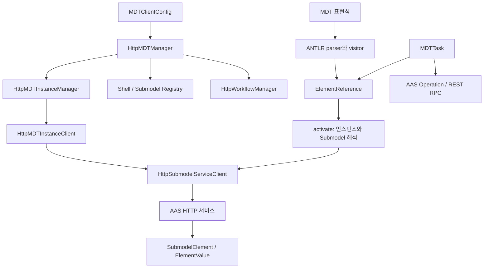

# mdt-client 개발자 가이드

`mdt-client`는 MDT 시스템에 접근하는 Java 라이브러리이자, 여러 MDT 프로젝트가 공유하는
모델·참조·값·워크플로우 계약을 담은 프로젝트다. HTTP로 Manager와 AAS 서비스에 접근하는 코드 외에
모델 변환, 표현식 파싱, 연산 실행, 태스크 구현, ROS2 데이터 변환도 포함한다.

이 가이드는 처음 코드를 읽거나 클라이언트 기능을 개발하는 사람이 사용할 진입점과 호출 흐름을 설명한다.
기준은 2026년 10월 17일의 작업 트리다. 예제의 URL, 인스턴스 ID, Submodel 이름과 요소 경로는
연동할 환경에 맞게 바꿔야 한다.

## 1. 프로젝트 구성과 읽는 순서

같은 Java 패키지가 여러 소스 디렉터리에 나뉘어 있다.
`build.gradle`은 아래 세 디렉터리를 하나의 main 소스셋으로 컴파일한다.
`src/main/api`에도 인터페이스뿐 아니라 값 객체와 실행 코드가 있으므로 구현을 찾을 때 함께 확인해야 한다.

| 경로 | 내용 |
| --- | --- |
| `src/main/api` | 공개 서비스 계약, AAS·MDT 도메인 타입, 참조·값 객체, 워크플로우 명세 |
| `src/main/java` | HTTP 구현, 모델 변환기, 표현식 평가, 태스크와 지원 기능 |
| `src/main/antlr` | `MdtExpr.g4`, 생성된 lexer·parser·visitor. `.antlr` 디렉터리는 컴파일 제외 |
| `src/test/java` | 모델·참조·값 직렬화, 워크플로우 인자, 상태 감시 등의 JUnit 테스트 |
| `src/main/java/mdt/test` | 서버 접근 등을 포함하는 수동 실행 예제. JUnit 테스트 소스셋과 구분 |
| `docs` | 이 가이드와 모델·표현식 상세 문서 |
| `docker` | 라이브러리 JAR와 설정을 담는 이미지 구성·배포 스크립트 |

기능별 출발점은 다음과 같다.

| 하고 싶은 일 | 먼저 볼 타입 / 패키지 |
| --- | --- |
| MDT 접속 설정 | `MDTClientConfig`, `HttpMDTManager` |
| 인스턴스 찾기·시작·중지 | `MDTInstanceManager`, `MDTInstance`, `mdt.client.instance` |
| AAS·Submodel 탐색 | `mdt.aas`, `mdt.client.registry`, `mdt.client.repository` |
| 요소 읽기·쓰기·첨부파일 | `SubmodelService`, `HttpSubmodelServiceClient` |
| 짧은 표현식으로 값 접근 | `mdt.model.sm.ref`, `mdt.model.expr` |
| 값만 변환하거나 전달 | `mdt.model.sm.value`, `mdt.aas.DataTypes` |
| MDT 표준 모델 생성·해석 | `mdt.model.sm.entity`, `sm.data`, `sm.info`, `sm.ai`, `sm.simulation` |
| AAS Operation 실행 | `AASOperationClient`, `AASOperationTask` |
| 워크플로우 모델·실행 관리 | `mdt.workflow`, `mdt.workflow.model`, `HttpWorkflowManager` |
| 로봇 데이터 변환 | `mdt.rt.Ros2Types`, `Ros2SerDes` |

처음 읽을 때는 `MDTManager → MDTInstanceManager → MDTInstance → SubmodelService` 순서로
원격 접근 구조를 익힌 뒤, `ElementReference → ElementValue`를 읽으면 표현식과 태스크 코드가 연결된다.

## 2. 빌드와 의존성

현재 [build.gradle](../build.gradle)의 Java toolchain은 **21**이다.
이전 안내에 남아 있는 Java 17 설명보다 실제 빌드 설정을 기준으로 한다.
[settings.gradle](../settings.gradle)은 형제 프로젝트 `../../common/utils`를 `:utils`로 포함한다.

```text
development/
├── common/utils/
└── mdt/mdt-client/
```

현재 저장소에는 Gradle Wrapper 실행 파일 `gradlew`가 없다. Gradle이 설치된 환경에서 다음과 같이 실행한다.

```bash
export MDT_BUILD_VERSION=1.0.0
gradle compileJava
gradle test
gradle build
gradle shadowJar
```

`MDT_BUILD_VERSION`을 지정하지 않으면 프로젝트 버전은 `unknown`이다.
일반 JAR와 의존성을 포함한 Shadow JAR는 `build/libs`에서 확인한다.
`build.gradle`에 고정된 `mdt-client-all.jar` 출력명이나 애플리케이션 main class 설정은 없다.
Docker 쪽은 이 고정 이름의 배포 파일을 기대하므로 빌드 산출물과 배포용 파일명을 구분해야 한다.

| 의존성 | 현재 빌드 설정 | 주요 용도 |
| --- | --- | --- |
| `:utils` | 로컬 프로젝트 | 비동기 실행, HTTP·RPC, 스트림·함수형 도구, 파일·JDBC 등의 공통 기능 |
| aas4j JSON·AASX | 1.0.5 | AAS 메타모델과 직렬화 |
| Jackson | 2.18.4 | JSON·YAML·Java 시간 타입 |
| OkHttp | 4.12.0 | HTTP 통신 |
| Eclipse Paho | 1.2.5 | MQTT |
| ANTLR runtime | 4.13.2 | MDT 표현식 파싱 |
| JUnit Jupiter / Mockito | 5.10.2 / 4.11.0 | 테스트 |

테스트는 JUnit Platform을 사용하고 `--add-opens=java.base/java.lang=ALL-UNNAMED`가 설정되어 있다.
`spring_boot_version` 변수는 남아 있으나 현재 dependencies에는 Spring HTTP 클라이언트 의존성이 없다.
현재 통신 코드는 OkHttp와 `utils.http`를 중심으로 읽으면 된다.

## 3. 전체 호출 구조



`MDTManager`는 인스턴스 관리자, Submodel 레지스트리, 워크플로우 관리자를 제공하는 최상위 계약이다.
HTTP 구현인 `HttpMDTManager`가 하위 클라이언트를 만든다.
Manager를 통해 인스턴스를 찾은 뒤에는 descriptor의 서비스 주소를 사용해 실제 AAS·Submodel에 접근한다.

Registry는 서비스 위치 등을 담은 **descriptor**, Repository는 **AAS·Submodel 자원 집합**,
Resource service는 **AAS 또는 Submodel 하나**를 다룬다.
예를 들어 Submodel descriptor를 등록하는 일과 실제 Submodel을 저장하는 일은 별도의 API 호출이다.

근거: [MDTManager](../src/main/api/mdt/model/MDTManager.java),
[HttpMDTManager](../src/main/java/mdt/client/HttpMDTManager.java),
[HttpSubmodelRepositoryClient](../src/main/java/mdt/client/repository/HttpSubmodelRepositoryClient.java),
[HttpSubmodelRegistryClient](../src/main/java/mdt/client/registry/HttpSubmodelRegistryClient.java).

## 4. 접속 설정과 빠른 시작

### 4.1 설정 파일

```yaml
mdtUrl: "http://localhost:12985"
connectTimeout: "10s"
readTimeout: "30s"
workflowManagerUrl: "http://localhost:12989"
```

필요한 경우 `mqttEndpoint: "tcp://localhost:1883"`를 추가한다.
`MDTClientConfig.load(File)`는 파일을 문자열로 읽어 `StringSubstitutor` 치환 후 YAML로 파싱하므로
`${env:MDT_URL}` 같은 환경 변수 표현도 사용할 수 있다.

| 생성 방식 | 설정 선택 |
| --- | --- |
| `HttpMDTManager.connect(url)` | URL 직접 지정. read timeout을 30초로 지정 |
| `connect(config)` | `MDTClientConfig`의 설정 사용. timeout 미지정 시 해당 builder 옵션을 설정하지 않음 |
| `connectWithConfigFile(file)` | 지정된 YAML 파일 사용 |
| `connectWithDefault()` | 아래의 기본 검색 절차 사용 |

`connectWithDefault()`의 검색 순서는 다음과 같다.

1. `MDT_CLIENT_HOME`이 있으면 그 디렉터리, 없으면 현재 작업 디렉터리를 선택한다.
2. 선택한 디렉터리의 `mdt_client_config.yaml`을 읽을 수 있으면 사용한다.
3. 읽을 수 있는 파일이 없으면 `MDT_URL` 환경 변수를 사용한다.
4. URL도 없으면 예외가 발생한다. 읽을 수 있는 설정 파일의 파싱 실패도 예외이며 환경 변수로 우회하지 않는다.

`MDT_CLIENT_HOME`이 지정된 경우 현재 작업 디렉터리를 두 번째 파일 검색 위치로 사용하지 않는다.
`workflowManagerUrl`을 생략하면 MDT URL을 사용한다.
주소 뒤에는 아래 경로가 붙으므로 설정에는 서비스의 base URL을 지정한다.

| 서비스 | 추가 경로 |
| --- | --- |
| 인스턴스 관리자 | `/instance-manager` |
| Shell Registry | `/aas_registry/shell-descriptors` |
| Submodel Registry | `/aas_registry/submodel-descriptors` |
| 워크플로우 관리자 | `/workflow-manager` |

`connect()`는 주로 프록시를 구성하며 HTTP 서버의 생존 확인은 `ping()` 또는 실제 API 호출에서 이뤄진다.
MQTT 주소를 지정한 경우에는 생성 중 MQTT 연결을 시도한다.
`HttpMDTManager.Builder`는 trust-all HTTP 클라이언트를 생성한다. 인증서 검증이 필요한 배포에서는
이 기본 구성과 하위 클라이언트에 전달하는 HTTP 클라이언트 구성을 검토해야 한다.

근거: [MDTClientConfig](../src/main/java/mdt/client/MDTClientConfig.java),
[HttpMDTManager](../src/main/java/mdt/client/HttpMDTManager.java).

### 4.2 파라미터 값 읽기

아래 코드는 `line-01` 인스턴스의 `Temperature` 파라미터를 읽는다.
실행하려면 Manager에 인스턴스와 해당 파라미터가 등록되어 있고, 인스턴스 서비스에 접근할 수 있어야 한다.

```java
import mdt.client.HttpMDTManager;
import mdt.model.instance.MDTInstanceManager;
import mdt.model.sm.ref.ElementReferences;
import mdt.model.sm.ref.MDTElementReference;
import mdt.model.sm.value.ElementValue;

public class ReadParameter {
    public static void main(String[] args) throws Exception {
        MDTInstanceManager manager = HttpMDTManager
                .connect("http://localhost:12985").getInstanceManager();

        MDTElementReference ref = ElementReferences.parseExpr("param:line-01:Temperature");
        ref.activate(manager);
        ElementValue value = ref.readValue();
        System.out.println(value.toValueJsonString());
    }
}
```

쓰기에는 활성화된 참조의 `updateValue(PropertyValue.DOUBLE(25.0))`처럼 타입이 있는 값을 전달한다.
이는 원격 값 변경이다. 대상 Property의 AAS 타입에 맞는 값 생성기를 선택해야 한다.

## 5. 인스턴스와 AAS 서비스

### 5.1 인스턴스 관리

[MDTInstanceManager](../src/main/api/mdt/model/instance/MDTInstanceManager.java)는 ID·AAS ID·자산 ID·Submodel ID에
따른 조회, 필터 조회, 등록·삭제를 제공한다.
[HttpMDTInstanceManager](../src/main/java/mdt/client/instance/HttpMDTInstanceManager.java)는
`/instance-manager/instances` 계열 API와 multipart 업로드를 사용한다.
필터는 문자열을 서버에 전달하는 방식이므로 문법과 검색 범위는 Manager 구현과 맞아야 한다.

조회한 [MDTInstance](../src/main/api/mdt/model/instance/MDTInstance.java)에서는 다음 기능을 이용한다.

- 인스턴스 ID, AAS 정보, 자산 정보, 서비스 endpoint 및 상태 조회
- `start(pollInterval, timeout)`, `stop(pollInterval, timeout)`으로 생명주기 제어
- Submodel descriptor·연산 descriptor·파라미터 서비스 조회
- AAS 서비스와 Submodel 서비스 획득

[HttpMDTInstanceClient](../src/main/java/mdt/client/instance/HttpMDTInstanceClient.java)의 descriptor 캐시 TTL은 3초다.
`getStatus()`는 캐시를 강제로 다시 읽는다.
`start()`는 `STARTING`, `stop()`은 `STOPPING` 상태에서 벗어날 때까지 선택적으로 polling한다.
`pollInterval=null`이면 대기하지 않으므로 반환 상태를 확인해야 한다.
대기 후에도 목표 상태인 RUNNING·STOPPED에 도달했는지는 호출자가 확인하는 것이 필요하다.

`getSubmodelServiceByIdShort()` 등의 단일 Submodel 검색은 `utils.func.FOption`을 반환한다.
없는 자원을 무조건 `get()`하기보다 `getOrThrow()` 등으로 오류를 명확히 처리한다.

`InstanceStatusMonitor`는 감시 대상의 상태 변경을 감지하면 대상에서 제거하고 listener에 통지한다.
연속 관찰이 필요하면 다시 등록해야 한다. 시작·중지 여러 건을 처리하는 보조 타입으로
`StartInstances`, `StartMDTInstances`, `StopMDTInstances`도 있다.

### 5.2 요소와 첨부파일 접근

[SubmodelService](../src/main/api/mdt/model/SubmodelService.java)는 Submodel 단위 작업을 정의하고,
[HttpSubmodelServiceClient](../src/main/java/mdt/client/resource/HttpSubmodelServiceClient.java)가 HTTP로 구현한다.
요소 경로는 `DataInfo.Equipment.ParameterValues[0].ParameterValue` 같은 idShortPath다.

| 목적 | 대표 API | 의미 |
| --- | --- | --- |
| 모델 조회 | `getSubmodel()`, `getSubmodelElementByPath()` | idShort·타입·semantic ID 등을 포함한 AAS 객체 |
| 요소 추가·교체 | `addSubmodelElementByPath()`, `setSubmodelElementByPath()` | 요소 구조 자체를 전달 |
| 값 갱신 | `updateSubmodelElementValueByPath(path, json)` | value-only JSON으로 PATCH |
| 값 읽기 | `getSubmodelElementValueByPath(path, prototype)` | prototype으로 값 구조와 타입을 해석 |
| 요소 삭제 | `deleteSubmodelElementByPath()` | 해당 요소 삭제 |
| 첨부파일 | `getAttachmentByPath()`, `putAttachmentByPath()`, `deleteAttachmentByPath()` | File 요소의 실제 내용 전송 |
| Operation | `invokeOperationSync()`, `invokeOperationAsync()` | AAS 연산 실행 |

`Modifier.VALUE`라는 enum은 존재하지만 HTTP 구현의 `getSubmodel(Modifier)`와
`getSubmodelElementByPath(path, Modifier)`는 VALUE를 거부한다. 값 조회에는 전용 메서드를 사용한다.
값 전용 응답은 prototype의 idShort로 감싼 JSON을 기대하는 구현이며,
일부 서버의 `SerializationException` 응답에서는 전체 요소 조회로 우회한다.
따라서 모든 AAS 서버의 응답 형태와 자동으로 호환된다고 가정하지 않는다.

Submodel ID의 URL 표현에는 Base64 URL-safe 인코딩을 사용한다.
사용자 코드가 URL을 직접 조립하기보다 Repository·Service API와 `AASUtils`·`DescriptorUtils`를 이용하면
전역 ID와 idShortPath의 인코딩을 혼동하기 쉽지 않다.

## 6. 모델, 값, 직렬화

### 6.1 서로 다른 세 가지 표현

| 표현 | 대표 타입 / API | 용도 |
| --- | --- | --- |
| 전체 AAS 요소 | aas4j `SubmodelElement`, `Property` | 구조·메타데이터를 포함한 모델 읽기·생성·교체 |
| MDT 타입 포함 값 JSON | `ElementValue.toJsonString()` | 값 타입을 보존하는 저장·전달·복원 |
| value-only JSON | `ElementValue.toValueJsonString()` | AAS 값 갱신, RPC 입력 등 값만 요구하는 계약 |

예를 들어 double 23.5의 타입 포함 JSON은 다음과 같다.

```json
{"@type": "mdt:value:double", "value": 23.5}
```

같은 값의 value-only JSON은 다음과 같다.

```json
23.5
```

`ElementValues.getValue(element)`는 전체 AAS 요소에서 값을 추출한다.
`ElementValues.update(element, value)`는 전달받은 Java 모델 객체의 값을 갱신한다.
이 메서드만 호출하면 원격 서버에 저장되는 것은 아니다. 저장하려면 Service나 활성 참조의 쓰기 API를 호출한다.

`ElementValues.parseJsonString()`은 MDT 타입 포함 JSON을 읽는다.
value-only JSON을 해석할 때는 `parseValueJsonNode()` 등 대상 타입·prototype을 받는 경로를 사용한다.

주요 값 타입은 `PropertyValue`, `ElementCollectionValue`, `ElementListValue`, `RangeValue`,
`MultiLanguagePropertyValue`, `FileValue`, `ReferenceElementValue`, `OperationVariableValue`다.
`mdt.aas.DataTypes`는 AAS XSD 타입과 Java 값, JSON 값, JDBC 값 사이의 변환을 담당한다.

### 6.2 모델 변환 계층

[MDTModelSerDe](../src/main/java/mdt/model/MDTModelSerDe.java)의 `readValue()`·`toJsonString(Object)`는
aas4j serializer/deserializer를 사용한다. `getJsonMapper()`는 Java 시간 모듈 등을 갖춘 Jackson mapper를 반환한다.
모델 다형성·사용자 serializer가 개입하므로 임의의 기본 `ObjectMapper`로 모든 타입을 대체하지 않는다.

[AASUtils.readEnvironment(File)](../src/main/java/mdt/model/AASUtils.java)은 JSON Environment를 읽고
AAS가 정확히 하나인지, Submodel ID가 중복되지 않는지, AAS의 Submodel 참조가 존재하는지 검사한다.
AASX 의존성이 포함되어 있다는 사실과 이 메서드의 입력 형식은 구분해야 한다. 이 파일 읽기 경로는 JSON용이다.

MDT 표준 모델은 다음과 같이 나뉜다.

| 패키지 | 주요 내용 |
| --- | --- |
| `mdt.model.sm.info` | `InformationModel`, `MDTInfo`, 트윈 구성·의존 관계 |
| `mdt.model.sm.data` | 설비·공정, 파라미터·값, BOM·LOT·생산계획·실적 등 |
| `mdt.model.sm.ai` | AI 모델·입출력·연산 서비스 |
| `mdt.model.sm.simulation` | Simulation 모델·도구·입출력·연산 서비스 |
| `mdt.model.sm.shape` | Shape 모델 계약 |
| `mdt.model.timeseries` | 메타데이터, 세그먼트, 레코드, 조회 연산 |
| `mdt.model.sm.entity` | Java 객체 필드와 AAS 모델을 연결하는 기반 클래스·어노테이션 |

`SubmodelEntity`·`SubmodelElementCollectionEntity`와 `@PropertyField`, `@SMCollectionField`,
`@SMListField` 등을 사용하면 Java 필드를 AAS 요소로 매핑할 수 있다.
예를 들어 `DefaultMDTInfo`는 `AssetName`, `AssetType`, `Status` 등을 어노테이션으로 연결한다.
이 매핑은 reflection·JavaBean 접근자를 사용하므로 필드 어노테이션뿐 아니라 getter/setter와 타입도 맞아야 한다.

모델 타입의 상세 설명은 [mdt.model 패키지 코드 해설](<mdt-client mdt.model 패키지 코드 해설.md>)을 참고한다.
값 계약의 근거는 [ElementValue](../src/main/api/mdt/model/sm/value/ElementValue.java),
[ElementValues](../src/main/api/mdt/model/sm/value/ElementValues.java)다.

## 7. 참조와 MDT 표현식

`ElementReference`는 값이 저장된 위치에 접근하는 객체다. `ElementValue`가 값 자체인 것과 구분한다.
`MDTElementReference`는 인스턴스 관리자를 통해 해석되는 원격 참조이고,
`FileStoreReference`는 로컬 파일에 저장된 요소를 다룬다.

원격 참조는 보통 다음 순서로 사용한다.

1. `ElementReferences.parseExpr()`로 표현식을 파싱한다.
2. `activate(MDTInstanceManager)`로 인스턴스·Submodel·요소 경로를 해석한다.
3. `read()`, `readValue()`, `updateValue()` 또는 첨부파일 API를 호출한다.

파싱 성공은 대상 자원이 실제로 존재한다는 뜻이 아니다.
활성화 전에는 서비스 접근 메서드를 사용할 수 없으며, 파라미터처럼 경로를 동적으로 해석하는 참조는
idShortPath도 활성화 후에 사용할 수 있다. 일반 요소 참조는 경로가 생성 시 고정된다.

| 표현식 | 대상 |
| --- | --- |
| `line-01:Data:DataInfo.Equipment.EquipmentName` | 일반 요소 |
| `param:line-01:Temperature` | MDT 파라미터 값 |
| `param:line-01:*` | 파라미터 전체 |
| `oparg:line-01:Simulation:in:Speed` | AI·Simulation 모델의 입력 인자 |
| `opvar:line-01:Ops:Calculate:out:0` | AAS Operation 요소의 첫 출력 변수 |
| `timeseries:line-01:Log#last=100` | 최근 100개 시계열 레코드 |

`oparg`는 MDT 연산 모델의 인자, `opvar`는 AAS Operation 요소 내부의 변수를 가리킨다.
Submodel 전역 ID로 참조할 때는 `submodel:id='urn:example:submodel'` 형식을 사용한다.
`mdt-instance` 내부의 `ElementLocation` 표현과 달리 여기에는 인스턴스 좌표가 포함된다.

파싱 흐름은 `MdtExpr.g4 → MdtExprLexer/Parser → MDTExpressionVisitor → *Expr.evaluate()`다.
일반 식은 `MDTExpressionParser.parseExpr()`, 값 리터럴은 `parseValueLiteral()`,
요소 참조는 `ElementReferences.parseExpr()`를 사용한다. 후행 토큰도 검증한다.

서버 없이 값 직렬화와 참조 복원을 확인하는 예제다.

```java
import mdt.model.sm.ref.ElementReferences;
import mdt.model.sm.value.ElementValues;
import mdt.model.sm.value.PropertyValue;

public class LocalValueExample {
    public static void main(String[] args) throws Exception {
        var value = PropertyValue.DOUBLE(23.5);
        String typedJson = value.toJsonString();
        System.out.println(typedJson);
        System.out.println(ElementValues.parseJsonString(typedJson).toValueJsonString());

        var ref = ElementReferences.parseExpr("param:line-01:Temperature");
        var restored = ElementReferences.parseJsonString(ref.toJsonString());
        System.out.println(restored.toJsonString());
    }
}
```

문법 전체와 표현식별 예제는 [MDTExpression 사용 가이드](mdt-expr-guide.md),
참조의 타입·확장 규약은 [sm.ref README](../src/main/api/mdt/model/sm/ref/README.md)에 있다.

### 7.1 시계열 참조

[TimeSeriesRecordsReference](../src/main/api/mdt/model/sm/ref/timeseries/TimeSeriesRecordsReference.java)는
Submodel의 `ReadRecordsByRange` 연산을 호출해서 레코드를 읽는다. 원시 DB 연결을 직접 여는 클라이언트가 아니다.
조회 범위는 개수 `Count`, 최근 기간 `Trailing`, 절대 시각 `Absolute`, 시작 시각과 개수 `Since`로 표현한다.

```text
timeseries:line-01:Log#last=100
timeseries:line-01:Log#last=1h@latest|current,voltage
timeseries:line-01:Log#last=1h@now|current
```

`latest`는 마지막 레코드 시각, `now`는 현재 시각 기준이다.
컬럼을 지정하면 내부적으로 `Time` 컬럼을 앞에 보충한다.
레코드 참조는 `write()`·`updateValue()`를 지원하지 않는다.
또한 `equals()`는 Submodel 참조만 비교하고 범위·컬럼은 비교하지 않으므로 서로 다른 조회를
캐시 키로 구분할 때는 범위와 컬럼을 별도로 포함해야 한다.

## 8. 연산 실행

### 8.1 AAS Operation

낮은 수준의 API는 `SubmodelService.invokeOperationSync()`와 `invokeOperationAsync()`다.
비동기 호출은 `OperationHandle`을 반환하고 상태·결과 조회 API로 이어진다.

[AASOperationClient](../src/main/java/mdt/client/operation/AASOperationClient.java)는 이 과정을 polling 실행으로 감싼다.
생성할 때 Operation 요소와 입출력 변수 정의를 읽고, `run()` 또는 비동기 실행 경로에서 연산을 호출한다.
변수는 idShort를 키로 하는 Map으로 관리한다.
`setInputVariable()`에 존재하지 않는 이름을 넘기면 새 인자가 추가되지 않고 아무 작업도 하지 않는다.

완료 시 출력·입출력 변수를 내부 Map에 반영한다.
FAILED는 `ExecutionException`, CANCELED와 서버 TIMEOUT은 `CancellationException`으로 처리한다.
클라이언트 timeout을 지정하지 않으면 서버에 전달하는 연산 timeout은 `P7D`다.
`saveOperation()`은 현재 변수들을 Operation 요소에 저장하는 별도 작업이며 단순 결과 조회와 다르다.

`SubmodelService.runOperation()`도 비동기 호출 뒤 polling하지만 실패 처리가 동일하지 않다.
현재 FAILED를 종료 상태로 보고 결과 조회로 진행하며, 로컬 경과 시간을 따로 검사하지 않는다.
이 메서드의 timeout은 서버 요청에 전달되는 값이다. 어떤 실행 래퍼를 선택했는지에 따라
예외·시간 제한·취소 동작을 확인해야 한다.

### 8.2 태스크로 AAS 연산 실행

다음은 기존 Operation의 `Speed` 입력을 설정하고 `Result` 출력을 다른 요소에 반영하는 예다.
Operation, 인자, 출력 대상은 모델에 미리 존재해야 한다.

```java
import java.time.Duration;
import mdt.client.HttpMDTManager;
import mdt.model.sm.ref.ElementReferences;
import mdt.task.AASOperationTask;
import mdt.task.TaskArgument;

public class RunAasOperation {
    public static void main(String[] args) throws Exception {
        var manager = HttpMDTManager.connect("http://localhost:12985").getInstanceManager();
        var task = AASOperationTask.builder()
                .operation(ElementReferences.parseExpr("line-01:Ops:Calculate"))
                .addInputArgument("Speed", TaskArgument.literal(10.0))
                .addOutputArgument("Result",
                        TaskArgument.reference("line-01:Data:Result"))
                .pollInterval(Duration.ofSeconds(1))
                .timeout(Duration.ofMinutes(1))
                .build();
        var outputs = task.run(manager);
        System.out.println(outputs.keySet());
    }
}
```

`AbstractOperationTask`는 입력·입출력 인자를 반영하고 연산 후 출력 참조를 갱신한다.
일부 출력 쓰기의 `IOException`은 경고 로그만 남기므로, 연산 성공과 모든 출력 저장 성공을 동일하게
판정하지 않는다. 현재 `cancel()`은 false를 반환하고 `getTaskDescriptor()`는 null이다.

`OperationSubmodelTask`는 Submodel의 `Operation` 요소를 호출하고, 명시하지 않은 입력을
AI·Simulation 모델의 입력 정의에서 보충하는 변형이다.

### 8.3 외부 HTTP RPC

새 연동에는 `RESTfulRpcTask` 또는 `RESTfulAsyncRpcTask`와 기반 `utils.rpc.restful` 클라이언트를 확인한다.
`HttpOperationClient`에는 `@Deprecated(forRemoval=true)`가 붙어 있고,
현재 `mdt-operation-http`의 `RpcServerDispatcher`와 URL·메시지 형식이 맞지 않는다고 명시되어 있다.
기존 `HttpSimulationClient`, `OperationRequest`·`OperationResponse`를 새 RPC 계약의 예제로 그대로 재사용하지 않는다.

| 구현 | 필수 옵션 | 실행 방식 |
| --- | --- | --- |
| `RESTfulRpcTask` | `opUrl` | 동기 RPC 요청·응답 |
| `RESTfulAsyncRpcTask` | `baseUrl`, `endpoint` | 비동기 RPC와 상태 polling. 기본 poll 3초 |

두 태스크 모두 입력을 value-only JSON으로 변환한다.
출력은 대상 참조에서 읽은 모델 객체에 반영한 뒤 Map으로 반환하며,
**현재 `run()` 본문은 그 출력 값을 원격 참조에 저장하지 않는다.**
반환 결과를 원격 모델에도 기록해야 한다면 호출 측에서 명시적으로 저장해야 한다.
두 구현의 `cancel()`도 현재 false를 반환한다.

근거: [AbstractOperationTask](../src/main/java/mdt/task/AbstractOperationTask.java),
[RESTfulRpcTask](../src/main/java/mdt/task/RESTfulRpcTask.java),
[RESTfulAsyncRpcTask](../src/main/java/mdt/task/RESTfulAsyncRpcTask.java),
[HttpOperationClient](../src/main/java/mdt/client/operation/HttpOperationClient.java).

## 9. 워크플로우 명세와 실행 객체

### 9.1 데이터 모델

| 타입 | 역할 |
| --- | --- |
| `WorkflowModel` | 재사용할 모델. ID·이름·설명·`taskDescriptors`·`gui` 보관 |
| `TaskDescriptor` | 태스크의 ID·Java 타입명·dependencies·triggerRule(선택, 기본 `all_success`)·입출력 명세·options·labels |
| `ArgumentSpec` | 명세의 인자. reference·literal·다른 task 출력 참조 |
| `Workflow` | 실행 한 건의 이름·모델 ID·상태·시각·노드 목록 |
| `NodeTask` | 실행 노드의 메타데이터 |
| `MDTTask` | `run(manager)`로 실행하고 결과 Map을 반환하는 Java 계약 |
| `TaskArgument` | Builder 기반 태스크 실행 인자. reference·literal |

`ArgumentSpec`와 `TaskArgument`는 이름이 비슷하지만 다른 타입이다.
전자는 `id` 등의 명세 메타데이터와 `mdt:task_arg:*` 판별자를 사용하며 task-output을 지원한다.
후자는 `mdt:argument:*` 판별자와 실제 참조·값 객체를 사용하고 task-output 구현은 없다.
`ArgumentSpec.TaskOutputArgument.readValue()`도 직접 값을 읽을 수 없으므로 실행 엔진에서 선행 결과를 해결해야 한다.

다음은 값을 복사하는 태스크의 **전송·저장용 명세** 예시다.

```json
{
  "id": "set-temperature",
  "name": "목표 온도 설정",
  "type": "mdt.task.SetTask",
  "dependencies": [],
  "inputArguments": [
    {
      "@type": "mdt:task_arg:literal",
      "id": "source",
      "value": {"@type": "mdt:value:double", "value": 25.0}
    }
  ],
  "outputArguments": [
    {
      "@type": "mdt:task_arg:reference",
      "id": "target",
      "reference": "param:line-01:Temperature"
    }
  ],
  "options": [],
  "labels": []
}
```

`options`는 `{"name": "timeout", "value": "60s"}` 같은 객체의 배열이다.
`TaskDescriptor.parseJsonString()`이 명세를 읽는다고 실행 객체까지 자동 생성되는 것은 아니다.
현재 `SetTask`와 AAS 연산 태스크는 Builder 경로를 사용하고, REST RPC 태스크는 descriptor 생성자를 사용한다.
실행기에서 명세를 각 구현에 연결하는 방식도 함께 확인해야 한다.

[TaskDescriptors](../src/main/java/mdt/workflow/model/TaskDescriptors.java)의 현재 표시용 타입 매핑은 다음과 같다.

| Java 타입 문자열 | 단축 표시 |
| --- | --- |
| `mdt.task.AASOperationTask` | `AASOperation` |
| `mdt.task.OperationSubmodelTask` | `OperationSubmodel` |
| `mdt.task.RESTfulAsyncRpcTask` | `RESTful` |
| `mdt.task.RESTfulRpcTask` | `AIModel` |
| `mdt.task.SetTask` | `Copy` |
| `mdt.task.PythonScriptTask` | `PythonScript` |

이 매핑은 실행 클래스 팩토리가 아니다. `PythonScriptTask`는 문자열 상수로 등록되어 있으나
현재 프로젝트에 해당 Java 클래스는 없다. 이전 `HttpTask`·`ProgramTask` 구현도 현재 작업 트리에는 없다.
`BuiltInTaskTemplates`는 Map 초기화 코드가 주석 처리되어 있어 현재 템플릿 목록 제공 경로로 사용할 수 없다.

### 9.2 워크플로우 HTTP 관리

[HttpWorkflowManager](../src/main/java/mdt/client/workflow/HttpWorkflowManager.java)는 모델 저장과 실행 제어를
원격 workflow manager에 위임한다. 자체 DAG 스케줄러가 아니다.

| API | 원격 경로와 동작 |
| --- | --- |
| `getWorkflowModelAll()`, `getWorkflowModel(id)` | `GET /models`, `GET /models/{id}` |
| `addWorkflowModel(model)` | `POST /models` |
| `addOrReplaceWorkflowModel(model)` | `POST /models?updateIfExists=true` |
| `startWorkflow(modelId)` | `POST /models/{id}/start` |
| `getWorkflowAll()`, `getWorkflow(name)` | `GET /workflows`, `GET /workflows/{name}` |
| `stopWorkflow(name)` | `PUT /workflows/{name}/stop` |
| `suspendWorkflow(name)`, `resumeWorkflow(name)` | `PUT /workflows/{name}/suspend`, `/resume` |
| `getWorkflowLog(name, podName)` | `GET /workflows/{name}/log/{podName}` |

모델 ID와 실행 이름은 다른 식별자다. `startWorkflow()`가 반환한 `Workflow.getName()`을
후속 실행 조회·중지에 사용한다.
현재 `listWorkflowIds()`와 `getWorkflowStatus()`는 `UnsupportedOperationException`을 던진다.
목록과 상태는 구현된 `getWorkflowAll()`·`getWorkflow(name).getStatus()` 경로로 조회할 수 있다.
인터페이스에 메서드가 있다는 사실과 서버가 해당 제어 기능을 지원하는지는 각각 확인해야 한다.

근거: [TaskDescriptor](../src/main/api/mdt/workflow/model/TaskDescriptor.java),
[ArgumentSpec](../src/main/api/mdt/workflow/model/ArgumentSpec.java),
[TaskArgument](../src/main/api/mdt/task/TaskArgument.java),
[WorkflowModel](../src/main/api/mdt/workflow/WorkflowModel.java).

## 10. MQTT와 로봇 데이터 지원

### 10.1 서로 다른 MQTT 경로

`HttpMDTManager`의 선택적 MQTT 연결은 `/mdt/manager/instances/#`를 QoS 0으로 구독하고
`MDTManagerMqttMessage`를 정적 EventBus에 전달한다.
연결 실패는 경고로 기록하며 이 경로에는 자동 재연결 옵션 설정과 공개 close/unregister API가 없다.
`HttpMDTInstanceManager`의 상태 이벤트 callback도 현재 상태 갱신 처리를 수행하지 않으므로,
이벤트를 구독했다는 이유로 인스턴스 descriptor가 자동 갱신된다고 기대하면 안 된다.
관리자 프록시는 호출마다 새로 만들어질 수 있으므로 반복 생성보다 재사용하는 편이 적절하다.

별도 [MqttService](../src/main/java/mdt/client/support/MqttService.java)는 일반 publish/subscribe용 비동기 서비스다.
초기 연결 반복 시도, Paho 자동 재연결, 연결 후 재구독, `+`·`#` 토픽 분배 기능을 제공한다.
이 서비스의 재연결 구현을 `HttpMDTManager` MQTT 경로의 기능으로 혼동하지 않는다.
서비스의 RUNNING 전환은 실제 브로커 연결 완료를 의미하지 않으므로 `isConnected()`를 구분해서 사용한다.

### 10.2 ROS2 값 변환

`mdt.rt`는 통신 서버나 ROS2 노드를 실행하는 패키지가 아니다.
[Ros2Types](../src/main/java/mdt/rt/Ros2Types.java)의 record와
[Ros2SerDes](../src/main/java/mdt/rt/Ros2SerDes.java)가 JSON·Java record·`ElementValue` 사이를 변환한다.

- Header는 JSON의 `sec`·`nanosec`를 epoch 나노초 long으로 합친다.
- Pose는 position과 orientation을, PoseStamped는 header와 pose를 다룬다.
- Joints는 관절 이름 → float 맵을 다룬다.
- JointStates는 position·velocity·effort 각각을 관절 이름 → float 맵으로 다룬다.

JointStates JSON 예시는 다음과 같다.

```json
{
  "position": {"joint1": 0.25, "joint2": -0.1},
  "velocity": {},
  "effort": {}
}
```

이는 ROS `sensor_msgs/JointState`의 `name`·`position` 병렬 배열이나 rosbridge의
`op`·`topic`·`msg` 프레임과 다른 입력 형식이다.
JointStates의 ElementValue 변환은 현재 position만 보존하며 velocity·effort는 복원 시 빈 맵이다.
관절 JSON에서 null 값은 제외하고, Pose 수치의 null은 NaN으로 처리하는 등 변환기별 규칙도 다르다.
ROS2↔AAS 변환에서 모든 메타데이터가 보존되는 범용 변환기로 사용하지 않는다.

## 11. 확장과 테스트 안내

새 기능을 추가할 때 함께 확인할 지점은 다음과 같다.

| 변경 종류 | 함께 맞출 코드 |
| --- | --- |
| 원격 API 추가 | `src/main/api` 계약, HTTP 구현, 요청·응답 직렬화, 서버 경로 |
| 참조 타입 추가 | 타입 판별자, `ElementReferences` deserializer 등록, 활성화·경로 해석, JSON 왕복 변환 |
| 표현식 문법 추가 | `MdtExpr.g4`, 생성 파서, `MDTExpressionVisitor`, `*Expr`, `toStringExpr()` |
| 값 타입 추가 | `ElementValues` 타입 매핑, 값 JSON·타입 포함 JSON, AAS 변환 |
| 도메인 엔티티 추가 | semantic ID, 필드 어노테이션, JavaBean 접근자, 모델 변환 |
| 태스크 추가 | 실행 계약, 명세 연결, `TaskDescriptors` 표시 매핑, workflow 실행기의 operator 연결 |

문법 변경 시 저장소에 포함된 생성 파일도 재생성한다.
프로젝트 루트에서 다음 순서로 실행할 수 있다.

```bash
(cd src/main/antlr && bash antlr4_script.sh)
gradle compileJava
gradle test --tests 'mdt.model.sm.ref.*'
```

태스크의 외부 workflow/Airflow 연결 절차는 형제 프로젝트의
[연산자 추가 가이드](../../mdt-workflow/docs/adding-operator.md)를 함께 확인한다.
단축 타입명 등록만으로 다른 프로젝트에 실행 기능이 추가되지는 않는다.

관련 테스트는 `src/test/java/mdt/model/sm/ref`, `sm/value`, `sm/info`, `mdt/workflow/model`,
`mdt/client/instance`에 있다. 예를 들어 다음처럼 범위를 좁혀 실행할 수 있다.

```bash
gradle test --tests 'mdt.model.sm.value.PropertyValueTest'
gradle test --tests 'mdt.model.sm.ref.ElementReferencesTest'
gradle test --tests 'mdt.workflow.model.ArgumentSpecRoundTripTest'
```

참조는 표현식과 JSON 양쪽의 왕복 변환을 검증하고, 원격 API는 대상 서버의 응답 형식도 확인한다.
태스크는 연산 완료, 결과 Map 반환, 원격 출력 저장, 취소를 별도의 동작으로 검증하는 것이 중요하다.

## 12. 현재 구현에서 확인할 제한사항

| 위치 | 현재 동작과 사용 시 영향 |
| --- | --- |
| `HttpMDTManager.getService()` | 인스턴스·Shell·Submodel 조회 분기만 구현. 범용 계약과 달리 미지원 타입에 예외 발생. Workflow는 전용 getter 사용 |
| `HttpMDTManager.shutdown()` | 요청 코드가 주석 처리되어 실제 종료 요청을 보내지 않음 |
| `HttpMDTInstanceClient.start(..., listener)` | listener를 받는 오버로드가 null 반환. 두 인자 start와 별도 감시 경로 사용 |
| `HttpWorkflowManager` | ID 목록·상태 전용 메서드 미구현. 구현된 조회 API 이용 |
| `HttpOperationClient` | 폐기 예정이며 현재 RPC 서버 계약과 불일치 |
| Builder 기반 태스크 | descriptor 반환·취소 계약 일부 미구현. 실행 객체와 명세 객체를 구분 |
| REST RPC 태스크 | 결과 객체 반환과 원격 값 저장이 분리되어 있음 |
| `TaskDescriptors.loadArgumentSpecs()` | 출력 descriptor를 순회하는 분기에서도 `addInputArgument()` 호출. 자동 생성 명세의 입력·출력 구분 확인 필요 |
| `BuiltInTaskTemplates` | Map 초기화 비활성. 현재 정상적인 내장 템플릿 목록을 제공하지 못함 |
| 시계열 참조의 `equals()` | 범위·컬럼을 제외하므로 조회별 동등성 비교에 주의 |

이 제한들은 해당 기능을 사용하는 경로를 선택할 때 고려해야 할 구현상의 조건이다.
패키지명이나 인터페이스 선언만으로 실행 가능 범위를 판단하기보다 위의 실제 구현 진입점을 함께 확인한다.
