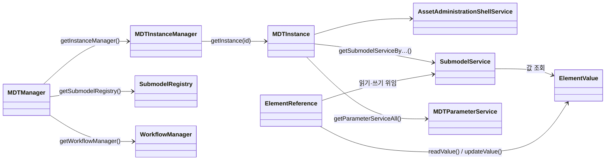
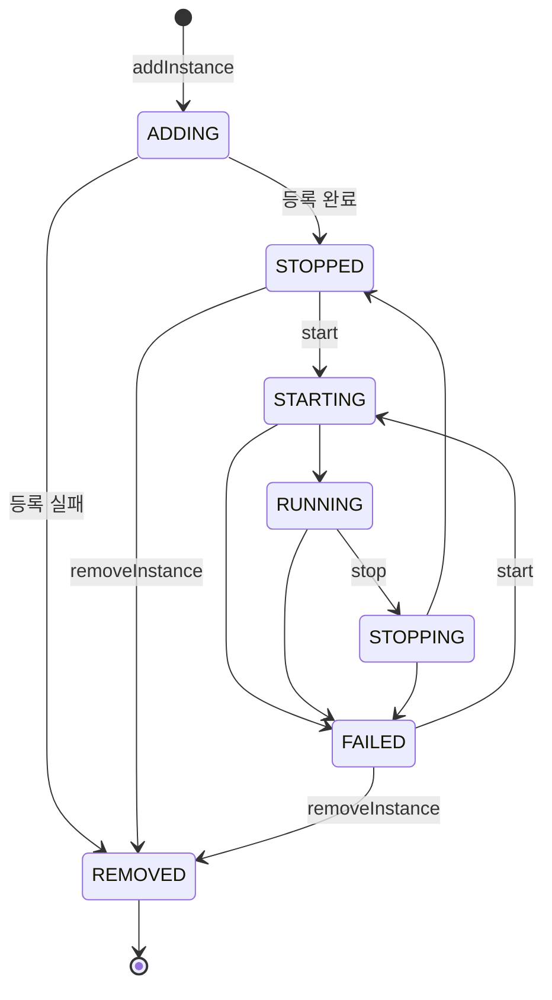

# mdt.model — MDT 클라이언트 공개 API

`mdt.model`은 mdt-client의 **공개 API 계층**이다. 최상위 진입점 `MDTManager`에서 출발해 MDTInstance, Submodel,
SubmodelElement 값까지 내려가는 인터페이스와 값 타입을 담고 있다. 이 문서는 패키지를 쓰는 사람을 위해 각 하위
패키지의 역할과 핵심 타입, 사용 방법을 설명한다.

> 요소 참조와 표현식 언어(MdtExpr)는 [sm/ref/README.md](sm/ref/README.md)에 따로 자세히 설명되어 있다. 이 문서는
> 그 내용을 요약만 한다. 예제의 `line-01`은 MDTInstance id이고, 검사 예외 처리는 생략했다.

## 목차

1. [개요](#1-개요)
   - 1.1 [소스 위치](#11-소스-위치) · 1.2 [패키지 구성](#12-패키지-구성) · 1.3 [타입 관계](#13-타입-관계)
2. [빠른 시작](#2-빠른-시작)
   - 2.1 [접속과 인스턴스 제어](#21-접속과-인스턴스-제어) · 2.2 [파라미터 읽고 쓰기](#22-파라미터-읽고-쓰기) ·
     2.3 [값과 JSON 변환](#23-값과-json-변환) · 2.4 [Data 서브모델을 엔티티로 읽기](#24-data-서브모델을-엔티티로-읽기) ·
     2.5 [시뮬레이션 연산 실행](#25-시뮬레이션-연산-실행)
3. [루트 패키지 `mdt.model`](#3-루트-패키지-mdtmodel)
   - 3.1 [`MDTManager`](#31-mdtmanager) · 3.2 [`SubmodelService`](#32-submodelservice) ·
     3.3 [`AssetAdministrationShellService`](#33-assetadministrationshellservice) · 3.4 [`MDTSemanticIds`](#34-mdtsemanticids) ·
     3.5 [예외 계층](#35-예외-계층) · 3.6 [그 밖의 타입](#36-그-밖의-타입)
4. [`mdt.model.instance` — MDTInstance 관리](#4-mdtmodelinstance--mdtinstance-관리)
   - 4.1 [`MDTInstanceManager`](#41-mdtinstancemanager) · 4.2 [`MDTInstance`](#42-mdtinstance) ·
     4.3 [`MDTInstanceStatus`](#43-mdtinstancestatus) · 4.4 [디스크립터와 이벤트](#44-디스크립터와-이벤트) ·
     4.5 [파라미터 서비스](#45-파라미터-서비스)
5. [`mdt.model.sm.value` — 요소 값](#5-mdtmodelsmvalue--요소-값)
   - 5.1 [값 타입](#51-값-타입) · 5.2 [두 가지 JSON 형식](#52-두-가지-json-형식) · 5.3 [`ElementValues`](#53-elementvalues)
6. [`mdt.model.sm.ref` — 요소 참조](#6-mdtmodelsmref--요소-참조)
   - 6.1 [참조 종류](#61-참조-종류) · 6.2 [주요 메소드](#62-주요-메소드)
7. [`mdt.model.sm.entity` — 어노테이션 기반 매핑](#7-mdtmodelsmentity--어노테이션-기반-매핑)
   - 7.1 [기반 타입](#71-기반-타입) · 7.2 [필드 어노테이션](#72-필드-어노테이션) · 7.3 [변환 규칙](#73-변환-규칙)
8. [도메인 서브모델](#8-도메인-서브모델)
   - 8.1 [한눈에 보기](#81-한눈에-보기) · 8.2 [연산형 서브모델 공통](#82-연산형-서브모델-공통) ·
     8.3 [Data](#83-data) · 8.4 [InformationModel](#84-informationmodel) · 8.5 [AI·Simulation·Shape](#85-aisimulationshape)
9. [`mdt.model.timeseries` — 시계열 서브모델](#9-mdtmodeltimeseries--시계열-서브모델)
10. [설계 특징과 제약](#10-설계-특징과-제약)
    - 10.1 [설계 특징](#101-설계-특징) · 10.2 [현재 제약](#102-현재-제약)

---

## 1. 개요

### 1.1 소스 위치

`build.gradle`의 main 소스셋은 `src/main/java`, `src/main/api`, `src/main/antlr` 세 디렉터리를 합친다. 그래서
`mdt.model` 패키지는 여러 디렉터리에 걸쳐 있다.

| 디렉터리 | 내용 |
| --- | --- |
| `src/main/api/mdt/model` | 호출자가 의존하는 인터페이스와 값 타입 (이 문서의 대상) |
| `src/main/java/mdt/model` | 구현 클래스(`Default*`)와 유틸리티(`AASUtils`, `MDTModelSerDe`, `ReferenceUtils` 등) |
| `src/main/java/mdt/model/expr`, `src/main/antlr` | MdtExpr 표현식 파서 (`api`에는 없다) |

AAS 메타모델은 Eclipse aas4j(`org.eclipse.digitaltwin.aas4j.v3.model`)를 그대로 쓰고, 이 패키지는 그 위에 MDT
고유의 개념(인스턴스, 파라미터, 연산 인자, 시계열 참조)을 얹는다. 공용 유틸리티(`utils.KeyValue`, `utils.io.TempFile`,
`utils.func.FOption` 등)는 `utils` 프로젝트에서 온다.

### 1.2 패키지 구성

`src/main/api/mdt/model` 아래에는 Java 파일 148개, 약 18,000줄이 있다. 절반 가까이가 요소 참조(`sm.ref`)와 요소
값(`sm.value`)이다.

| 패키지 | 파일 | 역할 | 대표 타입 |
| --- | --- | --- | --- |
| `mdt.model` | 19 | 최상위 진입점, AAS/Submodel 서비스, 예외, semantic ID | `MDTManager`, `SubmodelService`, `MDTException` |
| `mdt.model.instance` | 15 | MDTInstance 조회·등록·생명주기와 디스크립터 | `MDTInstanceManager`, `MDTInstance`, `MDTInstanceStatus` |
| `mdt.model.sm.ref` (+`timeseries`) | 17 | SubmodelElement 참조와 MdtExpr | `ElementReference`, `ElementReferences` |
| `mdt.model.sm.value` | 13 | SubmodelElement의 값과 JSON 변환 | `ElementValue`, `PropertyValue`, `ElementValues` |
| `mdt.model.sm.entity` | 15 | 어노테이션 기반 Java 객체 ↔ SubmodelElement 매핑 | `SubmodelEntity`, `@PropertyField` |
| `mdt.model.sm.data` | 32 | `Data` 서브모델: 설비·공정, 파라미터, 생산 도메인 | `Data`, `Equipment`, `ParameterValue` |
| `mdt.model.sm` | 4 | 연산형 서브모델 서비스, 파일 표현 | `OperationSubmodelService`, `AASFile` |
| `mdt.model.sm.info` | 9 | `InformationModel` 서브모델: 자산 정보, 트윈 구성 | `MDTInfo`, `TwinComposition` |
| `mdt.model.sm.simulation` | 6 | `Simulation` 서브모델 | `Simulation`, `SimulationSubmodelService` |
| `mdt.model.sm.ai` | 4 | `AI` 서브모델 | `AI`, `AISubmodelService` |
| `mdt.model.sm.shape` | 2 | `Shape` 서브모델 | `Shape`, `ShapeInfo` |
| `mdt.model.timeseries` | 12 | IDTA 시계열 서브모델 | `TimeSeries`, `Segment`, `Record` |

### 1.3 타입 관계



`ElementReference`는 "어디"(대상 위치), `ElementValue`는 "무엇"(값)을 나타낸다. 대부분의 코드는 참조를 만들어
활성화한 뒤 값을 읽고 쓰는 흐름이다.

---

## 2. 빠른 시작

### 2.1 접속과 인스턴스 제어

```java
MDTManager mdt = HttpMDTManager.connectWithDefault();   // mdt_client_config.yaml 사용
MDTInstanceManager manager = mdt.getInstanceManager();

MDTInstance inst = manager.getInstance("line-01");
if ( !inst.isRunning() ) {
    // 1초 간격으로 상태를 확인하며 최대 1분 기다린다.
    inst.start(Duration.ofSeconds(1), Duration.ofMinutes(1));
}

List<MDTInstance> stopped = manager.getInstanceAllByFilter("instance.status = 'STOPPED'");
```

### 2.2 파라미터 읽고 쓰기

```java
MDTElementReference ref = ElementReferences.parseExpr("param:line-01:Temperature");
ref.activate(manager);                       // 이 시점에 인스턴스와 경로가 정해진다.

Float temperature = ref.readAsFloat();       // xs:float 속성이어야 한다.
ref.updateValue(ElementValues.parseExpr("25.3"));
```

### 2.3 값과 JSON 변환

```java
ElementValue value = ref.readValue();
String full = value.toJsonString();               // {"@type":"mdt:value:float","value":25.3}
String valueOnly = value.toValueJsonString();     // 25.3

ElementValue restored = ElementValues.parseJsonString(full);             // 프로토타입이 필요 없다.
ElementValue parsed = ElementValues.parseValueJsonString("26.0", value); // value가 프로토타입
```

### 2.4 Data 서브모델을 엔티티로 읽기

```java
SubmodelService svc = inst.getSubmodelServiceByIdShort("Data")
                          .getOrThrow(() -> ResourceNotFoundException.ofIdShort("Submodel", "Data"));
Equipment eq = new DataSubmodelService(svc).getData().getDataInfo().getEquipment();
System.out.println(eq.getEquipmentId() + ": " + eq.getEquipmentName());
```

### 2.5 시뮬레이션 연산 실행

```java
// HTTP 클라이언트는 Simulation 서브모델을 SimulationSubmodelService로 감싸서 돌려준다.
SimulationSubmodelService sim = (SimulationSubmodelService)inst.getSubmodelServiceByIdShort("Simulation")
        .getOrThrow(() -> ResourceNotFoundException.ofIdShort("Submodel", "Simulation"));
Property speed = new DefaultProperty.Builder()
                        .idShort("Speed").valueType(DataTypeDefXsd.FLOAT).value("1.5")
                        .build();
Map<String,ElementValue> outputs = sim.run(Map.of("Speed", speed),
                                           Duration.ofMinutes(10), Duration.ofSeconds(2));
```

---

## 3. 루트 패키지 `mdt.model`

### 3.1 `MDTManager`

시스템 전체의 진입점이다. HTTP 구현은 `mdt.client.HttpMDTManager`다.

| 메소드 | 반환 | 설명 |
| --- | --- | --- |
| `getInstanceManager()` | `MDTInstanceManager` | MDTInstance 조회·등록·제어 |
| `getSubmodelRegistry()` | `mdt.aas.SubmodelRegistry` | Submodel 디스크립터 레지스트리 |
| `getWorkflowManager()` | `mdt.workflow.WorkflowManager` | 워크플로 관리 |
| `<T> getService(Class<T>)` | `T` | 클래스로 서비스를 찾는다. 지원하지 않는 클래스면 `null` |

### 3.2 `SubmodelService`

AAS Part 2(API)의 Submodel 서비스에 대응한다. 대상 요소는 모두 **idShortPath**(`a.b[0].c` 형식)로 지정한다.
조회 수준은 `Modifier`(`NONE`, `METADATA`, `VALUE`)로 고르며, 인자 없는 오버로드는 `NONE`을 쓴다.

| 분류 | 메소드 | 설명 |
| --- | --- | --- |
| Submodel | `getSubmodel([Modifier])`, `putSubmodel(Submodel)`, `getAllSubmodelElements()` | Submodel 전체 조회·교체 |
| 요소 조회 | `getSubmodelElementByPath(path [, Modifier])` | 없으면 `ResourceNotFoundException` |
| 요소 추가 | `addSubmodelElement(sme)`, `addSubmodelElementByPath(parentPath, sme)` | `sme`에 idShort가 있어야 한다 |
| 요소 교체 | `setSubmodelElementByPath(path, sme)` | 요소 전체를 바꾼다 |
| 값 변경 | `updateSubmodelElementByPath(path, sme)` | `sme`의 값만 반영한다 |
| | `updateSubmodelElementValueByPath(path, json)` | value-only JSON 문자열로 값을 바꾼다 |
| | `getSubmodelElementValueByPath(path, prototype)` | 값을 `ElementValue`로 읽는다 |
| 요소 삭제 | `deleteSubmodelElementByPath(path)` | |
| 첨부파일 | `readAttachmentByPath(path, OutputStream)` | File 요소의 내용을 스트림에 쓴다 |
| | `readAttachmentToTempFile(path)` | 내용을 임시 파일(`TempFile`)로 받는다 (기본 메소드) |
| | `putAttachmentByPath(path, FileValue, InputStream \| File)` | 내용을 올린다. 반환값은 크기 |
| | `deleteAttachmentByPath(path)` | |
| 연산 | `invokeOperationSync`, `invokeOperationAsync` → `OperationHandle` | |
| | `getOperationAsyncStatus(handle)`, `getOperationAsyncResult(handle)` | |
| | `runOperation(path, in, inout, timeout, pollInterval)` | 비동기로 시작하고 끝날 때까지 기다린다 (기본 메소드) |

`runOperation`은 `pollInterval`마다 상태를 확인하고, 끝나면 결과를 돌려준다.

- `timeout`이 `null`이면 7일(`P7D`)을 쓴다. `pollInterval`은 `null`일 수 없다(`IllegalArgumentException`).
- 상태가 `FAILED`이면 `ExecutionException`(원인은 서버 메시지를 담은 `RESTfulRemoteException`), `TIMEOUT`이면
  `TimeoutException`, `CANCELED`이면 `CancellationException`을 던진다.

### 3.3 `AssetAdministrationShellService`

AAS 셸 하나를 다룬다.

| 분류 | 메소드 |
| --- | --- |
| AAS | `getAssetAdministrationShell()`, `putAssetAdministrationShell(aas)` |
| Submodel 참조 | `getAllSubmodelReferences()`, `postSubmodelReference(ref)`, `deleteSubmodelReference(submodelId)` |
| 자산 정보 | `getAssetInformation()`, `putAssetInformation(info)` |
| 썸네일 | `getThumbnail()`, `putThumbnail(resource)`, `deleteThumbnail()` |

### 3.4 `MDTSemanticIds`

MDT 표준 서브모델과 요소의 semantic ID 상수다. 모두 `https://etri.re.kr/mdt` + 경로 + `/1/1` 형식이다.

| 분류 | 상수 |
| --- | --- |
| 서브모델 | `SUBMODEL_INFO`(`/Submodel/InformationModel`), `SUBMODEL_DATA`, `SUBMODEL_AI`, `SUBMODEL_SIMULATION`, `SUBMODEL_SHAPE` |
| 요소 | `MDT_INFO`, `TWIN_COMPOSITION`, `COMPOSITION_ITEM`, `COMPOSITION_DEPENDENCY`, `EQUIPMENT`, `OPERATION`, `PARAMETER`, `PARAMETER_VALUE`, `ARGUMENT_INPUT`, `ARGUMENT_OUTPUT` |
| 시계열 연산 | `TIME_SERIES_READ_RECORDS_BY_RANGE`, `TIME_SERIES_RANGE`, `TIME_SERIES_COLUMNS` |

`toReference(String)`은 문자열을 `EXTERNAL_REFERENCE` + `GLOBAL_REFERENCE` 키 하나로 된 aas4j `Reference`로 바꾼다.
도메인 인터페이스는 이를 `SEMANTIC_ID_REFERENCE` 상수로 미리 만들어 둔다.

### 3.5 예외 계층

도메인 예외는 모두 unchecked(`RuntimeException`)다. 원격 입출력이 일어나는 경로만 `IOException`을 검사 예외로
드러낸다.

```text
MDTException
├── ResourceException
│   ├── ResourceNotFoundException       ofId / ofIdShort / ofSemanticId 팩토리
│   ├── ResourceAlreadyExistsException
│   └── InvalidResourceStatusException  인스턴스 상태가 요청과 맞지 않을 때
├── ModelGenerationException
├── ModelValidationException
└── MDTInstanceManagerException         (instance 패키지)
```

### 3.6 그 밖의 타입

| 타입 | 종류 | 설명 |
| --- | --- | --- |
| `Input` / `Output` | 인터페이스 | 연산 인자 하나(ID, 이름, 값 `SubmodelElement`, 타입). semantic ID는 `ARGUMENT_INPUT` / `ARGUMENT_OUTPUT` |
| `NameValue` | final 클래스 | `KeyValue<String,String>` + `Named`. JSON은 `{"name": …, "value": …}` |
| `SubModelInfo` | 인터페이스 | 서브모델 공통 정보(title, creator, type, format, identifier) |
| `MinResourceRequirements` | 인터페이스 | GPU/CPU 사양, 메모리 크기·속도 (모두 문자열) |
| `MDTManagerEvent` | 클래스 | `eventType`을 가진 이벤트의 기반 클래스 |
| `MDTEntityFactory` | 인터페이스 | idShort로 `SubmodelElementEntity`를 만드는 팩토리 |
| `TopLevelEntity` | 인터페이스 | `DataInfo` 아래 최상위 엔티티를 나타내는 마커 |

---

## 4. `mdt.model.instance` — MDTInstance 관리

`MDTInstanceManager`가 인스턴스의 등록·조회·제거를, `MDTInstance`가 기동·정지와 AAS/Submodel 서비스 접근을 맡는다.

### 4.1 `MDTInstanceManager`

| 분류 | 메소드 | 설명 |
| --- | --- | --- |
| 조회 | `getInstance(id)`, `existsInstance(id)`, `countInstances()`, `getInstanceAll()` | `getInstance`는 없으면 `ResourceNotFoundException` |
| 필터 조회 | `getInstanceAllByFilter(filterExpr)` | 아래 필터 문법 참고 |
| 편의 조회 | `getInstanceByAasId`, `getInstanceBySubmodelId` | 0건이면 `ResourceNotFoundException`, 2건 이상이면 `MDTInstanceManagerException` |
| | `getInstanceAllByAasIdShort`, `getInstanceAllByAssetId`, `getInstanceAllBySubmodelIdShort` | 목록 반환 |
| 등록 | `addInstance(id, port, instanceFile)`, `addInstance(id, instanceFile)` | 디렉터리 또는 zip을 받는다. `port = -1`이면 자동 할당 |
| 제거 | `removeInstance(id)`, `removeInstanceAll()` | 없는 id는 무시한다. RUNNING이면 `InvalidResourceStatusException` |

**필터 문법**은 `<속성> (= | !=) '<리터럴>'` 형식의 단일 조건이다.

- 속성: `instance.{instanceId, status, baseEndpoint, aasId, aasIdShort, globalAssetId, assetType}`,
  `submodel.{id, idShort, semanticId}`
- 예: `instance.status != 'RUNNING'`, `submodel.idShort = 'Data'`
- 리터럴 안의 작은따옴표는 `''`로 적는다. `MDTInstanceManager.toFilterLiteral(value)`가 따옴표를 붙이고
  escape까지 해 준다. 편의 조회 메소드는 모두 이를 쓴다.

```java
String filter = "instance.aasIdShort = " + MDTInstanceManager.toFilterLiteral(idShort);
List<MDTInstance> found = manager.getInstanceAllByFilter(filter);
```

모든 메소드는 `null` 인자를 받지 않는다(`IllegalArgumentException`). 상수로 인스턴스 구성 파일 이름
(`mdt-instance-all.jar`, `model.json`, `model.aasx`, `config.json`, `mdt_cert.p12`, `mdt_global_config.json`)을 갖는다.

### 4.2 `MDTInstance`

| 분류 | 메소드 | 비고 |
| --- | --- | --- |
| 식별·속성 | `getId`, `getAasId`, `getAasIdShort`, `getGlobalAssetId`, `getAssetType`, `getInstanceDescriptor`, `getServiceEndpoint` | 앞의 다섯은 `InstanceDescriptor`에 위임 |
| 생명주기 | `getStatus`, `isRunning`, `start(pollInterval, timeout)`, `stop(pollInterval, timeout)`, `getOutputLog` | 아래 참고 |
| 서비스 | `getAssetAdministrationShellService`, `getSubmodelServiceAll`, `getSubmodelServiceById`, `getSubmodelServiceByIdShort`, `getSubmodelServiceAllBySemanticId` | id/idShort 조회는 `FOption<SubmodelService>`. idShort는 인스턴스 안에서만 유일 |
| 디스크립터 | `getAASShellDescriptor`, `getAASSubmodelDescriptorAll`, `getMDTSubmodelDescriptorAll`, `getMDTOperationDescriptorAll`, `getMDTTwinCompositionDescriptor` | 앞의 둘은 aas4j 타입. TwinComposition이 없으면 `null` |
| 파라미터 | `getParameterServiceAll`, `getParameterCollection` | `Data` 서브모델이 없으면 `ResourceNotFoundException` |
| 인스턴스 간 의존 | `getComponentInstanceAll`, `getTargetInstanceAllOfDependency(type)`, `getSourceInstanceAllOfDependency(type)` | `getComponentInstanceAll`은 `"contain"` 의존의 대상 목록 |

`start`/`stop`의 동작:

- `pollInterval`이 `null`이면 요청만 보내고 바로 돌아오므로 STARTING/STOPPING 상태가 반환될 수 있다.
- `timeout`이 `null`이면 끝날 때까지 기다린다.
- 이미 실행 중인데 `start`하거나, 실행 중이 아닌데 `stop`하면 `InvalidResourceStatusException`이다.
- HTTP 구현(`HttpMDTInstanceClient`)에는 상태가 바뀔 때마다 `StatusChangedListener`를 부르는
  `start(pollInterval, timeout, listener)`가 더 있다.

### 4.3 `MDTInstanceStatus`

`ADDING`, `STOPPED`, `STARTING`, `RUNNING`, `STOPPING`, `FAILED`, `REMOVED` 일곱 상태가 있다.
ADDING·STARTING·STOPPING은 일시 상태이고, 서비스 엔드포인트는 RUNNING에서만 유효하다.



### 4.4 디스크립터와 이벤트

| 타입 | JSON 필드 | 비고 |
| --- | --- | --- |
| `InstanceDescriptor` | `id`, `aasId`, `aasIdEncoded`, `aasIdShort`, `globalAssetId`, `assetType`, `status`, `baseEndpoint` | `aasIdEncoded`는 aasId의 Base64 URL-safe 값으로, 역직렬화 때는 무시한다 |
| `MDTModel` | 위 필드(`aasIdEncoded` 제외) + `submodels`, `parameters`, `operations`, `twinComposition` | 인스턴스 전체를 한 번에 보여 주는 집계 뷰 |
| `MDTSubmodelDescriptor` | `id`, `idShort`, `semanticId`, `endpoint` | `equals`/`hashCode`는 id만 비교 |
| `MDTParameterDescriptor` | `id`, `name`, `valueType`, `reference`, `endpoint` | `endpoint`는 파라미터 값의 REST 주소 |
| `MDTOperationDescriptor` | `id`, `operationType`, `inputArguments`, `outputArguments` | `toSignatureString()` → `id(in1, in2) -> (out1)` |
| `MDTTwinCompositionDescriptor` | `id`, `type`, `compositionItems`, `compositionDependencies` | 항목은 `(id, reference)`, 의존은 `(type, sourceItem, targetItem)` |
| `InstanceStatusChangeEvent` | `eventType`, `instanceId`, `statusChange`, `serviceEndpoint` | `statusChange`는 상태 이름 또는 `ADDED`, `ADD_FAILED`. `getInstanceStatus()`는 이 둘을 STOPPED, REMOVED로 바꾼다 |

`InstanceDescriptor.getParameterEndpoint(idx, smEndpoint)`는 파라미터 값의 REST 주소를 만든다. 자산 타입이
`Machine`이면 `DataInfo.Equipment.EquipmentParameterValues[idx].ParameterValue`, `Process`면 `Equipment` 대신
`Operation`을 쓴 경로이고, 그 밖의 타입은 `IllegalStateException`이다.

### 4.5 파라미터 서비스

| 타입 | 설명 |
| --- | --- |
| `MDTParameterService` | 파라미터 하나. `getId`, `getDescriptor`, `getReference`, `read()` → `ElementValue`, `update(ElementValue)`. 참조는 처음 쓸 때 만들어 활성화한다 |
| `MDTParameterServiceCollection` | `List<MDTParameterService>`. 인덱스 또는 파라미터 id(`get(String)`, 없으면 `null`)로 찾는다. 수정 메소드는 `UnsupportedOperationException` |
| `MDTInstanceManagerAware` | `activate(MDTInstanceManager)`를 가진 객체. 정적 `activate(obj, manager)`는 해당 타입일 때만 활성화한다 |

---

## 5. `mdt.model.sm.value` — 요소 값

`ElementValue`는 SubmodelElement에서 메타데이터(idShort, semanticId 등)를 뺀 **값 부분**만 나타낸다.
`ElementValues.getValue(sme)`로 요소에서 값을 꺼내고, `ElementValues.update(sme, value)`로 다시 넣는다.

`ElementValue`의 메소드는 여섯 개다.

| 메소드 | 설명 |
| --- | --- |
| `toValueObject()` | Java 값(`Map`, `List`, 기본 타입 등) |
| `toJsonString()` / `toJsonNode()` | 타입 정보를 포함한 전체 JSON |
| `toValueJsonString()` / `toValueJsonNode()` | 값만 담은 JSON |
| `toDisplayString()` | 화면 표시용 문자열 |

### 5.1 값 타입

| 클래스 | AAS 요소 | `@type` | 값 JSON 형태 |
| --- | --- | --- | --- |
| `PropertyValue<T>` (하위 11종) | Property | `mdt:value:string`, `integer`, `float`, `double`, `boolean`, `dateTime`, `date`, `duration`, `long`, `short`, `decimal` | Java 값 그대로 (Duration·Date는 ISO-8601 문자열) |
| `MultiLanguagePropertyValue` | MultiLanguageProperty | `mdt:value:mlprop` | `[{"ko": "…"}, …]` |
| `RangeValue<T>` | Range | `mdt:value:range` | `{"min": …, "max": …}` |
| `FileValue` | File | `mdt:value:file` | `{"contentType": …, "value": …}` |
| `ReferenceElementValue` | ReferenceElement | `mdt:value:reference` | `[{"type": …, "value": …}, …]` (키 목록) |
| `ElementCollectionValue` | SubmodelElementCollection | `mdt:value:collection` | `{idShort: 값, …}` (순서 유지) |
| `ElementListValue` | SubmodelElementList | `mdt:value:list` | `[값, …]` |
| `OperationVariableValue` | Operation | `mdt:value:opvars` | `{"inputs": […], "outputs": […], "inoutputs": […]}` |

`PropertyValue`의 XSD 타입 대응은 다음과 같다. 정적 팩토리는 `PropertyValue.STRING(…)`, `PropertyValue.INTEGER(…)`처럼
타입 이름을 그대로 쓴다. 표에 없는 XSD 타입은 `IllegalArgumentException`이다.

| XSD | Java | XSD | Java |
| --- | --- | --- | --- |
| `STRING` | `String` | `DATE_TIME` | `Instant` |
| `INT` | `Integer` | `DURATION` | `Duration` |
| `LONG`, `INTEGER` | `Long` | `FLOAT` | `Float` |
| `SHORT` | `Short` | `DOUBLE` | `Double` |
| `BOOLEAN` | `Boolean` | `DECIMAL` | `BigDecimal` |

`xs:integer`는 `Long`으로 읽으므로 long 범위를 넘는 값은 읽을 수 없다.

### 5.2 두 가지 JSON 형식

- **전체 JSON**: `{"@type": "mdt:value:<종류>", "value": …}`. 스스로 타입을 설명하므로
  `ElementValues.parseJsonString`으로 바로 복원된다. 컬렉션·리스트의 멤버도 각자 이 형식을 갖는다.
- **값 JSON**: `toValueObject()`를 JSON으로 바꾼 것(AAS ValueOnly와 비슷하다). 타입 정보가 없어서 읽을 때
  **프로토타입** `ElementValue`가 필요하며, 보통 현재 요소의 `getValue(sme)`를 쓴다.

프로토타입은 이렇게 쓰인다.

| 대상 | 규칙 |
| --- | --- |
| Property | 프로토타입의 XSD 타입으로 해석한다 |
| 컬렉션 | 프로토타입의 필드만 본다. JSON에 없는 필드는 `null`, 프로토타입에 없는 JSON 필드는 무시한다 |
| 리스트 | 크기가 같아야 하고, 위치로 짝을 짓는다 |
| File, MultiLanguageProperty | 프로토타입이 필요 없다 |

### 5.3 `ElementValues`

| 목적 | 메소드 |
| --- | --- |
| 요소 → 값 | `getValue(SubmodelElement)` (Blob, Entity 등 지원하지 않는 요소는 `IllegalArgumentException`) |
| 전체 JSON → 값 | `parseJsonString(json)`, `parseJsonNode(node)` |
| 값 JSON·Java 객체 → 값 | `parseValueJsonString(json, proto)`, `parseValueJsonNode(node, proto)`, `fromValueObject(obj, proto)` |
| 형식 자동 판별 | `parseJsonNode(node, proto)` — `@type`이 있으면 전체 JSON, 없으면 `proto` 기준 값 JSON. `Supplier` 오버로드는 proto가 필요할 때만 얻는다 |
| 표현식 리터럴 → 값 | `parseExpr("25.3")`, `parseExpr("'안녕'@ko")` 등 |
| 요소 갱신 | `update(sme, ElementValue)`, `updateFromValueJson(sme, JsonNode \| String)`(값 JSON), `updateFromValueString(sme, String)`(AAS 값 문자열), `updateValue(sme, Number)`(Java 숫자) |

```java
Property prop = (Property)svc.getSubmodelElementByPath("DataInfo.Equipment.EquipmentName");
ElementValues.updateFromValueString(prop, "Press-02");      // AAS 값 문자열
ElementValues.updateFromValueJson(prop, "\"Press-03\"");    // 값 JSON (문자열이므로 따옴표 포함)
svc.updateSubmodelElementByPath("DataInfo.Equipment.EquipmentName", prop);
```

`NamedValueType`은 `(name, valueType)` 쌍과 `"name (type)"` 문자열을 다루는 별도의 POJO로, `ElementValue` 계층에
속하지 않는다.

---

## 6. `mdt.model.sm.ref` — 요소 참조

`ElementReference`는 SubmodelElement 하나를 저장 위치와 상관없이 같은 방법으로 읽고 쓰는 핸들이다. 참조는
MdtExpr 문자열이나 JSON으로 만들고, MDT가 관리하는 대상이면 `activate(MDTInstanceManager)`로 실제 인스턴스에
연결한 뒤 쓴다. 파싱과 역직렬화는 네트워크를 쓰지 않으며, 활성화 전에 읽거나 쓰면 `IllegalStateException`이다.

문법, 활성화 규칙, 예제는 [sm/ref/README.md](sm/ref/README.md)에 자세히 있다.

### 6.1 참조 종류

| 클래스 | 표현식 예 | `@type` |
| --- | --- | --- |
| `DefaultElementReference` | `line-01:Data:DataInfo.Equipment.EquipmentName` | `mdt:ref:element` |
| `MDTParameterReference` | `param:line-01:Temperature` | `mdt:ref:param` |
| `MDTParameterCollectionReference` | `param:line-01:*` | `mdt:ref:param` |
| `MDTArgumentReference` | `oparg:line-01:Simulation:in:Speed` | `mdt:ref:oparg` |
| `OperationVariableReference` | `opvar:line-01:Ops:Calc:out:0` | `mdt:ref:opvar` |
| `TimeSeriesRecordsReference` | `timeseries:line-01:Log#last=1h` | `mdt:ref:timeseries` |
| `FileStoreReference` | 없음 (JSON 전용, 로컬 파일) | `mdt:ref:file` |

### 6.2 주요 메소드

| 분류 | 메소드 |
| --- | --- |
| 생성 | `ElementReferences.parseExpr(expr)`, `parseSubmodelExpr(expr)`, `parseJsonString(json)`, `parseJsonNode(node)` |
| 활성화 | `activate(manager)`, `isActivated()` (`MDTElementReference`) |
| 읽기 | `read()`, `readValue()`, `readAsProperty()`, `readAsString()`, `readAsInt()` 등 타입별 메소드, `readCollection()`, `readList()` |
| 쓰기 | `write(sme)`(요소 교체), `update(sme)`(값 반영), `updateValue(ElementValue)`, `updateFromValueJson(JsonNode \| String)` |
| 첨부파일 | `readAttachment(OutputStream \| File)`, `updateAttachment(…)`, `removeAttachment()` |
| 직렬화 | `toStringExpr()`, `toJsonString()`, `toJsonNode()` |

`MDTElementReference.updatePropertyValue(PropertyValue)`는 대상이 파라미터 값이면 `EventDateTime`도 현재 시각으로
함께 갱신한다.

---

## 7. `mdt.model.sm.entity` — 어노테이션 기반 매핑

Java 필드에 어노테이션을 붙이면 `AbstractSMEContainerEntity`가 리플렉션으로 필드와 SubmodelElement를 양방향으로
변환한다. `sm.data`, `sm.info`, `sm.ai`, `sm.simulation`의 구현 클래스(`Default*`)가 모두 이 방식을 쓴다.

### 7.1 기반 타입

| 타입 | 역할 |
| --- | --- |
| `AASModelEntity<T>` | `updateAasModel(T)`(엔티티 → AAS), `updateFromAasModel(T)`(AAS → 엔티티) |
| `SubmodelElementEntity` | 위 인터페이스 + `getIdShort()`, `newSubmodelElement()` |
| `AbstractSMEContainerEntity<T>` | idShort·semanticId와 리플렉션 매핑 로직을 담은 추상 클래스 |
| `SubmodelEntity` | `Submodel` 대응. `id`와 `newSubmodel()`을 더한다 |
| `SubmodelElementCollectionEntity` | SubmodelElementCollection(SMC) 대응 |
| `SubmodelElementListEntity<E>` | SubmodelElementList(SML) 대응. 하위 클래스가 `newMemberEntity()`를 구현한다 |
| `PropertyEntity` | Property 하나(idShort, valueType, 문자열 값). 원시값 SML을 읽을 때 쓴다 |

### 7.2 필드 어노테이션

| 어노테이션 | 대응 요소 | 속성(기본값) |
| --- | --- | --- |
| `@PropertyField` | Property | `idShort`, `valueType`, `keepNullField=false` |
| `@MultiLanguagePropertyField` | MultiLanguageProperty | `idShort`, `keepNullField=false` |
| `@SMCollectionField` | SMC | `idShort`, `keepNullField=false`, `adaptorClass=void.class` |
| `@SMListField` | SML | `idShort`, `typeValueListElement=SMC`, `valueTypeListElement=STRING`, `orderRelevant=false`, `keepNullField=false`, `elementClass=void.class` |
| `@SMElementField` | 임의 SubmodelElement (그대로 보관) | `idShort` |

`@PropertyField.valueType`은 `DataTypes.fromDataTypeName`으로 해석한다. 대소문자를 구분하며 `DataTypeDefXsd`
이름(`"INT"`, `"DURATION"`)이나 `xs:` 식별자(`"xs:int"`, `"xs:duration"`)를 쓴다. 비워 두면 읽을 때는 Property의
valueType을, 쓸 때는 필드 값의 Java 타입을 따른다.

```java
@Getter @Setter
public class DefaultSimulationTool extends SubmodelElementCollectionEntity implements SimulationTool {
    @PropertyField(idShort="SimToolName") private String simToolName;
    @PropertyField(idShort="SimulationTimeout", valueType="DURATION") private Duration simulationTimeout;
    …
}
```

### 7.3 변환 규칙

- **AAS → 엔티티**: `updateFromAasModel`이 idShort·id·semanticId를 채우고, 자식 요소를 idShort로 찾아 어노테이션이
  붙은 필드(상위 클래스 필드 포함)마다 변환한다.
  - Property는 데이터 타입에 맞게 파싱하고, Enum 필드는 `valueOf`를 쓴다.
  - SMC는 `adaptorClass`(없으면 필드 타입)의 객체를 만들어 재귀적으로 채운다.
  - SML은 `elementClass`에 따라 엔티티 목록, 문자열 목록, 원본 SubmodelElement 목록 중 하나가 된다.
  - 타입이 맞지 않으면 `ModelGenerationException`이다.
- **엔티티 → AAS**: `newSubmodel()`/`newSubmodelElement()`가 빈 모델을 만들고 `updateAasModel(model)`을 부른다.
  필드로 만든 요소가 같은 idShort의 기존 요소를 제자리에서 교체하고, 대응 필드가 없는 기존 요소는 그대로 남는다.
  Property는 값이 `null`이 아니거나 `keepNullField`일 때만 만든다. Enum은 `name()`을 문자열로 쓴다.
- 필드 값은 getter/setter로 읽고 쓰므로 공개 접근자가 필요하다. 구현 클래스는 주로 Lombok `@Getter`/`@Setter`를 쓴다.

---

## 8. 도메인 서브모델

### 8.1 한눈에 보기

MDT 표준 서브모델 다섯 개를 Java 인터페이스로 표현한다. 인터페이스는 `api`에, 구현(`Default*`)은 같은 패키지 이름으로
`src/main/java`에 있다.

| 서브모델 | 루트 인터페이스 | semantic ID 경로 | 하위 구조 | 서비스 클래스 |
| --- | --- | --- | --- | --- |
| Data | `Data` | `/Submodel/Data` | `SubModelInfo`, `DataInfo` | `DataSubmodelService` |
| InformationModel | `InformationModel` | `/Submodel/InformationModel` | `MDTInfo`, `TwinComposition` | 없음 |
| AI | `AI` | `/Submodel/AI` | `SubModelInfo`, `AIInfo` | `AISubmodelService` |
| Simulation | `Simulation` | `/Submodel/Simulation` | `SubModelInfo`, `SimulationInfo` | `SimulationSubmodelService` |
| Shape | `Shape` | `/Submodel/Shape` | `ShapeInfo` | 없음 (구현 클래스도 없음) |

`HttpMDTInstanceClient`는 semanticId를 보고 Simulation/AI 서브모델을 각각 `SimulationSubmodelService`/
`AISubmodelService`로 감싸서 돌려준다. Data 서브모델은 감싸지 않으므로 `new DataSubmodelService(svc)`로 직접 만든다.

### 8.2 연산형 서브모델 공통

`OperationSubmodelService`는 `SubmodelService`를 감싸고(Lombok `@Delegate`) 연산 인자를 다룬다. 생성할 때
semanticId로 경로 접두어를 정한다(Data → `DataInfo`, AI → `AIInfo`, Simulation → `SimulationInfo`).

| 메소드 | 설명 |
| --- | --- |
| `getInputs()` / `getOutputs()` | `<접두어>.Inputs`/`.Outputs` 리스트를 `ArgumentCollection`으로 돌려준다 |
| `run(inputs, timeout, pollInterval)` | `Operation` 요소를 실행하고 출력 idShort → `ElementValue` 맵을 돌려준다 |

`ArgumentCollection`은 인자 id → 값의 모음이다. `getValue()`로 값 맵을 읽고, `setValue(id, value)`·`setValue(map)`으로
바꾼 뒤 `save()`로 서버에 쓴다. 생성 시점에 서버에서 읽은 내용을 들고 있으므로, 다시 읽으려면 `load()`를 부른다.

```java
OperationSubmodelService opSvc = new OperationSubmodelService(svc);
OperationSubmodelService.ArgumentCollection inputs = opSvc.getInputs();
inputs.setValue("Speed", PropertyValue.FLOAT(1.5f)).save();
```

`OperationEntity`(`get/setInputs`, `get/setOutputs`)는 `AIInfo`, `SimulationInfo`, `ShapeInfo`가 확장한다.

`sm` 루트에는 이 밖에 File 요소의 경로와 contentType을 담는 `AASFile`, SubmodelElement의 메타데이터(idShort,
modelType, valueType, semanticId, typeValueListElement)를 담는 불변 클래스 `Metadata`가 있다.

### 8.3 Data

`Data`는 `getSubModelInfo()`와 `getDataInfo()`를 갖는다. `DataInfo`는 최상위 엔티티 목록으로, Equipment가 있으면
설비형, Operation이 있으면 공정형이다(`isEquipment`, `isOperation`, `getEquipment`, `getOperation`).

- `DataInfo`의 하위 엔티티는 `DefaultMDTEntityFactory`가 idShort로 만든다: `Equipment`, `Operation`, `Line`,
  `Equipments`, `ProductionPlannings`, `ProductionOrders`, `ProductionPerformances`, `Repairs`, `Andons`,
  `ItemMasters`, `BOMs`, `Routings`. 그 밖의 idShort는 엔티티로 만들지 않고 건너뛰며, 다시 쓸 때도 그대로 남는다.
- `ParameterCollection`은 `getParameterList()`와 `getParameterValueList()` 두 목록을 갖고, 두 목록은 인덱스로 1:1
  대응한다. `getParameter(int | String)`, `getParameterValue(int | String)`, `getParameterIndex(String)` 등을
  제공한다. `Equipment`와 `Operation`이 이를 확장한다.

| 타입 | 주요 필드 |
| --- | --- |
| `Equipment` | EquipmentId, EquipmentName, EquipmentType, UseIndicator (+ 파라미터 목록) |
| `Operation` | OperationId, OperationName, OperationType, UseIndicator, ProductionOrders (+ 파라미터 목록) |
| `Parameter` | EntityId, ParameterId(키), ParameterName, ParameterType, ParameterGrade, ParameterUOMCode, LSL, USL, PeriodicDataCollectionIndicator, DataCollectionPeriod |
| `ParameterValue` | EntityId, ParameterId(키), ParameterValue(`SubmodelElement`), EventDateTime(`Instant`), ValidationResultCode |
| `EquipmentParameter(Value)`, `OperationParameter(Value)` | 위 두 타입에 EquipmentId 또는 OperationId를 더한 형태 |

`ParameterValue.setParameterValue(ElementValue)`는 `ElementValues.update`로 값만 바꾼다.

생산 도메인 타입은 semantic ID 없이 getter/setter만 갖는다. 복수형(`…s`)은 `getElementAll()`을 가진 목록 래퍼다.

| 타입 | 내용 | 주요 필드 |
| --- | --- | --- |
| `Andon(s)` | 라인 정지(안돈) 이벤트 | AndonID, OperationID, StartDateTime, EndDateTime, CauseName, LineStopType |
| `BOM(s)` | 자재명세 | BOMID, BOMType, ItemID, BOMQuantity, ValidStart/EndDateTime |
| `ItemMaster(s)` | 품목 마스터 | ItemID, ItemType, ItemName, ItemUOMCode, LotSize |
| `LOT` | 작업 로트 (Equipment의 WorkingLOTs) | LotId, ItemId, State, Quantity, Start/EndDateTime, AppliedTactTime |
| `Line` | 생산 라인 | LineID, LineName, LineType, UseIndicator, LineStatus |
| `ProductionOrder(s)` | 생산 지시 | ProductionOrderID, ItemID, ProductionOrderQuantity, ProductionDueDateTime, ScheduleStart/EndDateTime |
| `ProductionPerformance(s)` | 생산 실적 | ProductionPerformanceID, ProductionOrderID, ProducedQuantity, DefectQuantity, ExecutionStart/EndDateTime |
| `ProductionPlanning(s)` | 생산 계획 | ProductionPlanID, ItemID, ProductionPlanQuantity, ScheduleStart/EndDateTime |
| `Repair(s)` | 불량 등록·수리 | RepairID, DefectRegOperationID, DefectRegDateTime, RepairDateTime, InitialDefectLevel1~3 |
| `Routing(s)` | 라우팅 | RoutingID, RoutingName, ItemID, SetupTime |

### 8.4 InformationModel

| 타입 | 내용 |
| --- | --- |
| `MDTInfo` | `MDTInfo` SMC. idShort, AssetType(`MDTAssetType`: `Machine`, `Process`, `Line`, `Factory`), AssetName, Status(`MDTAssetStatus`: `Created`, `Registered`, `Executed`) |
| `TwinComposition` | CompositionID, CompositionType, CompositionItems(`ID`, `Reference`, `Description`), CompositionDependencies(`SourceId`, `TargetId`, `DependencyType`) |

`MDTInstance`의 의존 조회(`getComponentInstanceAll` 등)는 TwinComposition의 구성 정보를 따른다.

### 8.5 AI·Simulation·Shape

- **AI**: `AIInfo`는 Inputs/Outputs와 `MinResourceRequirements`를 갖는다. `ai.Model`은 LearningMethod, AIModelType,
  AIFramework, ModelDescription, LastExecutionTime이다. `AISubmodelService`는 `OperationSubmodelService`에
  `getAI()`를 더한다.
- **Simulation**: `SimulationInfo`는 Model, MinResourceRequirements, SimulationTool, Inputs/Outputs를 갖는다.
  - `SimulationTool`: SimToolName, OperatingSystem, LicenseModel, SimulatorEndpoint, SimulationTimeout,
    SessionRetainTimeout
  - `simulation.Model`: ModelFileType, ModelFileVersion, LastExecutionTime
  - `Simulation`에는 SimulatorEndpoint 등의 idShortPath 상수와 `getSimulationOperation()`(aas4j `Operation`)이 있다.
- **Shape**: `Shape`는 `getSubModelInfo()`와 `getShapeInfo()`를 갖고, `ShapeInfo`는 `OperationEntity`를 확장할 뿐
  추가 멤버가 없다.

---

## 9. `mdt.model.timeseries` — 시계열 서브모델

IDTA TimeSeries 서브모델 템플릿을 표현하는 인터페이스다. semantic ID는 MDT 고유 URI가 아니라
`https://admin-shell.io/idta/TimeSeries/…/1/1`이고 `TimeSeriesSemanticIds`에 모여 있다. 레코드를 실제로 조회할 때는
`TimeSeriesRecordsReference`(6장)를 쓴다.

| 타입 | 내용 | 주요 메소드 |
| --- | --- | --- |
| `TimeSeries` | 서브모델 루트 | `getMetadata()`, `getSegments()` |
| `Metadata` | 이름·설명·레코드 구조 | `getName()`/`getDescription()`(`MultiLanguagePropertyValue`), `getRecord()` → `RecordMetadata`(컬럼 이름·타입) |
| `Record` / `Records` | 레코드 한 건 / 목록 | `getTimestamp()`(`Instant`), `getFieldValues()` / `getRecordList()` |
| `Segment` / `Segments` | 구간 / 목록 | 이름, 설명, `getRecordCount()`, `getStartTime()`/`getEndTime()`, `getDuration()`, `getSamplingInterval()`, `getSamplingRate()`, `getState()`, `getLastUpdate()` |
| `InternalSegment` | 레코드를 내부에 가진 구간 | `getRecords()` |
| `ExternalSegment` | 파일에 저장된 구간 | `getData()`(AAS `File`) |
| `LinkedSegment` | 외부 저장소에 있는 구간 | `getEndpoint()`, `getQuery()` |
| `SegmentState` | 구간 상태 | `IN_PROGRESS`, `COMPLETED` |
| `TimeSeriesOperationReference` | 연산 요소를 감싼 `MDTElementReference` | `read()`가 입력 `Timespan`(DATE_TIME Range)으로 연산을 실행한다. 쓰기·직렬화는 `UnsupportedOperationException` |

구현은 `src/main/java/mdt/model/timeseries`의 `DefaultTimeSeries`, `DefaultMetadata`, `DefaultRecord(s)`,
`DefaultSegment(s)`, `DefaultInternalSegment`, `DefaultLinkedSegment`다.

---

## 10. 설계 특징과 제약

### 10.1 설계 특징

- **참조와 값의 분리**: `ElementReference`는 대상 위치, `ElementValue`는 값을 담는다. 읽기는 `ref.readValue()`,
  쓰기는 `ref.updateValue(value)`로 두 축이 만난다.
- **지연 연결**: 참조는 파싱·역직렬화 때 네트워크를 쓰지 않고 `activate`에서 인스턴스에 연결된다. 그래서 워크플로나
  CLI 인자로 참조를 문자열·JSON으로 주고받을 수 있다.
- **예외 정책**: 도메인 예외는 unchecked(`MDTException` 계열)이고, 원격 입출력 경로만 `IOException`을 드러낸다.
- **api와 java의 의존**: `api` 쪽 코드 일부가 구현 코드를 직접 쓴다. `OperationSubmodelService`와
  `TimeSeriesOperationReference`는 `mdt.client.operation.AASOperationClient`를, `sm.ref`는
  `mdt.model.sm.SubmodelUtils`를, `AI`·`Simulation`·`DataSubmodelService`는 `DefaultAI`·`DefaultSimulation`·
  `DefaultData`를 쓴다. 따라서 `api`만 따로 빌드할 수는 없다.

### 10.2 현재 제약

| 대상 | 내용 |
| --- | --- |
| `Shape`/`ShapeInfo`, `ExternalSegment` | 구현 클래스가 없다 |
| `Segment.getState()` | `SegmentState`가 아니라 상수 이름 문자열을 돌려준다 |
| `StatusChangedListener` | `MDTInstance` 인터페이스에는 등록 방법이 없고, `HttpMDTInstanceClient.start(…, listener)`에서만 쓴다 |
| `@SMListField.orderRelevant` | 값을 읽는 코드가 없다. 리스트의 `orderRelevant`는 `SubmodelElementListEntity.setOrderRelevant`로 정한다 |
| `NamedValueType` | 사용하는 곳이 없다 |
| 주석 처리된 멤버 | `Equipment`(여러 필드), `Operation`(시작·종료 시각), `Line`(BOM·품목·라우팅 목록), `AIInfo.getModel` |
| `ArgumentCollection`, `DataSubmodelService` | 생성 시점에 읽은 내용을 들고 있어 서버 값이 바뀌어도 자동으로 갱신되지 않는다 |
