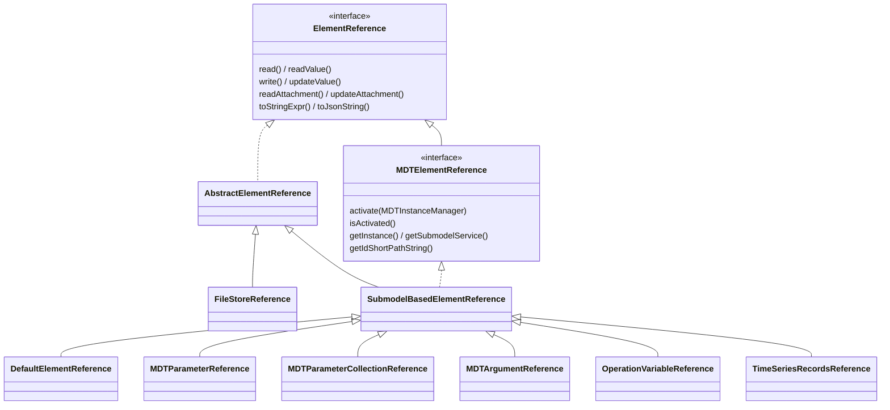
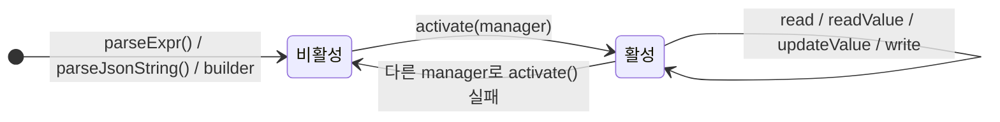

# mdt.model.sm.ref — 요소 참조와 MdtExpr 표현식

MDT 시스템의 자원(Submodel, SubmodelElement, 파라미터, 연산 인자, 시계열 레코드)을 가리키는 **참조(reference)**
객체와, 이 참조와 값을 한 줄 문자열로 적는 표현식 언어 **MdtExpr**의 사용법을 설명한다.

참조를 쓰면 대상이 어디에 어떻게 저장되어 있든(원격 Submodel, MDT 파라미터, 연산 인자, 시계열, 로컬 파일) 같은
방법으로 읽고, 쓰고, 값만 갱신하고, 첨부파일을 주고받고, JSON으로 저장할 수 있다. 긴 모델 경로 대신
`param:line-01:Temperature` 같은 짧은 표현식을 쓸 수 있고, 같은 문법이 Java API, CLI 옵션, REST API의 `ref`
파라미터, 워크플로 태스크 인자에 공통으로 쓰인다.

> 예제의 `line-01`은 MDTInstance id이고 `Data`, `Simulation`, `Log` 등은 Submodel idShort이다. 실제 환경의
> 식별자로 바꿔서 사용한다.

## 목차

1. [개요](#1-개요)
   - 1.1 [처리 흐름](#11-처리-흐름) · 1.2 [빠른 시작](#12-빠른-시작) · 1.3 [한눈에 보기](#13-한눈에-보기)
2. [핵심 개념](#2-핵심-개념)
   - 2.1 [참조 타입 계층](#21-참조-타입-계층) · 2.2 [활성화](#22-활성화) · 2.3 [참조 종류별 지원 기능](#23-참조-종류별-지원-기능)
3. [MdtExpr 기본 문법](#3-mdtexpr-기본-문법)
   - 3.1 [기호](#31-기호) · 3.2 [구분자와 공백](#32-구분자와-공백) · 3.3 [이름과 따옴표](#33-이름과-따옴표) ·
     3.4 [숫자](#34-숫자) · 3.5 [Submodel 참조](#35-submodel-참조) · 3.6 [idShortPath](#36-idshortpath)
4. [요소 참조 표현식](#4-요소-참조-표현식)
   - 4.1 [기본 요소 참조](#41-기본-요소-참조) · 4.2 [파라미터 `param:`](#42-파라미터-참조--param) ·
     4.3 [연산 인자 `oparg:`](#43-연산-인자-참조--oparg) · 4.4 [Operation 변수 `opvar:`](#44-operation-변수-참조--opvar) ·
     4.5 [시계열 `timeseries:`](#45-시계열-참조--timeseries)
5. [값 리터럴과 범용 표현식](#5-값-리터럴과-범용-표현식)
   - 5.1 [값 리터럴](#51-값-리터럴) · 5.2 [범용 표현식 `parseExpr`](#52-범용-표현식-parseexpr) ·
     5.3 [대입 표현식](#53-대입-표현식)
6. [핵심 API](#6-핵심-api)
   - 6.1 [`ElementReferences`](#61-elementreferences) · 6.2 [`ElementReference`](#62-elementreference) ·
     6.3 [`MDTElementReference`](#63-mdtelementreference) · 6.4 [`MDTExpressionParser`](#64-mdtexpressionparser) ·
     6.5 [시계열 API](#65-시계열-api) · 6.6 [`DefaultSubmodelReference`](#66-defaultsubmodelreference)
7. [참조 사용하기](#7-참조-사용하기)
   - 7.1 [읽기](#71-읽기) · 7.2 [쓰기와 값 갱신](#72-쓰기와-값-갱신) · 7.3 [첨부파일](#73-첨부파일) ·
     7.4 [문자열 표현과 정규화](#74-문자열-표현과-정규화) · 7.5 [JSON 직렬화](#75-json-직렬화)
8. [활용 예제](#8-활용-예제)
   - 8.1 [파라미터 읽고 쓰기](#81-파라미터-읽고-쓰기) · 8.2 [설비 값을 시뮬레이션 입력으로 복사](#82-설비-값을-시뮬레이션-입력으로-복사) ·
     8.3 [시계열 조회](#83-시계열-조회) · 8.4 [연산 출력 인자 전체 읽기](#84-연산-출력-인자-전체-읽기) ·
     8.5 [태스크 인자와 `SetTask`](#85-태스크-인자와-settask) · 8.6 [워크플로 기술자](#86-워크플로-기술자) ·
     8.7 [CLI](#87-cli) · 8.8 [REST API](#88-rest-api)
9. [오류 처리](#9-오류-처리)
   - 9.1 [예외 정리](#91-예외-정리) · 9.2 [참조와 리터럴 구분하기](#92-참조와-리터럴-구분하기) ·
     9.3 [자주 하는 실수](#93-자주-하는-실수)
10. [부록](#10-부록)
    - 10.1 [문법 요약](#101-문법-요약) · 10.2 [관련 파일](#102-관련-파일)

---

## 1. 개요

### 1.1 처리 흐름

표현식 문자열은 ANTLR4 파서를 거쳐 `*Expr` 객체가 되고, `evaluate()`하면 참조 객체나 값 객체가 나온다.
참조는 `MDTInstanceManager`로 **활성화**한 뒤에 읽고 쓸 수 있다.

```text
 "param:line-01:Temperature"
            │  MdtExprLexer / MdtExprParser   (src/main/antlr/MdtExpr.g4)
            ▼
        파스 트리
            │  MDTExpressionVisitor
            ▼
   *Expr 객체 (MDTExpression)
            │  evaluate()
            ▼
 ┌──────────────────────────┐        ┌───────────────────────┐
 │ 참조 객체 (비활성)        │        │ 값 객체 (ElementValue) │
 │ MDTParameterReference …  │        └───────────────────────┘
 └──────────────────────────┘
            │  activate(MDTInstanceManager)
            ▼
   read() / readValue() / updateValue() / write() …   ──▶ 원격 MDTInstance
```

대부분은 이 과정을 한 번에 해 주는 파사드(`ElementReferences.parseExpr`, `ElementValues.parseExpr`)만 쓰면 된다.

표현식을 파싱하면 **대상을 가리키는 객체**만 생긴다. 파싱에 성공했다고 해서 대상이 실제로 있거나 읽고 쓸 수
있다는 뜻은 아니며, 인스턴스와 모델을 찾는 일은 활성화나 실제 접근 단계에서 이루어진다.

### 1.2 빠른 시작

```java
import mdt.client.HttpMDTManager;
import mdt.model.instance.MDTInstanceManager;
import mdt.model.sm.ref.ElementReferences;
import mdt.model.sm.ref.MDTElementReference;
import mdt.model.sm.value.ElementValue;
import mdt.model.sm.value.ElementValues;

// mdt_client_config.yaml 설정으로 접속한다. 직접 지정하려면 HttpMDTManager.connect("http://localhost:12985")
MDTInstanceManager manager = HttpMDTManager.connectWithDefault().getInstanceManager();

// 1) 표현식 → 참조 객체. 이 시점에는 좌표만 가진 비활성 상태이고 네트워크에 접근하지 않는다.
MDTElementReference ref = ElementReferences.parseExpr("param:line-01:Temperature");

// 2) 활성화: 실제 MDTInstance와 SubmodelService에 연결한다.
ref.activate(manager);

// 3) 읽기
ElementValue value = ref.readValue();      // 값 객체
Float temperature = ref.readAsFloat();     // 타입별 편의 메소드

// 4) 쓰기: 값 리터럴 표현식 → ElementValue
ref.updateValue(ElementValues.parseExpr("25.3"));
```

읽기·쓰기에서 생기는 `IOException`은 호출자가 처리한다. 대상이 없으면 활성화나 첫 접근에서
`ResourceNotFoundException`이 발생한다.

### 1.3 한눈에 보기

| 하고 싶은 일 | 표현식 | 파싱 결과 |
|--------------|--------|-----------|
| 인스턴스의 Submodel 지정 | `line-01:Data` | `DefaultSubmodelReference` |
| Submodel 안의 요소 지정 | `line-01:Data:DataInfo.Equipment.EquipmentName` | `DefaultElementReference` |
| 설비 파라미터 값 지정 | `param:line-01:Temperature` | `MDTParameterReference` |
| 파라미터 전체 지정 | `param:line-01:*` | `MDTParameterCollectionReference` |
| 시뮬레이션 입력 인자 지정 | `oparg:line-01:Simulation:in:Speed` | `MDTArgumentReference` |
| AAS `Operation` 요소의 첫 출력 변수 지정 | `opvar:line-01:Ops:Calc:out:0` | `OperationVariableReference` |
| 최근 1시간 `current` 컬럼 시계열 조회 | `timeseries:line-01:Log#last=1h\|current` | `TimeSeriesRecordsReference` |
| 값 리터럴 | `25.3`, `'hello'`, `'정상'@ko`, `[0, 100]` | `ElementValue` 계열 |

> 표 안의 `\|`는 Markdown 표 때문에 이스케이프한 것이다. 실제 표현식에서는 `|` 한 글자다.

---

## 2. 핵심 개념

### 2.1 참조 타입 계층

모든 참조는 `ElementReference`를 구현한다. MDT가 관리하는 요소를 가리키는 참조는 `MDTElementReference`이며,
(인스턴스 id, Submodel, idShort 경로) 좌표로 대상을 찾는다. 로컬 파일에 저장된 요소를 가리키는
`FileStoreReference`만 `MDTElementReference`가 아니다.



Submodel 자체를 가리키는 `DefaultSubmodelReference`(`ByIdSubmodelReference`, `ByIdShortSubmodelReference`)는 요소
참조의 앞부분으로 쓰이며, 단독으로도 쓸 수 있다.

### 2.2 활성화

파싱하거나 JSON에서 복원한 직후의 `MDTElementReference`는 좌표만 가진 **비활성 상태**다. 읽고 쓰기 전에 반드시
`activate(MDTInstanceManager)`로 활성화해야 한다.



- 활성화할 때 인스턴스를 찾고, `param:`·`oparg:`처럼 실제 경로가 모델에 따라 달라지는 참조는 이때 경로를 정한다.
- 활성화 전에 `getInstance()`, `getSubmodelService()`, 읽기·쓰기 메소드를 호출하면 `IllegalStateException`이
  발생한다. 경로가 활성화 때 정해지는 참조(`param:`, `oparg:`, `opvar:`, `timeseries:`)는 `getIdShortPathString()`도
  마찬가지다. `DefaultElementReference`는 경로가 생성 시점에 고정되므로 활성화와 무관하게 경로를 돌려준다.
- 다른 매니저로 다시 활성화하다 실패하면 참조는 비활성 상태가 되며, 이전 대상에 계속 접근하지 않는다.

### 2.3 참조 종류별 지원 기능

| 클래스 | 가리키는 대상 | JSON `@type` | 읽기 | 쓰기·값 갱신 | 첨부파일 |
|--------|---------------|--------------|:----:|:------------:|:--------:|
| `DefaultElementReference` | Submodel 안의 임의의 SubmodelElement | `mdt:ref:element` | ○ | ○ | ○ |
| `MDTParameterReference` | `Data` Submodel의 파라미터 값(또는 그 하위 요소) | `mdt:ref:param` | ○ | ○ | ○ |
| `MDTParameterCollectionReference` | `Data` Submodel의 파라미터 값 전체 | `mdt:ref:param` | ○ | ○ | × |
| `MDTArgumentReference` | Simulation/AI 연산의 입력·출력 인자 | `mdt:ref:oparg` | ○ | ○ (`*`는 ×) | ○ |
| `OperationVariableReference` | AAS `Operation` 요소의 변수 | `mdt:ref:opvar` | ○ | ○ | × |
| `TimeSeriesRecordsReference` | 시계열 Submodel의 레코드 | `mdt:ref:timeseries` | ○ | × | — |
| `FileStoreReference` | 로컬 파일에 저장된 SubmodelElement | `mdt:ref:file` | ○ | ○ | × |

×는 호출하면 `UnsupportedOperationException`이 발생한다는 뜻이다. 시계열 참조(—)는 대상이 `File` 요소가 아니므로
첨부파일 메소드를 쓰지 않는다. `FileStoreReference`는 표현식이 없고 JSON으로만 만들 수 있다.

---

## 3. MdtExpr 기본 문법

### 3.1 기호

| 기호 | 용도 | 예 |
|------|------|----|
| `:` | 참조 종류, 인스턴스, Submodel, 경로 구분 | `line-01:Data:Status` |
| `.` | 하위 요소 선택 | `Status.Temperature` |
| `[n]` | 0부터 시작하는 리스트 인덱스 | `Samples[0].Value` |
| `*` | 파라미터 전체 또는 연산 인자 전체 | `param:line-01:*`, `oparg:…:out:*` |
| `#` | 시계열 조회 범위 시작 | `#last=100` |
| `\|` | 시계열 컬럼 선택 시작 | `\|Temperature,Pressure` |
| `@` | 언어 코드 또는 기간의 기준점 | `'정상'@ko`, `last=1h@now` |
| `~` | 시계열 시작·종료 시각 구분 | `2026-10-08T00:00:00Z~2026-10-08T01:00:00Z` |
| `+` | 시계열 시작 시각과 레코드 개수 연결 | `2026-10-08T00:00:00Z+100` |
| `=` | 명시적 식별자, 조회 조건, 대입 | `idShort=Data`, `last=10`, `A = 10` |

MdtExpr는 모델 참조와 값을 기술하는 언어다. 산술식(`1 + 2`)·비교식·조건식·함수 호출, 표현식 안의 주석,
`*`를 이용한 패턴 매칭이나 재귀 검색은 지원하지 않는다. `*`는 위 표의 "전체 선택" 자리에서만 쓸 수 있다.

### 3.2 구분자와 공백

- 요소 사이의 구분자는 `:`이다.
- 토큰 사이의 공백은 무시한다. `line-01 : Data : A . B`는 `line-01:Data:A.B`와 같다. 다만 셸이나 URL에서 다루기
  쉽도록 공백 없이 쓰기를 권한다.
- 파서는 **입력 전체를 소비해야** 성공한다. 유효한 표현식 뒤에 토큰이 남으면 `MDTParserException`이다
  (예: `line-01:Data:X Y`).

### 3.3 이름과 따옴표

인스턴스 id, Submodel idShort, 요소 idShort, 컬럼 이름 같은 이름은 두 가지 형태로 쓴다.

| 형태 | 규칙 | 예 |
|------|------|----|
| 따옴표 없는 식별자 | `[a-zA-Z_][a-zA-Z0-9_-]*` (영문자나 `_`로 시작, 대소문자 구별) | `line-01`, `Data`, `_tmp` |
| 문자열 | `'...'` 또는 `"..."` | `'my inst'`, `"Item 1"`, `'설비 1'`, `'http://x/sm/1'` |

문자열은 바깥 따옴표만 벗기며 escape 문법이 없다. `\n`이나 `\'`를 해석하지 않으므로, 작은따옴표가 든 이름은
큰따옴표로 감싼다(`"it's"`).

다음 경우에는 **반드시 따옴표로 감싼다.**

| 경우 | 잘못된 예 | 올바른 예 |
|------|-----------|-----------|
| 공백·한글·`/`·`:`·`.` 등 특수문자 포함 | `line-01:Data:Item 1` | `line-01:Data:'Item 1'` |
| 숫자로 시작 | `line-01:Data:1stAxis` | `line-01:Data:'1stAxis'` |
| 예약 토큰 `true`, `false`, `null`, `from`, `length` | `line-01:Data:true` | `line-01:Data:'true'` |
| 기간 단위 토큰 `ms`, `s`, `m`, `h`, `d` | `line-01:Data:s` | `line-01:Data:'s'` |
| ISO8601 기간 모양(`P1D`, `PT5M` 등) | `line-01:Data:P1D` | `line-01:Data:'P1D'` |
| URL 형태의 Submodel id | `submodel:id=http://...` | `submodel:id='http://...'` |

반면 문법 키워드 `mdt`, `idShort`, `submodel`, `id`, `param`, `oparg`, `opvar`, `timeseries`, `in`, `out`,
`inout`, `last`, `now`, `latest`, `file`은 **soft keyword**라서 이름 자리에 따옴표 없이 쓸 수 있다. 예를 들어
`param:last:in`은 인스턴스 `last`의 파라미터 `in`을 가리킨다. 값 리터럴 자리에서는 혼동을 피하도록 `'last'`처럼
따옴표로 감싸는 편이 명확하다.

> **예외:** `oparg:`의 인자 이름은 따옴표를 벗기지 않고 원문 그대로 쓴다([4.3절](#43-연산-인자-참조--oparg)).

### 3.4 숫자

- 정수는 `[0-9]+`, 실수는 `[0-9]+.[0-9]+`이다. `.5`, `1.`, `1e3` 같은 표기는 쓸 수 없다.
- **음수는 값 리터럴에서만** 쓸 수 있다(`-5`, `-0.5`). 배열 인덱스, 파라미터·인자 번호, 개수, 기간에는 음수를 쓸
  수 없다.
- 정수 리터럴은 Java `int` 범위(최대 `2147483647`)까지만 허용하며, 넘으면 `NumberFormatException`이다.

### 3.5 Submodel 참조

Submodel은 세 가지 형태로 가리킨다.

| 형태 | 의미 | 결과 |
|------|------|------|
| `<instanceId>:<submodelIdShort>` | 인스턴스 안에서 idShort가 일치하는 Submodel | `ByIdShortSubmodelReference` |
| `<instanceId>:idShort=<submodelIdShort>` | 위와 같다(명시형) | `ByIdShortSubmodelReference` |
| `submodel:id=<submodelId>` | 전역 Submodel id로 직접 지정 | `ByIdSubmodelReference` |

```text
line-01:Data
line-01:idShort=Data
'line 01':'Operation Data'
submodel:id='http://mdt.etri.re.kr/line-01/sm/Data'
```

- Submodel idShort(인스턴스 안에서만 유일)와 전역 id(대개 URL·URN)를 혼동하지 않는다. 전역 id에는 `:`·`/`가
  들어가므로 따옴표로 감싼다.
- **주의:** `submodel:Data`는 id 기반 참조가 아니다. 인스턴스 id가 `submodel`인 인스턴스의 `Data` Submodel로
  해석된다. id 기반 참조는 반드시 `submodel:id=...`로 쓴다.

Submodel 참조는 단독으로도 쓰이고(`mdt run submodel`, REST의 Submodel 조회 등) 요소 참조와 `oparg:`·`opvar:`·
`timeseries:` 참조의 앞부분으로도 쓰인다.

### 3.6 idShortPath

Submodel 안의 요소 경로는 idShort를 `.`로 잇고, `SubmodelElementList`의 원소는 `[n]`(0부터)으로 지정한다.

```text
DataInfo.Equipment.EquipmentName
DataInfo.Equipment.EquipmentParameterValues[1].ParameterValue
Matrix[0][2]
Items.'Item 1'.Value
```

- 경로는 Submodel 바로 아래 요소의 idShort로 시작한다(`[0].A`는 쓸 수 없다).
- 인덱스에는 음수를 쓸 수 없고(`A[-1]`은 오류), 슬라이스나 `*` 선택도 지원하지 않는다.
- 끝에 `.`이 남으면 오류다(`A.B.`).

---

## 4. 요소 참조 표현식

요소 참조의 종류는 선두 라벨(`param:`, `oparg:`, `opvar:`, `timeseries:`)로 정해지며, 라벨이 없으면 기본 요소
참조다. 모두 `ElementReferences.parseExpr(String)`으로 파싱한다.

| 표현식 | 결과 |
|--------|------|
| `<submodelSpec>:<idShortPath>` | `DefaultElementReference` |
| `param:<instanceId>:<parameterId \| index \| parameterId 하위경로>` | `MDTParameterReference` |
| `param:<instanceId>:*` | `MDTParameterCollectionReference` |
| `oparg:<submodelSpec>:(in \| out):<argName \| index \| *>` | `MDTArgumentReference` |
| `opvar:<submodelSpec>:<idShortPath>:(in \| out \| inout):<index>` | `OperationVariableReference` |
| `timeseries:<submodelSpec>[#<range>][\|<column>,…]` | `TimeSeriesRecordsReference` |

### 4.1 기본 요소 참조

```text
<submodelSpec>:<idShortPath>
```

Submodel 안의 임의의 SubmodelElement를 가리킨다.

```text
line-01:Data:DataInfo.Equipment.EquipmentName
line-01:idShort=Data:DataInfo.Equipment
submodel:id='http://mdt.etri.re.kr/line-01/sm/Data':DataInfo.Equipment
line-01:Data:DataInfo.Equipment.EquipmentParameterValues[1].ParameterValue
```

### 4.2 파라미터 참조 — `param:`

```text
param:<instanceId>:<parameterId | index | parameterId 하위경로 | *>
```

인스턴스 `Data` Submodel에 정의된 **파라미터의 값(`ParameterValue`)**을 가리킨다. 파라미터 컬렉션 안의 실제
경로를 몰라도 파라미터 이름만으로 접근할 수 있다.

| 예 | 의미 |
|----|------|
| `param:line-01:Temperature` | id가 `Temperature`인 파라미터의 값 |
| `param:line-01:0` | 0번째 파라미터의 값 |
| `param:line-01:Pose.Position.X` | 파라미터 `Pose` 값의 하위 요소 `Position.X` |
| `param:line-01:Points[2]` | 파라미터 `Points` 값(리스트)의 2번 원소 |
| `param:line-01:*` | 파라미터 값 전체 (`MDTParameterCollectionReference`) |

하위 경로는 선택한 `ParameterValue` 안에서 적용된다. 실제 경로는 활성화할 때 인스턴스의 asset type에 따라 정해진다.

| asset type | 실제 경로 |
|------------|-----------|
| `Machine` | `DataInfo.Equipment.EquipmentParameterValues[i].ParameterValue<하위경로>` |
| `Process` | `DataInfo.Operation.OperationParameterValues[i].ParameterValue<하위경로>` |

그 밖의 asset type에서는 `param:` 참조를 쓸 수 없다. `Data` Submodel의 다른 필드는 기본 요소 참조로 지정한다.

**파라미터 전체(`param:<inst>:*`)** 는 다음 형태로 읽고 쓴다.

| 메소드 | 형태 |
|--------|------|
| `read()` | 각 파라미터 값 요소의 idShort를 `ParameterID`로 바꿔 담은 `SubmodelElementList` |
| `readValue()` | `{"<ParameterID>": <값>, …}` 형태의 `ElementCollectionValue` (파라미터 순서 유지) |
| `updateValue()` / `updateFromValueJson()` | `readValue()`와 같은 형태. 주어진 ID만 갱신하는 부분 갱신이며, 모르는 ID가 있으면 아무것도 기록하지 않고 `IllegalArgumentException` |
| `write(sme)` | `read()`와 같은 형태의 리스트. 모든 파라미터의 값이 있어야 하며, 넘긴 요소는 바뀌지 않는다(복사본을 기록) |

### 4.3 연산 인자 참조 — `oparg:`

```text
oparg:<submodelSpec>:(in | out):<argName | index | *>
```

`Simulation` 또는 `AI` Submodel로 기술된 MDT 연산의 입력·출력 인자 값을 가리킨다.

| 예 | 의미 |
|----|------|
| `oparg:line-01:Simulation:in:Speed` | 입력 인자 중 `InputID`가 `Speed`인 인자의 값 |
| `oparg:line-01:Simulation:out:0` | 0번째 출력 인자의 값 |
| `oparg:line-01:Simulation:out:*` | 모든 출력 인자 |
| `oparg:submodel:id='urn:sm:sim':out:Result` | id로 지정한 Submodel의 출력 인자 `Result` |

- 종류는 `in`과 `out`만 쓸 수 있다(`inout`은 오류).
- 활성화할 때 Submodel의 semanticId로 연산 종류를 판별해 `SimulationInfo.Inputs[i].InputValue`,
  `AIInfo.Outputs[i].OutputValue` 같은 실제 경로로 바꾼다. Simulation·AI Submodel이 아니면 오류다.
- **`*` 참조**는 각 인자 값 요소(idShort를 인자 이름으로 바꾼 것)를 담은 `SubmodelElementList`로 읽힌다.
  `readValue()`도 같은 형태의 값을 돌려준다. 이 목록은 원래 인자 구조로 되돌릴 수 없으므로 `write()`,
  `updateValue()`, `updateFromValueJson()`은 `UnsupportedOperationException`이다.
- 이 참조를 읽는 것만으로 시뮬레이션이나 AI 연산이 실행되지는 않는다. 입력값을 준비하는 용도이고, 실행은 별도의
  연산 실행 API나 CLI 명령(`mdt run submodel`)으로 한다.
- **인자 이름은 따옴표까지 원문 그대로 쓴다.** `oparg:…:in:'Speed'`는 `Speed`가 아니라 `'Speed'`라는 이름으로
  찾으므로, 따옴표 없는 이름이나 인덱스를 쓴다.

### 4.4 Operation 변수 참조 — `opvar:`

```text
opvar:<submodelSpec>:<idShortPath>:(in | out | inout):<index>
```

AAS `Operation` 요소의 입력·출력·입출력 변수를 가리킨다. `<idShortPath>`는 **Operation 요소 자체**의 경로이고,
`<index>`는 같은 종류 변수 목록 안에서의 순번(0부터)이다.

```text
opvar:line-01:Ops:Calc:in:0          ← Ops Submodel의 Operation 'Calc'의 첫 번째 입력 변수
opvar:line-01:Ops:Group.Calc:out:1   ← 하위 경로에 있는 Operation의 두 번째 출력 변수
opvar:line-01:Ops:Calc:inout:0       ← 첫 번째 입출력 변수
```

- `oparg:`가 MDT 인자 모델(`Inputs`/`Outputs` 리스트)을 이름이나 번호로 찾는 것과 달리, `opvar:`는 실제 AAS
  `Operation` 요소의 변수 목록에서 번호로 찾는다. 이름이나 `*`는 쓸 수 없다(`opvar:…:in:x`는 오류).
- 읽기는 Operation 요소를 읽어 해당 변수의 값을 꺼내고, 쓰기는 변수 값을 바꾼 뒤 Operation 전체를 다시 기록한다.
  변수 참조가 Operation을 호출하지는 않는다.
- 변수는 idShort 경로로 직접 가리킬 수 없으므로 첨부파일 메소드는 `UnsupportedOperationException`이다.

### 4.5 시계열 참조 — `timeseries:`

```text
timeseries:<submodelSpec>[#<range>][|<column>(,<column>)*]
```

시계열 Submodel의 레코드를 조회한다. 범위는 `#`로, 컬럼은 `|`로 지정하며 둘 다 생략할 수 있다(대괄호는 설명용
표기다). 읽을 때 대상 Submodel의 `ReadRecordsByRange` 연산을 호출하므로 Submodel이 이 연산을 제공해야 한다.
**읽기 전용**이라 쓰기 메소드는 `UnsupportedOperationException`이다.

```text
timeseries:line-01:Log                                    ← 전체 레코드, 전체 컬럼
timeseries:line-01:Log#last=5                             ← 마지막 5개 레코드
timeseries:line-01:Log#last=10s                           ← 최신 레코드 시각 기준 이전 10초
timeseries:line-01:Log#last=1h@now                        ← 현재 시각 기준 이전 1시간
timeseries:line-01:Log#last=PT2H30M|current,power         ← 최근 2시간 30분, 두 컬럼만
timeseries:line-01:Log#2024-01-01T09:00:00Z~2024-01-01T18:00:00Z
timeseries:line-01:Log#2024-01-01T09:00:00+09:00~         ← 해당 시각 이후 전부
timeseries:line-01:Log#~2024-02-01T00:00:00Z              ← 해당 시각 이전 전부
timeseries:line-01:Log#2024-01-01T09:00:00Z+100           ← 해당 시각부터 100개
timeseries:line-01:Log|current                            ← 전체 기간, current 컬럼만
```

시계열은 Submodel 단위로 가리킨다. `timeseries:line-01:Log:Tail#last=5`처럼 Submodel 뒤에 요소 경로를 붙일 수 없다.
`read()`는 레코드를 담은 `SubmodelElementCollection`을, `readValue()`는 `ElementCollectionValue`를 돌려준다.

**범위(range)**

| 문법 | 의미 | `TimeSeriesRange` |
|------|------|-------------------|
| (생략) | 조건 없이 전체 조회 | — |
| `last=N` | 마지막 N개 레코드(단위 없는 정수) | `Count(N)` |
| `last=<기간>`, `last=<기간>@latest` | **가장 최신 레코드 시각**부터 거슬러 올라간 기간 | `Trailing(기간, LATEST)` |
| `last=<기간>@now` | **현재 시각**부터 거슬러 올라간 기간 | `Trailing(기간, NOW)` |
| `<from>~<to>` | 절대 시간 구간(양끝 포함) | `Absolute(from, to)` |
| `<from>~`, `~<to>` | 한쪽이 열린 구간 | `Absolute(from, null)`, `Absolute(null, to)` |
| `<from>+N` | `from`(포함)부터 시간 순으로 최대 N개 | `Since(from, N)` |

- `last=10`은 레코드 개수이고 `last=10s`는 기간이다. 개수 범위에는 기준점을 붙일 수 없다(`last=5@now`는 오류).
- 결과 레코드는 범위 종류와 상관없이 항상 **시각 오름차순**이다.
- `@latest`와 `@now`는 데이터 수집이 멈춘 장비에서 차이가 난다. `last=1h@now`는 빈 결과일 수 있지만,
  `last=1h`(=`@latest`)는 마지막으로 수집된 1시간을 돌려준다.

```text
       최신 레코드 시각                      현재 시각
            │                                  │
 ───────────●──────────────────────────────────┼──▶ 시간
   ◀── 1h ──┤                                  │
   last=1h (@latest)                ◀── 1h ────┤
                                    last=1h@now  (수집이 멈췄다면 빈 결과)
```

**기간(duration)**

| 형태 | 예 | 비고 |
|------|----|------|
| 단순형 | `500ms`, `30s`, `2m`, `2h`, `1d` | 정수 + 단위(`ms`, `s`, `m`, `h`, `d`). 소수 불가(`0.5s`는 오류) |
| ISO8601 | `PT0.5S`, `PT2H30M`, `P1D`, `P1DT2H30M` | 일(`D`)·시(`H`)·분(`M`)·초(`S`, 소수 가능) |

복합 기간이나 소수 초는 ISO8601로 쓴다. 길이가 일정하지 않은 주·월·년(`1w`, `P1M`, `P1Y`)은 지원하지 않으므로
주 단위는 `7d`로 쓴다.

**시각(timestamp)**

```text
YYYY-MM-DD[Thh:mm[:ss[.fff]]][Z | ±hh:mm]
```

- **시간대(`Z` 또는 `±hh:mm`)를 적기를 권한다.** 시간대가 없으면 *표현식을 평가하는 JVM의 기본 시간대*로
  해석한다. 예를 들어 KST 환경에서 `2024-01-01T09:00:00`은 `2024-01-01T00:00:00Z`가 된다.
- 날짜만 쓰면(`2024-01-01`) 그 날짜의 00:00을 JVM 기본 시간대로 해석한다. KST 환경에서 `#2024-01-01~2024-02-01`은
  `2023-12-31T15:00:00Z~2024-01-31T15:00:00Z`가 된다.
- 시간대 오프셋의 `+hh:mm`과 개수 범위의 `+N`은 충돌하지 않는다. `2024-01-01T09:00:00+09:00+100`은 "KST 09시부터
  100개"다.

**컬럼 선택(projection)**

- `|` 뒤에 컬럼 이름을 `,`로 나열한다. 생략하면 전체 컬럼이다. 범위(`#`)는 컬럼 목록보다 앞에 쓴다.
- 시각 컬럼 `Time`은 지정하지 않아도 항상 맨 앞에 포함된다.
- 컬럼 이름에도 [3.3절](#33-이름과-따옴표)의 따옴표 규칙이 적용된다.

---

## 5. 값 리터럴과 범용 표현식

### 5.1 값 리터럴

`ElementValues.parseExpr(String)`으로 파싱하며 결과는 `ElementValue`다. 요소 값을 갱신하거나 연산 입력에 상수를
넘길 때 쓴다.

| 리터럴 | 예 | 결과 타입 | value-only JSON |
|--------|----|-----------|-----------------|
| 정수 | `42`, `-5` | `IntegerPropertyValue` (`xs:int`) | `42` |
| 실수 | `3.14`, `-0.5` | `DoublePropertyValue` (`xs:double`) | `3.14` |
| 불리언 | `true`, `false` | `BooleanPropertyValue` (`xs:boolean`) | `true` |
| 문자열 | `abc`, `'hello world'`, `"정상"` | `StringPropertyValue` (`xs:string`) | `"abc"` |
| 다국어 문자열 | `'안녕'@ko` | `MultiLanguagePropertyValue` | `[{"ko":"안녕"}]` |
| 파일 | `file:'/tmp/a.txt'('text/plain')` | `FileValue` (경로, MIME 타입) | `{"contentType":"text/plain","value":"/tmp/a.txt"}` |
| 범위 | `[0, 100]`, `[0.5, 1.5]`, `['a', 'z']` | `RangeValue` | `{"min":0,"max":100}` |

- 따옴표 없는 식별자(`abc`)도 문자열 리터럴이다. 공백이나 특수문자가 있으면 따옴표로 감싼다.
- 날짜·시각은 리터럴 타입이 따로 없으므로 문자열로 넘긴다(`'2024-01-01T09:00:00Z'`).
- 정수는 `xs:int`, 실수는 `xs:double`로만 만들어진다. `long`·`float` 등이 필요하면 `PropertyValue.LONG(…)`처럼
  Java API로 직접 만든다.
- `[1, 10]`은 배열이 아니라 최솟값·최댓값이다. 두 끝값의 타입을 맞추며, 임의의 JSON 배열·객체 리터럴은 없다.
- 파일 리터럴은 경로와 MIME 타입만 만든다. 파일 내용을 읽거나 서버에 올리지 않는다.
- `null`은 값 리터럴이 아니다. `ElementValues.parseExpr("null")`은 `MDTParserException`이고, 문자열 `"null"`이
  필요하면 `'null'`로 쓴다.

```java
ElementValue temperature = ElementValues.parseExpr("23.5");
ElementValue state       = ElementValues.parseExpr("'정상'@ko");
ElementValue bounds      = ElementValues.parseExpr("[-10.0, 80.0]");
```

### 5.2 범용 표현식 `parseExpr`

`MDTExpressionParser.parseExpr(String)`은 입력이 어떤 종류인지 모를 때 쓰는 진입점이다. 다섯 가지를 모두 받으며,
결과 `MDTExpression`의 타입을 보고 분기한다.

| 입력 예 | 반환 `MDTExpression` | `evaluate()` 결과 |
|---------|----------------------|-------------------|
| `42`, `'abc'`, `abc` | `LiteralExpr` | `ElementValue` |
| `line-01:Data` | `MDTSubmodelExpr` | `DefaultSubmodelReference` |
| `line-01:Data:A.B`, `param:line-01:P` … | `MDTElementReferenceExpr` | `MDTElementReference` |
| `line-01:Data:A = 10` | `AssignmentExpr` | 왼쪽 요소 참조([5.3절](#53-대입-표현식)) |
| `null` | `NullExpr` | `null` |

`:`가 없는 단일 이름(`abc`)은 문자열 리터럴, `a:b`는 Submodel 참조, `a:b:c`는 요소 참조로 해석된다. 시계열 범위
(`last=10m`)처럼 전용 파서용 입력은 받지 않는다.

```java
MDTExpression expr = MDTExpressionParser.parseExpr(input);
if ( expr instanceof MDTElementReferenceExpr refExpr ) {
	MDTElementReference ref = refExpr.evaluate();
	ref.activate(manager);
	// 요소 처리
}
else if ( expr instanceof MDTSubmodelExpr smExpr ) {
	DefaultSubmodelReference smRef = smExpr.evaluate();
	smRef.activate(manager);
	// Submodel 처리
}
else if ( expr instanceof LiteralExpr litExpr ) {
	ElementValue value = litExpr.evaluate();
	// 값 처리
}
```

MDT Manager의 REST 핸들러(`MDTInstanceManagerController`)도 이 방식으로 `ref` 파라미터를 처리한다.

### 5.3 대입 표현식

```text
<요소 참조> = <값 리터럴>
<요소 참조> = <요소 참조>
```

```text
line-01:Data:DataInfo.Equipment.Speed = 10
oparg:line-01:Simulation:in:Speed = param:line-01:Speed
```

대입을 파싱하면 `AssignmentExpr`가 만들어진다. `activate(MDTInstanceManager)`를 먼저 호출한 뒤 `evaluate()`하면,
오른쪽이 참조이면 그 현재 값을, 리터럴이면 리터럴 값을 왼쪽 요소에 기록하고 왼쪽 참조를 돌려준다. 활성화하지 않고
`evaluate()`하면 실패한다.

```java
AssignmentExpr assignment = (AssignmentExpr)MDTExpressionParser.parseExpr(
		"oparg:line-01:Simulation:in:Speed = param:line-01:Speed");
assignment.activate(manager);
assignment.evaluate();
```

---

## 6. 핵심 API

### 6.1 `ElementReferences`

표현식과 JSON을 참조 객체로 바꾸는 정적 파사드다.

| 메소드 | 하는 일 |
|--------|---------|
| `static MDTElementReference parseExpr(String refExpr)` | 요소 참조 표현식([4장](#4-요소-참조-표현식))을 파싱한다. 결과는 비활성 상태다. `null`이면 `IllegalArgumentException`, 문법 오류는 `MDTParserException` |
| `static DefaultSubmodelReference parseSubmodelExpr(String exprStr)` | Submodel 참조 표현식([3.5절](#35-submodel-참조))을 파싱한다 |
| `static ElementReference parseJsonString(String jsonStr) throws IOException` | `@type` 판별자를 가진 JSON 문자열을 참조로 복원한다([7.5절](#75-json-직렬화)) |
| `static ElementReference parseJsonNode(JsonNode node) throws IOException` | 위와 같고 입력이 `JsonNode`다 |

### 6.2 `ElementReference`

모든 참조가 구현하는 인터페이스다.

| 메소드 | 하는 일 |
|--------|---------|
| `SubmodelElement read() throws IOException` | 대상 요소 전체를 읽는다 |
| `ElementValue readValue() throws IOException` | 대상 요소의 값만 읽는다 |
| `Property readAsProperty()` / `String readAsString()` | 대상이 Property일 때 Property 또는 문자열 값으로 읽는다 |
| `Integer readAsInt()`, `Long readAsLong()`, `Float readAsFloat()`, `Boolean readAsBoolean()` | 타입별로 값을 읽는다. 값이 없으면 `null` |
| `BigInteger readAsInteger()` | `xs:integer` Property의 값을 읽는다 |
| `Instant readAsDateTime()`, `Duration readAsDuration()` | 시각·기간 값으로 읽는다 |
| `SubmodelElementCollection readCollection()`, `SubmodelElementList readList()` | 대상을 컬렉션·리스트로 읽는다 |
| `void write(SubmodelElement newElm) throws IOException` | 대상 요소를 통째로 교체한다 |
| `void update(SubmodelElement sme) throws IOException` | 주어진 요소의 값으로 대상의 값을 갱신한다. 메타데이터는 바뀌지 않는다 |
| `void updateValue(ElementValue smev) throws IOException` | 값 객체로 대상의 값을 갱신한다 |
| `void updateFromValueJson(String valueJsonString)`, `updateFromValueJson(JsonNode valueNode)` | value-only JSON으로 값을 갱신한다(문자열 Property면 `"\"abc\""`처럼 따옴표 포함) |
| `void readAttachment(OutputStream out)`, `readAttachment(File outputFile)` | `File` 요소의 첨부파일 내용을 읽는다 |
| `FileValue updateAttachment(File contentFile)`, `updateAttachment(InputStream)`, `updateAttachment(FileValue, InputStream)` | 첨부파일 내용을 올린다 |
| `void removeAttachment() throws IOException` | 첨부파일을 지운다 |
| `String toStringExpr()` | 표현식 문자열로 바꾼다([7.4절](#74-문자열-표현과-정규화)) |
| `String toJsonString()`, `JsonNode toJsonNode()` | JSON으로 직렬화한다 |
| `String getSerializationType()` | JSON `@type` 값(예: `mdt:ref:param`)을 돌려준다 |

### 6.3 `MDTElementReference`

MDT가 관리하는 요소를 가리키는 참조다. `ElementReference`의 메소드에 다음이 더해진다.

| 메소드 | 하는 일 |
|--------|---------|
| `void activate(MDTInstanceManager manager)` | 인스턴스와 Submodel 서비스에 연결하고 실제 경로를 정한다 |
| `boolean isActivated()` | 활성화 여부 |
| `String getInstanceId()` | 대상 인스턴스 id. 활성화 전에도 쓸 수 있다 |
| `MDTInstance getInstance()` | 대상 인스턴스. 활성화 전이면 `IllegalStateException` |
| `SubmodelService getSubmodelService()` | 대상 Submodel 서비스. 활성화 전이면 `IllegalStateException` |
| `String getIdShortPathString()` | Submodel 안의 실제 idShort 경로 |
| `AASFile readAsFile()` | `File` 요소를 `AASFile`로 읽는다 |
| `void updatePropertyValue(PropertyValue<?> propValue)` | Property 값을 갱신한다 |

### 6.4 `MDTExpressionParser`

문법 규칙 하나마다 정적 메소드 하나가 대응한다. 결과는 `*Expr` 객체이며 `evaluate()`로 실제 객체를 얻는다.
일반 코드에서는 오른쪽 열의 파사드를 쓰는 편이 간단하다.

| 메소드 | 받는 형태 | `evaluate()` 결과 | 파사드 |
|--------|-----------|-------------------|--------|
| `parseElementReference(String)` | 요소 참조 | `MDTElementReference` | `ElementReferences.parseExpr` |
| `parseSubmodelReference(String)` | Submodel 참조 | `DefaultSubmodelReference` | `ElementReferences.parseSubmodelExpr` |
| `parseValueLiteral(String)` | 값 리터럴 | `ElementValue` | `ElementValues.parseExpr` |
| `parseTimeSeriesRange(String)` | 시계열 범위(`last=5`, `from~to` …) | `TimeSeriesRange` | `TimeSeriesRange.parse` |
| `parseIdShortPath(String)` | idShortPath | `IdShortPath` | — |
| `parseInstanceReference(String)` | 인스턴스 id | `String` | — |
| `parseExpr(String)` | 위의 것 전부 + 대입 + `null` | `Object` | `TaskArgument.parseExpr`(참조·리터럴만) |

```java
TimeSeriesRange range = TimeSeriesRange.parse("last=1h@now");
IdShortPath path = MDTExpressionParser.parseIdShortPath("A.B[2].C").evaluate();
DefaultSubmodelReference smRef = ElementReferences.parseSubmodelExpr("line-01:Simulation");
```

### 6.5 시계열 API

범위를 프로그램에서 만들 때는 문자열을 이어 붙이기보다 팩토리와 빌더를 쓰는 편이 안전하다.

**`TimeSeriesRange`** (`mdt.model.sm.ref.timeseries`)

| 메소드 | 만드는 범위 | 표현식 |
|--------|-------------|--------|
| `static TimeSeriesRange length(int length)` | 마지막 N개 | `last=N` |
| `static TimeSeriesRange last(Duration duration)` | 최신 레코드 기준 기간 | `last=<기간>` |
| `static TimeSeriesRange last(Duration duration, Anchor anchor)` | 기준점(`LATEST`/`NOW`)을 지정한 기간 | `last=<기간>@now` |
| `static TimeSeriesRange between(Instant from, Instant to)` | 절대 구간(한쪽 `null`이면 열린 구간) | `<from>~<to>` |
| `static TimeSeriesRange since(Instant from, int length)` | 시작 시각부터 N개 | `<from>+N` |
| `static TimeSeriesRange parse(String str)` | 범위 문자열 파싱 | — |

**`TimeSeriesRecordsReference.Builder`**

| 메소드 | 하는 일 |
|--------|---------|
| `static Builder builder()` | 빌더를 만든다 |
| `submodelReference(DefaultSubmodelReference smRef)` | 대상 시계열 Submodel |
| `last(int length)`, `last(Duration last, Anchor anchor)`, `between(Instant, Instant)`, `since(Instant, int)`, `range(TimeSeriesRange)` | 범위 지정 |
| `columns(List<String> columns)` | 컬럼 선택(`Time`은 자동으로 맨 앞에 포함) |

```java
TimeSeriesRecordsReference ref = TimeSeriesRecordsReference.builder()
		.submodelReference(DefaultSubmodelReference.ofIdShort("line-01", "Log"))
		.last(Duration.ofMinutes(30), TimeSeriesRange.Anchor.NOW)
		.columns(List.of("current", "power"))
		.build();
```

`TimeSeriesRecordsReference.equals()`는 Submodel 참조, 범위, 컬럼을 모두 비교한다.

### 6.6 `DefaultSubmodelReference`

| 메소드 | 하는 일 |
|--------|---------|
| `static ByIdShortSubmodelReference ofIdShort(String instanceId, String submodelIdShort)` | 인스턴스 id와 Submodel idShort로 만든다 |
| `static ByIdSubmodelReference ofId(String submodelId)` | 전역 Submodel id로 만든다 |
| `static DefaultSubmodelReference parseStringExpr(String refExpr)` | Submodel 참조 표현식을 파싱한다 |
| `void activate(MDTInstanceManager manager)` | 활성화한다 |
| `SubmodelService get()` | 활성화된 Submodel 서비스 |

---

## 7. 참조 사용하기

### 7.1 읽기

```java
MDTElementReference ref = ElementReferences.parseExpr("line-01:Data:DataInfo.Equipment");
ref.activate(manager);

SubmodelElement sme = ref.read();                      // 요소 전체
ElementValue value  = ref.readValue();                 // 값만
SubmodelElementCollection coll = ref.readCollection(); // 컬렉션으로

MDTElementReference speed = ElementReferences.parseExpr("param:line-01:Speed");
speed.activate(manager);
Integer i = speed.readAsInt();                         // readAsLong / readAsFloat / readAsBoolean …
Instant t = speed.readAsDateTime();                    // 시각 Property라면
```

### 7.2 쓰기와 값 갱신

```java
ref.updateValue(ElementValues.parseExpr("42"));   // 값만 갱신 (요소 타입과 맞는 값이어야 한다)
ref.updateFromValueJson("\"abc\"");              // value-only JSON으로 갱신
ref.write(newElement);                            // 요소 전체 교체
```

`updateValue()`·`updateFromValueJson()`은 기존 요소의 **값만** 바꾸고, `write()`는 요소를 **통째로** 교체한다.
보통은 값 갱신을 쓴다.

### 7.3 첨부파일

`File` 요소의 첨부파일을 주고받는다. 표에서 첨부파일을 지원하지 않는 참조([2.3절](#23-참조-종류별-지원-기능))는
`UnsupportedOperationException`을 던진다.

```java
MDTElementReference manual = ElementReferences.parseExpr("param:line-01:Manual");
manual.activate(manager);

manual.readAttachment(new File("./manual.pdf"));               // 내려받기
FileValue fv = manual.updateAttachment(new File("./new.pdf")); // 올리기
manual.removeAttachment();                                     // 지우기
```

### 7.4 문자열 표현과 정규화

모든 참조는 `toStringExpr()`로 표현식 문자열을 다시 만들며, 이 문자열을 다시 파싱하면 같은 참조가 된다. 결과는
입력과 다를 수 있으며 다음과 같이 정규화된다.

| 입력 | `toStringExpr()` |
|------|------------------|
| `line-01:idShort=Data:A` | `line-01:Data:A` |
| `timeseries:line-01:Log#last=10s` | `timeseries:line-01:Log#last=PT10S@latest` |
| `timeseries:line-01:Log#last=1d` | `timeseries:line-01:Log#last=PT24H@latest` |
| `timeseries:line-01:Log#2024-01-01T09:00:00+09:00+100` | `timeseries:line-01:Log#2024-01-01T00:00:00Z+100` |
| `param:line-01:'Speed'` | `param:line-01:Speed` (따옴표가 필요 없는 이름은 벗긴다) |
| `submodel:id='http://x/sm/Data':A` | `submodel:id='http://x/sm/Data':A` (필요한 따옴표는 붙인다) |
| `line-01:Data:"it's"` | `line-01:Data:"it's"` (작은따옴표가 든 이름은 큰따옴표로) |

이름에 따옴표를 붙일지는 [3.3절](#33-이름과-따옴표)의 규칙으로 정한다(`MDTExpressionParser.toNameExpr`).
예외적으로 작은따옴표와 큰따옴표가 모두 든 이름은 escape 문법이 없어 표현식으로 나타낼 수 없으므로, 이런 참조는
JSON 직렬화로 저장한다. `oparg:`의 인자 이름은 입력한 원문(따옴표 포함)을 그대로 쓴다.

### 7.5 JSON 직렬화

참조는 `getSerializationType()`이 돌려주는 `@type` 판별자로 구분되어 JSON으로 저장·복원된다.

```java
String json = ref.toJsonString();     // {"@type":"mdt:ref:param", …}
MDTElementReference back = (MDTElementReference)ElementReferences.parseJsonString(json);
back.activate(manager);               // 복원 직후에도 비활성 상태다
```

- `parseJsonString`의 반환 타입이 `ElementReference`인 것은 JSON으로만 만들 수 있는 `FileStoreReference`가
  `MDTElementReference`가 아니기 때문이다.
- 문자열 전체가 JSON 값 하나여야 한다. `"null"`이나 뒤에 붙은 입력은 거부한다.
- `@type` 누락·미등록 타입, 필수 필드 누락, 문자열 필드에 JSON 문자열이 아닌 값, `ordinal`에 정수가 아닌 값이 오면
  `JacksonDeserializationException`(필드 이름을 담은 메시지)이다. JSON 문법 오류는 Jackson의 `IOException`이다.
- `mdt:ref:param`은 `MDTParameterReference`와 `MDTParameterCollectionReference`가 함께 쓴다. `parameterExpr`이
  `*`이면 전체 집합 참조로, 아니면 개별 파라미터 참조로 복원된다.
- `mdt:ref:opvar`는 대상 Operation 요소의 참조를 `aasOpVar` 필드에 `@type`을 포함한 중첩 객체로 저장한다.

---

## 8. 활용 예제

### 8.1 파라미터 읽고 쓰기

```java
MDTElementReference speed = ElementReferences.parseExpr("param:line-01:Speed");
speed.activate(manager);

Integer current = speed.readAsInt();
speed.updateValue(ElementValues.parseExpr(String.valueOf(current + 10)));

// 파라미터 전체를 ID → 값 형태로 읽고, 일부만 갱신한다.
MDTElementReference all = ElementReferences.parseExpr("param:line-01:*");
all.activate(manager);
System.out.println(all.readValue().toValueJsonString());   // {"Speed":20,"Temperature":25.3,…}
all.updateFromValueJson("{\"Speed\": 30}");                // Speed만 바뀐다
```

### 8.2 설비 값을 시뮬레이션 입력으로 복사

```java
MDTElementReference source = ElementReferences.parseExpr("param:line-01:Speed");
MDTElementReference target = ElementReferences.parseExpr("oparg:line-01:Simulation:in:Speed");

source.activate(manager);
target.activate(manager);
target.updateValue(source.readValue());
```

입력값을 준비할 뿐이다. 시뮬레이션 실행은 연산 실행 API(`SimulationSubmodelService.run`)나 `mdt run submodel`로 한다.

### 8.3 시계열 조회

```java
MDTElementReference ref = ElementReferences.parseExpr("timeseries:line-01:Log#last=30m@now|current,power");
ref.activate(manager);

SubmodelElementCollection records = ref.readCollection();   // Time, current, power 컬럼
System.out.println(ref.readValue().toValueJsonString());
```

### 8.4 연산 출력 인자 전체 읽기

```java
MDTElementReference outputs = ElementReferences.parseExpr("oparg:line-01:Simulation:out:*");
outputs.activate(manager);
for ( SubmodelElement arg : outputs.readList().getValue() ) {
	System.out.println(arg.getIdShort() + " = " + ElementValues.getValue(arg));   // idShort = 인자 이름
}
```

### 8.5 태스크 인자와 `SetTask`

`TaskArgument.parseExpr`은 입력이 요소 참조이면 `ReferenceArgument`, 값 리터럴이면 `LiteralArgument`를 만든다.

```java
TaskArgument a1 = TaskArgument.parseExpr("param:line-01:Speed");   // ReferenceArgument
TaskArgument a2 = TaskArgument.parseExpr("25.3");                  // LiteralArgument (xs:double)
TaskArgument a3 = TaskArgument.parseExpr("hello");                 // LiteralArgument (xs:string)

// 명시적으로 만들 때
TaskArgument ref = TaskArgument.reference("oparg:line-01:Simulation:out:Result");
TaskArgument lit = TaskArgument.literal(25.3);
```

Submodel 참조(`line-01:Data`), 대입식, `null`, 그리고 문법에 맞지 않는 입력(빈 문자열, 따옴표 없는 날짜·기간
`2024-01-01T00:00:00Z`·`PT5S`, 공백이 든 단어 등)은 `MDTParserException`으로 거부한다. 이런 값을 문자열로 넘기려면
따옴표로 감싼다(예: `'PT5S'`).

리터럴이나 참조 값을 대상 요소에 기록할 때는 `SetTask`를 쓴다. CLI의 `mdt run set`이 이 태스크를 실행한다.

```java
SetTask task = SetTask.builder()
		.source(TaskArgument.parseExpr("25.0"))                  // 리터럴 또는 참조
		.target(TaskArgument.reference("param:line-01:SetPoint"))
		.build();
task.run(manager);
```

### 8.6 워크플로 기술자

워크플로 태스크 인자에서 참조는 `reference` 필드에 표현식 문자열로 적는다. 태스크를 실행할 때
`ElementReferences.parseExpr()`로 파싱되고 워크플로 엔진의 `MDTInstanceManager`로 활성화된다.

```json
{
  "@type": "mdt:task_arg:reference",
  "id": "speed",
  "reference": "param:line-01:Speed"
}
```

### 8.7 CLI

`mdt-cli`의 `mdt` 명령과 접속 설정이 준비되어 있다고 가정한 Bash 예제다(`#`은 Bash 주석이다).

```bash
# 요소 조회
mdt get element --ref 'param:line-01:Temperature' -o value
mdt get element --ref 'line-01:Data:DataInfo.Equipment' -o json
mdt get element --ref 'timeseries:line-01:Log#last=10|current,power' -o json

# 파일 요소
mdt get file    'param:line-01:Manual' -f ./manual.pdf
mdt set file    'param:line-01:Manual' ./manual.pdf --mimeType application/pdf
mdt remove file 'param:line-01:Manual'

# 연산 실행: 입력은 참조나 리터럴, 출력은 참조
mdt run submodel line-01 Simulation --in.Speed 'param:line-01:Speed' --out.Result 'param:line-01:SimResult'
mdt run operation line-01 Ops predict --in.x 3 --out.y 'param:line-01:result' --showResult

# 값 설정·복사 (SetTask)
mdt run set --in.source 25.3 --out.target 'param:line-01:Temperature'
mdt run set --in.source 'param:line-01:Speed' --out.target 'oparg:line-01:Simulation:in:Speed'

# 숫자 25가 아니라 문자열 "25"를 넘길 때: 셸 큰따옴표 안에 MdtExpr 작은따옴표
mdt run set --in.source "'25'" --out.target 'line-01:Data:Label'

# 참조를 REST URL로 해석
mdt resolve reference 'param:line-01:Temperature'
```

셸에서는 표현식을 **항상 작은따옴표로 감싸는 것**이 안전하다. `|`(파이프), `*`(glob), 따옴표, `#`(주석), 공백이
셸에서 특별한 의미를 갖기 때문이다. 셸은 바깥 따옴표를 벗겨서 넘기므로, MdtExpr 쪽에 따옴표를 전달하려면 셸
따옴표 안에 다른 종류의 따옴표를 넣는다.

`--in.<name>` 값은 먼저 요소 참조로 해석해 보고, 참조가 아니면 리터럴로 처리한다. 따라서 `3`, `25.3`, `hello`는
리터럴이고 `param:line-01:Speed`는 참조다.

### 8.8 REST API

MDT Manager(기본 `http://localhost:12985`)의 `/instance-manager` 아래 엔드포인트는 `ref` 쿼리 파라미터로
표현식을 받는다. 표현식에는 `:`, `|`, `#`, `+`, `'` 등이 들어가므로 **반드시 URL 인코딩**한다.

| 메소드와 경로 | 동작 |
|---------------|------|
| `GET /instance-manager/submodel-element?ref=…` | 요소(또는 Submodel) JSON 조회 |
| `PUT /instance-manager/submodel-element?ref=…` | 요소 교체 |
| `GET /instance-manager/submodel-element/$value?ref=…` | 요소 값(value-only) 조회 |
| `PATCH /instance-manager/submodel-element/$value?ref=…` | 요소 값 갱신 |
| `GET /instance-manager/references/$url?ref=…` | 참조를 접근 URL로 해석 |
| `GET /instance-manager/references/$json?ref=…` | 참조의 JSON 직렬화 결과 |

```bash
curl -G 'http://localhost:12985/instance-manager/submodel-element/$value' \
     --data-urlencode 'ref=param:line-01:Temperature'

curl -G 'http://localhost:12985/instance-manager/submodel-element' \
     --data-urlencode 'ref=timeseries:line-01:Log#last=1h@now|current'
```

`curl -G --data-urlencode`를 쓰면 curl이 인코딩한다. 특히 `#`을 인코딩하지 않으면 URL fragment로 잘려 서버에
전달되지 않는다.

오류 응답은 `RESTfulErrorEntity` 본문과 함께 온다. 상태 코드는 예외 종류에 따라 정해진다.

| 예외 | 상태 코드 |
|------|-----------|
| `IllegalArgumentException` | `400 Bad Request` |
| `ResourceNotFoundException` | `404 Not Found` |
| `UnsupportedOperationException` | `501 Not Implemented` |
| `MDTParserException`(문법 오류) 등 그 밖의 예외 | `500 Internal Server Error` |

---

## 9. 오류 처리

### 9.1 예외 정리

| 상황 | 예외 | 발생 시점 |
|------|------|-----------|
| 문법 오류, 인식할 수 없는 문자, 유효한 표현식 뒤에 남은 토큰 | `MDTParserException` (`RuntimeException`) | 파싱 |
| 정수 리터럴이 `int` 범위 초과 | `NumberFormatException` | 파싱 |
| 시각 형식 오류 | `DateTimeParseException` | `evaluate()` |
| 활성화 전 인스턴스·Submodel 접근, 읽기·쓰기 | `IllegalStateException` | 사용 |
| 인스턴스·Submodel·파라미터·인자를 찾을 수 없음 | `ResourceNotFoundException` | 활성화·사용 |
| `param:`을 지원하지 않는 asset type, Simulation·AI가 아닌 Submodel의 `oparg:` | `IllegalArgumentException`, `ModelValidationException` | 활성화·사용 |
| 시계열 참조 쓰기, `oparg:…:*` 쓰기, `opvar:` 첨부파일 | `UnsupportedOperationException` | 사용 |
| 읽기·쓰기 중 통신 오류 | `IOException` | 사용 |

### 9.2 참조와 리터럴 구분하기

"참조이면 참조로, 아니면 리터럴로" 처리하는 코드를 직접 짤 때는 `MDTParserException`과 함께
`IllegalArgumentException`도 잡는다. `ElementReferences.parseExpr`는 참조 객체를 만드는 평가 단계까지 하므로 그
단계의 의미 오류가 `IllegalArgumentException`으로 나올 수 있다. 보통은 이 일을 해 주는 `TaskArgument.parseExpr`를
쓰면 된다.

```java
try {
	return TaskArgument.reference(ElementReferences.parseExpr(input));
}
catch ( MDTParserException | IllegalArgumentException notAReference ) {
	return TaskArgument.literal(input);
}
```

### 9.3 자주 하는 실수

| 증상 | 원인 | 해결 |
|------|------|------|
| `submodel:Data:…`가 엉뚱한 인스턴스를 찾음 | `submodel`이 인스턴스 id로 해석됨 | id 기반은 `submodel:id='…'` |
| URL 형태 Submodel id에서 `token recognition error at: '/'` | 따옴표 누락 | `submodel:id='http://…'` |
| idShort `1stAxis`, `s`, `true`에서 파싱 오류 | 숫자로 시작하거나 예약 토큰 | `'1stAxis'`, `'s'`, `'true'` |
| `line-01:Data:Samples[-1]` 오류 | 인덱스는 0 이상 정수만 | `Samples[0]` 등 |
| `timeseries:inst:Log:Tail#last=5` 실패 | 시계열은 Submodel 단위 | `timeseries:inst:Log#last=5` |
| `last=10@now` 오류 | 개수 범위에는 기준점 불가 | 기간이면 `last=10s@now` |
| `last=0.5s` 오류 | 단순형 기간은 정수만 | `last=PT0.5S` 또는 `last=500ms` |
| `last=1w`, `last=P1M` 오류 | 주·월·년 단위 미지원 | `last=7d`, `last=P30D` |
| 시간 범위가 9시간 어긋남 | 시간대 없는 시각은 JVM 기본 시간대로 해석 | `Z` 또는 `+09:00`을 적음 |
| `oparg:…:inout:0` 오류 | `oparg:`는 `in`/`out`만 지원 | AAS Operation 변수라면 `opvar:`의 `inout` |
| `opvar:…:in:x` 오류 | `opvar:`는 번호로만 지정 | `opvar:…:in:0` |
| `oparg:…:in:'Speed'`가 인자를 못 찾음 | `oparg:` 인자 이름은 따옴표까지 보존 | `oparg:…:in:Speed` 또는 인덱스 |
| `ElementValues.parseExpr("null")` 실패 | `null`은 값 리터럴이 아님 | 문자열이면 `'null'` |
| 활성화 전 읽기에서 `IllegalStateException` | 참조가 비활성 상태 | `ref.activate(manager)` 후 읽기 |
| 파싱은 됐는데 대상을 찾지 못함 | 인스턴스·Submodel·파라미터 id 또는 모델 구조 불일치 | 식별자와 모델 구조 확인 |
| REST 호출에서 `#` 이후가 사라짐 | URL fragment로 해석됨 | `--data-urlencode` 등으로 인코딩 |
| 셸에서 `\|` 뒤가 다른 명령으로 실행됨 | 셸 파이프 | 표현식 전체를 작은따옴표로 감쌈 |

---

## 10. 부록

### 10.1 문법 요약

[`MdtExpr.g4`](../../../../../antlr/MdtExpr.g4)를 읽기 쉽게 줄인 것이다. `'…'`는 리터럴 토큰, `?`·`*`는 생략
가능·반복이다.

```text
expr                := valueLiteral | submodelSpec | elementSpec | assignment | 'null'
assignment          := elementSpec '=' ( valueLiteral | elementSpec )

submodelSpec        := name ':' ( 'idShort' '=' )? name
                     | 'submodel' ':' 'id' '=' name

elementSpec         := 'param'      ':' name ':' ( idShortPath | INTEGER | '*' )
                     | 'oparg'      ':' submodelSpec ':' ( 'in' | 'out' ) ':' ( name | INTEGER | '*' )
                     | 'opvar'      ':' submodelSpec ':' idShortPath ':' ( 'in' | 'out' | 'inout' ) ':' INTEGER
                     | 'timeseries' ':' submodelSpec ( '#' tsRange )? ( '|' name ( ',' name )* )?
                     | submodelSpec ':' idShortPath

idShortPath         := name ( '.' name | '[' INTEGER ']' )*

tsRange             := 'last' '=' INTEGER
                     | 'last' '=' duration ( '@' ( 'now' | 'latest' ) )?
                     | TIMESTAMP '~' TIMESTAMP | TIMESTAMP '~' | '~' TIMESTAMP
                     | TIMESTAMP '+' INTEGER
duration            := INTEGER ( 'ms' | 's' | 'm' | 'h' | 'd' ) | ISO8601_DURATION

valueLiteral        := ID | STRING | '-'? INTEGER | '-'? FLOAT | BOOLEAN
                     | STRING '@' ID                          (다국어 문자열)
                     | 'file' ':' STRING '(' STRING ')'       (파일: 경로, MIME 타입)
                     | '[' valueLiteral ',' valueLiteral ']'  (범위)

name                := ID | STRING | soft-keyword
soft-keyword        := 'mdt' | 'idShort' | 'submodel' | 'id' | 'param' | 'oparg' | 'opvar'
                     | 'timeseries' | 'in' | 'out' | 'inout' | 'last' | 'now' | 'latest' | 'file'

ID                  := [a-zA-Z_] [a-zA-Z0-9_-]*
STRING              := '"' … '"' | "'" … "'"                  (escape 없음)
INTEGER             := [0-9]+
FLOAT               := [0-9]+ '.' [0-9]+
BOOLEAN             := 'true' | 'false'
TIMESTAMP           := YYYY-MM-DD ( 'T' hh:mm ( ':' ss ( '.' f+ )? )? ( 'Z' | ('+'|'-') hh:mm )? )?
ISO8601_DURATION    := 'P' n 'D' ( 'T' time )? | 'PT' time      (time: nH nM n[.n]S 조합)
```

문법을 고치려면 `.g4`를 수정한 뒤 파서를 다시 생성해야 한다. 절차는 이 패키지의
[CLAUDE.md](CLAUDE.md)의 "문법 수정 워크플로"를 따른다.

### 10.2 관련 파일

| 파일 | 내용 |
|------|------|
| [`MdtExpr.g4`](../../../../../antlr/MdtExpr.g4) | 표현식 문법 |
| [`MDTExpressionParser`](../../../../../java/mdt/model/expr/MDTExpressionParser.java) | 파서 파사드 |
| [`MDTExpressionVisitor`](../../../../../java/mdt/model/expr/MDTExpressionVisitor.java) | 파스 트리 → `*Expr` 변환 |
| [`AssignmentExpr`](../../../../../java/mdt/model/expr/AssignmentExpr.java) | 대입 평가 |
| [`ElementReferences`](ElementReferences.java) | 표현식·JSON → 참조 파사드 |
| [`TimeSeriesRange`](timeseries/TimeSeriesRange.java) | 시계열 범위 모델 |
| [`TaskArgument`](../../../task/TaskArgument.java) | 태스크 인자 |
| [`SetTask`](../../../../../java/mdt/task/SetTask.java) | 값 설정 태스크 |
| [CLAUDE.md](CLAUDE.md) | 패키지 구현 노트(타입 계층, 확장 규약, 문법 수정 절차) |
